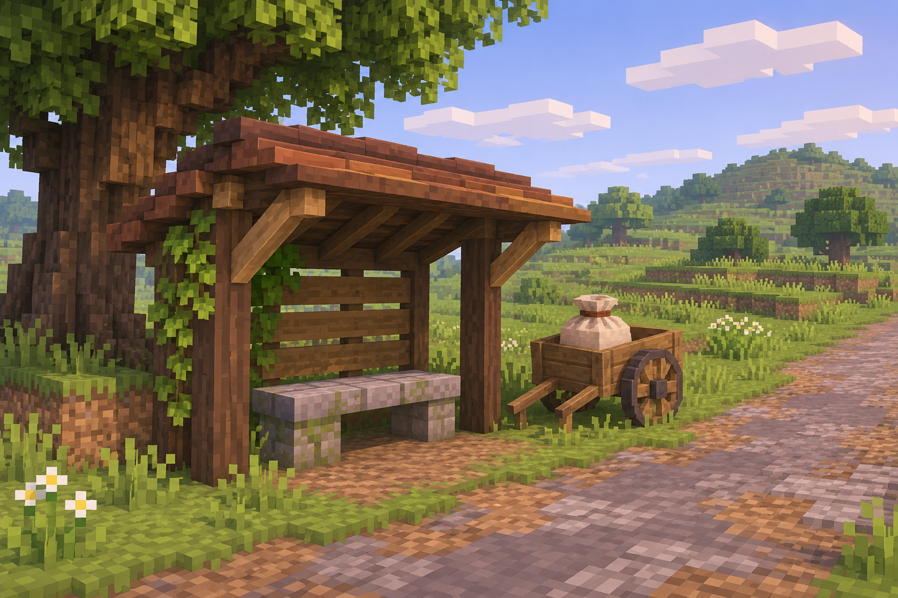

# Kingdom of Rostia: interpreted rural stopping place (`rostia`): concept art

- **View / ground:** Camera faces east toward a dry country lane; small shelter and cart stand on a grass-and-earth shoulder.
- **Source scope:** The official Johann Rostia profile explicitly calls him a duke of the Kingdom of Rostia. It establishes kingdom identity,not its capital,precise location,early ruler or a building plan.
- **Our interpretation:** Timber rain roof,stone bench,plain cart and sack are original server scenery. No royal architecture,finance headquarters,flag or story event is reconstructed.
- **Terrain / fit:** Radius8 lies in gameplay A; that does not make Rostia a town of Raja. The picture is a pin-scale vignette,not a complete sovereign territory or certified capital footprint.
- **Reservation:** centre(-2780,200),radius8.0,kind`clearing`,margin24. All58 site attributes match map1209e38. Coordinates/radii are authored server values. This art branch stacks on96e1069 and retains older map/source files; [map PR74](https://github.com/Yasuke2000/ocs-two-lives/pull/74) governs current terrain. Sainte's depicted alternative is explicitly separate.
- **Era:** Immediately after Kijin naming,S1E10. No named initial resident,late faction crest,postwar reconstruction or future outcome is shown. Enduring geography does not prove each distant building's initial condition. [Era policy](../../../world/era.md).
- **References:** [Source/design review](final-places-reference-review.csv) · [project brief](../../chatgpt/places/rostia.md). Imported-map data and ambiguous source leads remain qualified.
- **Provenance:** Built-in image_gen new original generation from the written brief. No copyrighted frame,map,mod texture or third-party build was an image input. No older local PNG candidate existed for this ID; legacy sheets remain intact. [Exact prompt set](final-places-prompts.json) and [manifest](final-places-asset-manifest.json) record selected original/output hashes. Lossless PNG packaging preserves every selected decoded RGB pixel.
- **Acceptance:** Representative art only. Canonical geometry/country coverage,initial architecture,exact voxel dimensions,foundation/roof/water/tree handling,lighting,access and runtime acceptance remain open. No SVG,blueprint,tool,mod,pack,apply or deployment change by this art delivery.

## Exact generation prompt

Create an original close roadside rural vignette for the Kingdom of Rostia,whose exact capital and national geography are unverified. One low timber rain shelter over a modest stone bench,a small plain two-wheeled handcart with a closed sack,and a simple grassy verge beside a worn lane. No grand entrance,royal palace,royal flag,border post,military headquarters,named ruler or city skyline. Neutral green western countryside,one old tree,low gentle hills,soft afternoon light; compact grouping fitting a16-block-diameter quest pin. Dry ground,no creek,lake,harbour or new bridge. The kingdom identity is real source context; this bench/cart/road setting is an authored server interpretation and not evidence that Rostia is a town of Raja. Original Minecraft voxel environment concept,1536x1024 landscape opaque RGB. Polished broad readable block materials,soft natural light and restrained painterly detail,not photoreal noise. Natural asymmetry and practical construction. No text,lettering,UI,logos,map panels or named people. Early post-Kijin baseline S1E10; no future federation crests,railways,metropolis or later event outcome. This is original interpreted design,not a copied anime frame.
