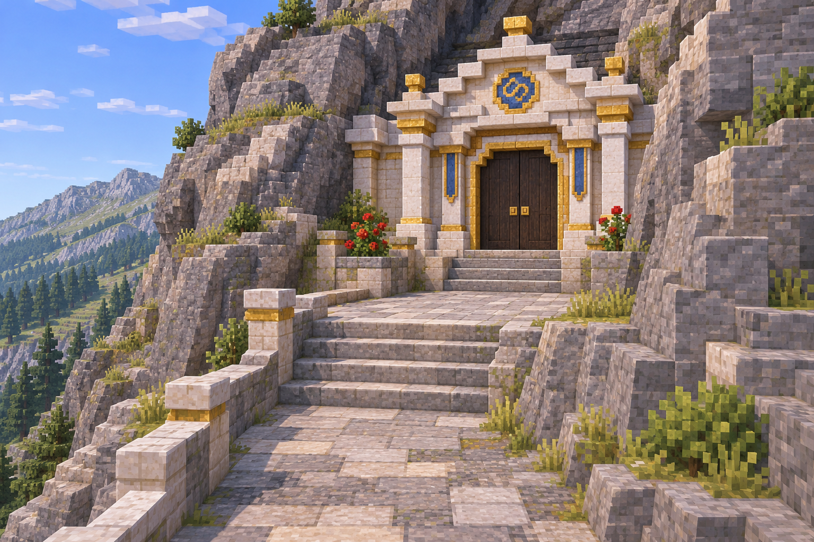

# Sacred Mountain / small summit sanctuary threshold (`sacred_mountain`): concept art

- **Brief:** Southern mountain-stair approach toward a compact sealed shrine between natural rock shoulders. Early snapshot immediately after Kijin naming, anime S1E10.
- **Canon / source scope:** The public LN6 passage directly describes a stone-stair mountain path reaching a summit shrine, smaller than the cathedral but richly adorned. LN06-001/002/003 and the new relative-size record qualify this; no precise NW bearing or exact exterior is supplied.
- **Our interpretation and revision:** Small white/gold threshold, dark leaves, abstract medallion, two stair flights, roses and rock shoulders are original project design. The image keeps the shrine modest rather than treating it as another huge cathedral. Exact height, step count, facade and closed-door state are interpretation.
- **Terrain and fit:** The radius95 plateau reserve belongs to the authored western ridge. Exact compass placement remains a server choice. Do not infer a new mountain chain, complete palace, active barrier or NPC roster from the threshold concept; actual slope/roof/approach need fit review.
- **Current reservation:** centre(-3900,-1600), radius95, kind`plateau`, margin48. Checked against [current map commit40c7833](https://github.com/Yasuke2000/ocs-two-lives/blob/40c7833/world/map.svg),source90ee15b1. These are authored server coordinates and preparation dimensions,not canonical measurements. This art branch retains older map/source files;the linked map branch governs current terrain.
- **Palette / approach:** Pale stone and restrained gold for Lubelius/shrine; pale masonry, charcoal ribs and rust trim for the tower; woodland, dark masonry and warm lamps for the park. These are authored palettes. Camera direction, apparent dimensions and exact materials are illustrative; no mod IDs or blueprint bounding boxes are asserted. A visible entrance/viewpoint is not a newly registered site.
- **Era limits:** No fixed named early resident roster, later council, student visit, golem encounter, tower damage or later alliance is depicted. The orc crisis remains unresolved. Existing place-brief references to later names/alliances do not establish initial state.
- **References:** [Official episode context](https://gcnovels.jp/reading/slime6.htm) · [project place brief](../../chatgpt/places/sacred_mountain.md) · [reference review and confidence](western-sanctuary-reference-review.csv). Official episode22 and50/route54 stills were inspected; public LN6 relevant passage reread. No tower elevation or exact shrine exterior verified. No playback timestamp is claimed.
- **Provenance:** Built-in image_gen original generation from source-qualified written prompts. Existing legacy materials remain untouched; no official/anime image, mod texture or third-party map/build was supplied to image generation. Exact prompt below and in [prompt collection](western-sanctuary-prompts.json). Lossless PNG packaging preserves every decoded RGB pixel of the selected output; original/output/legacy-input hashes are in [manifest](western-sanctuary-asset-manifest.json).
- **Acceptance scope:** Representative concept only. Source fidelity of the full city, shrine, tower or park, structure fit, geometry, foundation/roof/water handling and runtime-era placement require their own review. This delivery edits no SVG, blueprint, tools, runtime or server files.
- **Current terrain handoff (R73):** The [R68 measured support review](https://github.com/Yasuke2000/ocs-two-lives/blob/40c7833/world/sacred-mountain-fit-review.md) changes the preparation radius from80 to95;the current designed first-air is175. The original PNG remains a perspective/material concept,not a scaled drawing of that disc,an exact plateau footprint or proof of current runtime fit. Original generation prompt and image provenance below remain historical.

## Exact original generation prompt

Original buildable Minecraft landscape concept of LUBELIUS'S SACRED MOUNTAIN SUMMIT SANCTUARY APPROACH, early post-Kijin era. Landscape1536x1024 opaque RGB, one coherent original painterly voxel scene, no text/inscriptions/letters/UI/panels/logos/watermark. Primary public LN6 passage directly describes a mountain path with stone stairs reaching a richly adorned summit SHRINE SMALLER THAN THE CATHEDRAL. Show a restrained compact white/pale-limestone sanctuary threshold tucked between two natural weathered rock shoulders, reached by two short practical stair flights with a small landing. Simple dark closed double leaves in a pale-stone-and-gold frame; a small blue/gold abstract medallion and a few discreet roses are explicitly original project design, not copied religious symbols. The building must be small in relation to the mountain, not a giant cathedral, monumental castle, sprawling monastery or palace. The timber line falls away below the route, sparse hardy grass/low shrubs on the upper ledges, no glacier or snowy arctic world. Keep the western mountain natural and walkable where the designed stairs sit; no floating gate, giant chasm bridge, waterfalls, new lake, lava or outside city panorama deciding exact canonical compass bearings. Camera from the southern/uphill approach looking toward the north-facing sealed threshold, natural grey/pale rock enclosing the small court, original cubic slabs/stairs and supported foundations. No figures, later intrusion by Laplace, guards, named divine residents, active barrier/portal or future battle damage. Exact NW placement, shrine facade, step count and materials remain server interpretation.
