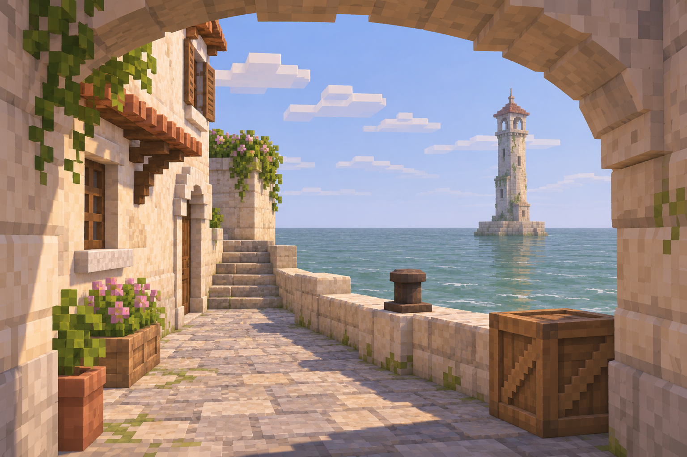

> **Current approved registration (24 November 2026):** centre x/first-air-y/z **(-2320,64,1645)**, radius **8**, kind `clearing`. Gameplay O; independent Malukshure, not a sovereignty claim. Unplated radius8 country pin;coast/cape/route are interpreted. [Active map and checks](../../../world/approved-islands-coast.md). The retained concept image is illustrative;earlier coordinates,fit tests and pending-choice statements below are historical and are superseded here. Its exact generation prompt remains historical evidence. No current voxel fit or complete city/palace is certified.

# Sainte-Malukshure: C14 coastal alternative (`sainte_malukshure`): concept art

- **View / ground:** Authored camera faces west/seaward from a modest dry stone lane and quay in the proposed coastal city.
- **Source scope:** Wiki describes the coastal capital beside the Magic Tower; the official Vacation manga volume2 synopsis locates that tower in Malukshure waters. Neither supplies the exact lane,harbour,tower silhouette,distance or surveyed shore orientation.
- **Our interpretation:** Pale stone arch,steps,bollard,crate and narrow offshore tower are original visual proxies. The small masonry platform is not a newly invented island. No fleet,royal palace,barrier effect or named resident is inferred.
- **Terrain / fit:** IMPORTANT: this image depicts the inert coastal proposal(-2320,1645),radius64,not the active inland H pin(-100,2000),radius8. C14 remains unresolved; no current terrain/registry change or whole-city fit is certified.
- **Reservation:** centre(-100,2000),radius8.0,kind`clearing`,margin24. All58 site attributes match map1209e38. Coordinates/radii are authored server values. This art branch stacks on96e1069 and retains older map/source files; [map PR74](https://github.com/Yasuke2000/ocs-two-lives/pull/74) governs current terrain. Sainte's depicted alternative is explicitly separate.
- **Era:** Immediately after Kijin naming,S1E10. No named initial resident,late faction crest,postwar reconstruction or future outcome is shown. Enduring geography does not prove each distant building's initial condition. [Era policy](../../../world/era.md).
- **References:** [Source/design review](final-places-reference-review.csv) · [project brief](../../chatgpt/places/sainte_malukshure.md). Imported-map data and ambiguous source leads remain qualified.
- **Provenance:** Built-in image_gen new original generation from the written brief. No copyrighted frame,map,mod texture or third-party build was an image input. No older local PNG candidate existed for this ID; legacy sheets remain intact. [Exact prompt set](final-places-prompts.json) and [manifest](final-places-asset-manifest.json) record selected original/output hashes. Lossless PNG packaging preserves every selected decoded RGB pixel.
- **Acceptance:** Representative art only. Canonical geometry/country coverage,initial architecture,exact voxel dimensions,foundation/roof/water/tree handling,lighting,access and runtime acceptance remain open. No SVG,blueprint,tool,mod,pack,apply or deployment change by this art delivery.

## Exact generation prompt

Create an original source-preferred COASTAL Sainte-Malukshure concept for a clearly identified proposed map alternative. Eye-level intimate view from a modest pale-stone seaside lane under a plain archway,toward a calm open sea. One simple mooring bollard,low sea wall,weathered stone steps and a closed ordinary wooden crate. In the distance offshore,a restrained narrow weathered scholarly stone tower rises directly from a small masonry water platform; its silhouette is only an original visual proxy for the Magic Tower,not a huge invented island or exact canon building. No sweeping capital panorama,fortified military harbour,fleets,cranes,king,flags,glowing force field,portals or ships. Quiet warm southern maritime atmosphere,grey-green sea and pale limestone. This image depicts the existing INERT C14 coastal alternative west of Sarion,not the fixed inland H/Fulbrosia pin. The city and its seaside proximity are source context; exact pier,facades,shoreline/tower design and distance are authored. No copyrighted map or art is an input. Original Minecraft voxel environment concept,1536x1024 landscape opaque RGB. Polished broad readable block materials,soft natural light and restrained painterly detail,not photoreal noise. Natural asymmetry and practical construction. No text,lettering,UI,logos,map panels or named people. Early post-Kijin baseline S1E10; no future federation crests,railways,metropolis or later event outcome. This is original interpreted design,not a copied anime frame.
