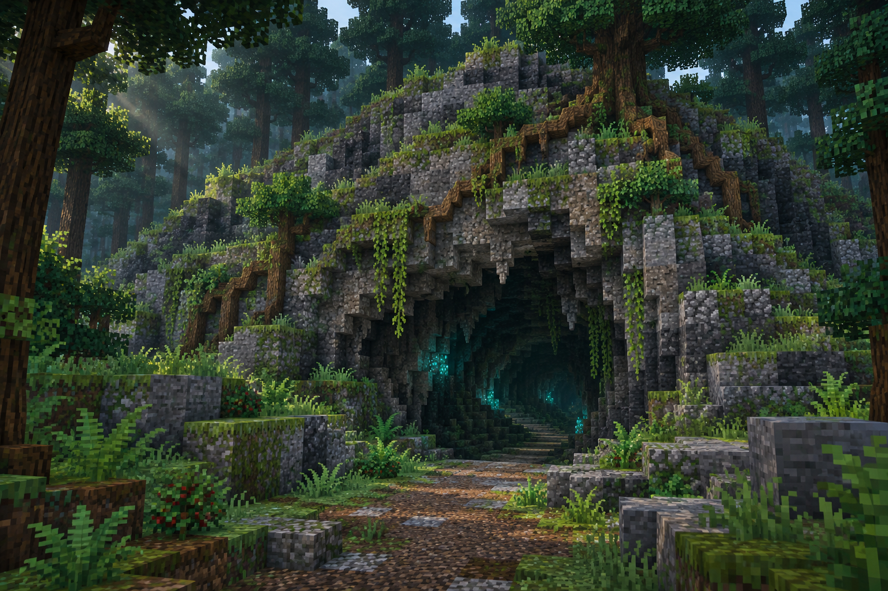

# Sealed Cave

## Designed site

- Anchor: `sealed_cave`; region `J`; proposed centre **(-300, -300)**; SVG y is Minecraft z.
- Site kind: `carve`; reserved radius **40 blocks**, diameter 80; exclusion margin 48 blocks.
- Relief footprint: sealed-cave-hill; woodland: light, dark.
- Approach / facing: **south**. This is our interpretation unless the lore specifies it. Underground rooms use local interior approaches, not separate surface gates.
- The site disc is not a measured blueprint bounding box. Final ground y, cliff cover, lake rim and build fit belong to Claude’s converter and site overrides.

## Scene and terrain integration

A rocky mossy hill (about 70 blocks across, 27 high) in a forest clearing, the mouth in its south face. Winding passage, antechamber with cave pond, magic ore in the walls, glow berries and a small hipokute plot; a narrow passage; then a round deepslate dome (28 x 26) with amethyst and ore, a double ring and hexagram of teal copper and sea lanterns in the floor (the dim, cracked seal), a black dais with snapped chains and claw gouges, six standing stones (two toppled) and an armillary of broken light-blue glass rings. A small basin marks where a slime woke up.

Surroundings and the view across the boundary follow [J in the region book](../../../world/regions.md). Keep the build on the reserved dry plate (except the designated water arena), let roots, buttresses, paths and vegetation blend into the local terrain, and keep the designed road corridor open. No isolated square platform or floating foundation. Buildings, palettes and local layout in the concept are **our interpretation**, not a replacement blueprint.

## Block palette

`minecraft:stone`, `minecraft:tuff`, `minecraft:moss_block`, `minecraft:deepslate`, `minecraft:amethyst_block`. These are existing vanilla Minecraft 1.21.1 IDs; decorative variants must be verified before implementation. Use a restrained three-to-six-material palette per building.

## Sources and interpretation

- [Place brief](../../chatgpt/places/sealed_cave.md) and [existing lore](../../../design/lore/sealed_cave.md). Legacy imported-world positions in those documents are not this map’s coordinates.
- [official world guide](https://www.ten-sura.com/map), [episode 9, still 1](https://www.ten-sura.com/4GfGdAp7/wp-content/themes/tensura_portal/anime/tensura-portal-anime-tensura/assets/images/story/no9/img1.jpg), [episode 9, still 2](https://www.ten-sura.com/4GfGdAp7/wp-content/themes/tensura_portal/anime/tensura-portal-anime-tensura/assets/images/story/no9/img2.jpg).
- Concept produced with the built-in image-generation tool from an original written brief; no official frame, mod texture or paid map was used as image input.

EN: Concept of Sealed Cave in its designed terrain.
NL: Concept van Sealed Cave in het ontworpen landschap.
