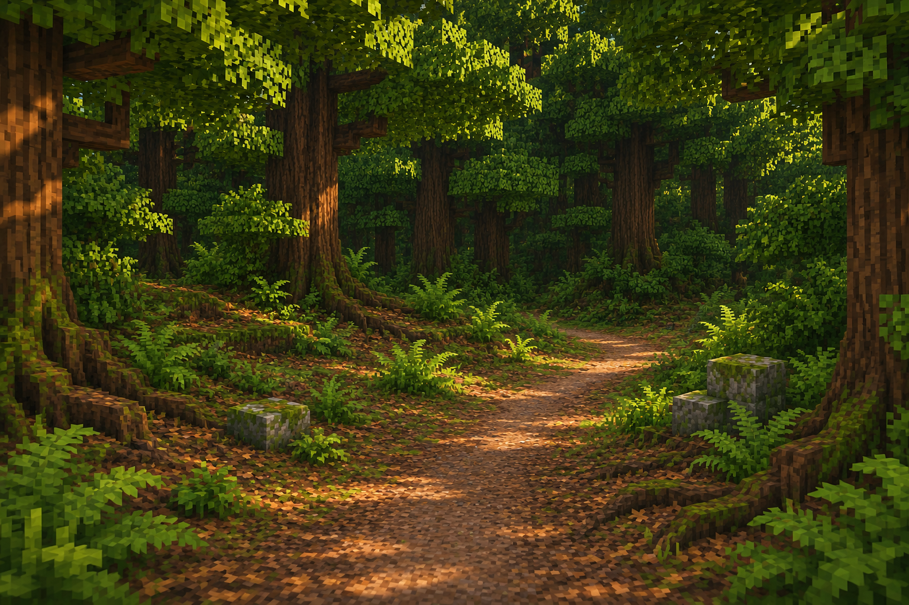

# Empty future encounter reservation (`shizu_spawn`): concept art

- **View / snapshot:** Close dry forest path, looking through shaded old woodland. Immediately after Kijin naming, anime S1E10.
- **Facing / ground:** Camera faces roughly east toward the early village through the dry inner forest; exact framing is our interpretation.
- **Source scope:** The legacy id is a server Hinata-quest reservation, not a source-located Shizu home or initial living resident. Official S1E10 supplies the selected naming-era baseline; it does not place this pin or its later ambush.
- **Our interpretation:** The new image removes the old houses, market, watercourse, grand stairs and bare cliff. Narrow dirt path, roots, moss and ferns are original scenery. No Hinata/Shizu figure or battle outcome is shown.
- **Terrain and fit:** Radius8 is a small encounter pin. The current west-side lake is nearby in the wider map, but the camera is an inland dry patch, not a reason to add a brook or lakeside settlement. Exact original ambush geography and future gameplay placement remain unverified.
- **Current reservation:** centre(-420.0,-80.0),radius8.0,kind`clearing`,margin24. Coordinates/radii are authored server values, not canonical measurements. All58 attributes match map commit48b0846. This art branch stacks on558b032 and retains older map/source files; [map PR74](https://github.com/Yasuke2000/ocs-two-lives/pull/74) governs current terrain.
- **Era:** No named initial resident, later federation insignia, completed future event or fixed active encounter is depicted. Camps and roles remain server adaptations. [Era policy](../../../world/era.md).
- **References:** [Source/design review](jura-route-reference-review.csv) · [project brief](../../chatgpt/places/shizu_spawn.md). Imported-map coordinates/audit imagery are historical context.
- **Provenance:** Built-in image_gen edit of our earlier original; its first-generation prompt is unavailable. No copyrighted anime frame,map,texture or third-party build was an image input. The legacy original is preserved. [Exact prompts](jura-route-prompts.json) and [manifest](jura-route-asset-manifest.json) record selected output and own-input hashes. Lossless PNG packaging preserves every selected decoded RGB pixel.
- **Acceptance:** Representative visual design only; exact source/era/voxel fit,terrain/tree/shelter placement,lighting,water/roof handling,residents and runtime acceptance remain open. No world,tool,mod,pack,blueprint,apply or deploy change in this art delivery.

## Exact current edit prompt

Edit our original forest clearing concept. Preserve its painterly voxel rendering and warm green forest atmosphere, but turn it into an EMPTY, modest, dry forest-path encounter reservation. Remove every house, market awning, crate court, fence, lamppost, lantern, long staircase and large exposed hill wall. Remove all water, brook, lake, waterfall and shore; replace them with shaded continuous leaf litter, roots, ferns and gently uneven dry earth. A narrow unpaved footpath bends through a small sun-dappled gap no more than about12 blocks wide; dense old dark-oak forest closes the view behind. Eye level, intimate scale, no skyline. A few natural mossy stones may edge the path but no monument, dais, ritual circle or built gateway. No people, Shizu, Hinata, battle, graves, damage or evidence of an encounter outcome. The future server ambush pin is radius8; it is not a built settlement, not a claim about Shizu's life or the exact anime ambush location. Landscape 1536x1024 opaque RGB. Original polished Minecraft voxel environment concept, coherent block scale, natural atmospheric light, detailed but buildable materials. No captions, lettering, logo, UI, collage, map or frame. Baseline immediately after six Kijin are named, anime S1E10; no later Tempest metropolis or federation flags. This is a server interpretation, not a reproduction of anime art.
