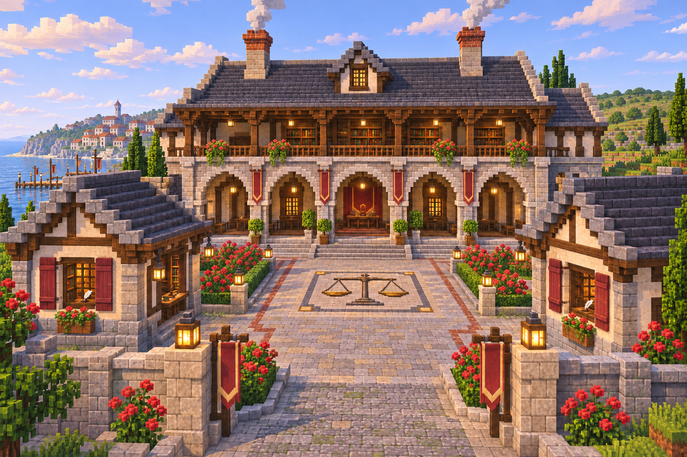

# Shia / Siltrosso counting court — server interpretation (`siltrosso`): concept art

- **Brief:** Southeastern court approach looking northwest, with a small coastal glimpse on the left. Post-Kijin design baseline; one coherent representative precinct.
- **Canon / context:** Siltrosso is treated as an independent kingdom in the selected source interpretation; gameplay regionF does not establish Falmuth sovereignty (C06).
- **Our interpretation:** The Rosso administrative court, public audience seat, balance motif, five-arched loggia, two offices, roses, crimson cloth and coast-facing camera are the pack's original interpretation. This is not an independently verified anime palace exterior or sovereign border.
- **Block notes:** Pale/grey stone, dark oak, slate-like roof blocks, restrained crimson/gold cloth, red flowers and lanterns. Cubic silhouettes and stair/slab construction; this is an illustration rather than a verified block model or light audit.
- **Terrain:** Dry compact coastal court with low green hills behind it. The edit removes the earlier invented snowy background; its small sea glimpse is pictorial and cannot override the authored coastline.
- **Current reservation:** centre(-2297,-1370), radius66.0, kind`coast`, margin48. These are server-authored coordinates. All58 site attributes in this art branch were compared with map commit`a997f81` and are identical. Active geography is the reviewed`fc36e38` geometry; this branch does not incorporate the later inert-comment/source review.
- **Reference inspection:** The existing local original candidate was inspected and reused through a focused built-in image edit. Only its unsupported high snowy backdrop was targeted for replacement by low hills. No verified anime exterior frame was found for this court. The complete edit prompt is recorded; the first-generation prompt is unavailable and is not reconstructed as exact provenance.
- **References:** [Official world map](https://www.ten-sura.com/map) · [Current source contradictions](../../../docs/research/tensura-world-2026-11-19/contradictions.md) · [Existing server design brief](../../chatgpt/places/siltrosso.md).
- **Geometry / era limit:** perspective, apparent size, water set dressing and tiny anonymous figures do not override the SVG or prove the initial NPC roster, foundations, site fit, material IDs, lighting, access grades or runtime era gating. The reserved circle is a design core, not the full size of a canonical city.
- **Provenance:** original built-in image_gen output. No copyrighted anime frame, map, mod asset or third-party build supplied as image input. Siltrosso edits only our earlier original image. Where PNG compression was repackaged, decoded RGB pixels were verified identical to the original generated output.

## Exact current prompt

Edit our supplied original Minecraft concept of the Siltrosso counting court. Keep the foreground courtyard, five-arched loggia, roofs, two flanking offices, paved balance motif, rose walks, crimson cloth, warm light and overall framing intact. Remove the conspicuous snow-capped mountains in the far-right background and replace them with modest low green coastal hills consistent with the current authored northern bay setting. Keep the existing small glimpse of sea at left; do not add water inside the dry court, new waterfalls or canals. This is an original SERVER-INTERPRETED Rosso administrative courtyard at Shia in the independent Kingdom of Siltrosso, not a verified anime royal palace, not part of Falmuth sovereignty, and not a depiction of later political outcomes. No named character roster, modern machinery, Tempest alliance emblems, words, captions, lettered signs, logos, watermark or inset panels. Preserve a coherent buildable Minecraft block/stair/slab architectural view. Output1536x1024 opaque RGB PNG. Do not trace or add official artwork; the input is our own earlier generated concept.
