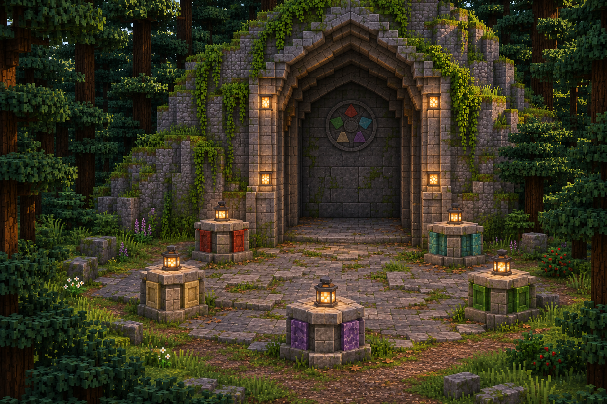

# Jura Spirit Gate / inactive server threshold (`spirit_gate`): concept art

- **View / snapshot:** Southern approach to a compact sealed cliff court in woodland. Immediately after Kijin naming, anime S1E10.
- **Canon and source limits:** The official map puts the canonical Spirit Dwelling entrance at Ulgr Nature Park (OFF-005/006). Episode22 supplies dark-masonry interior cues and a later visit. The Jura gateway and five-plinth scheme are explicit server adaptations, not that canonical entrance.
- **Our interpretation / correction:** The floating glade/other-world view, projected elemental glyphs, active ribbons/flames, stream and grand stairway are removed. A short shadowed passage ends at a closed plain seal, with restrained physical element colors and practical lamps.
- **Terrain and fit:** Radius70 lakeside reservation and57×57 project box are retained. Existing nearby authored water is outside this close view, not relocated. Closed concept state does not change or certify runtime portal behavior; realm access/era gating and foundation/water handling remain technical review.
- **Current reservation:** centre (-285, 350), radius 70.0, kind `lakeside`, margin 48. Exact coordinates/radii are server interpretations, not canon measurements. All 58 site attributes match current main map `e619fb7`. This branch stacks on art commit `d8a6355` and retains older map/source files; use [map PR74](https://github.com/Yasuke2000/ocs-two-lives/pull/74) for current terrain.
- **Palette:** Mossy grey stone, muted red/prismarine-green/sandstone/amethyst accents. Small worn apron meets forest soil. Materials are visual proxies, not unverified mod IDs.
- **Era:** No fixed named resident, golem/student visit, later federation insignia or encounter outcome is depicted. The orc crisis is unresolved. Other brief references to later structures/residents do not prove initial state.
- **References:** [Project place brief](../../chatgpt/places/spirit_gate.md) · [source/design review](jura-approach-reference-review.csv) · [current era policy](../../../world/era.md). Legacy imported-map coordinates do not govern this concept.
- **Provenance:** Built-in image_gen edits only our earlier original candidate. Exact current edit prompt below and in [prompt collection](jura-approach-prompts.json); the earlier first-generation prompt is unavailable. No copyrighted image, mod texture or third-party build was an input. The legacy candidate stays intact. [Manifest](jura-approach-asset-manifest.json) records selected-output and own-input hashes; lossless PNG packaging preserves every selected decoded RGB pixel.
- **Acceptance:** Representative visual reference only. Full site/structure/source fit, foundation/roof/water handling, lighting, residents, runtime access and in-game acceptance remain open. No SVG, blueprint, technical tool, runtime or deployment change is made by this art delivery.

## Exact current edit prompt

Edit this original Minecraft Spirit Gate illustration as an INACTIVE SERVER-ADAPTED JURA gateway, NOT the canonical Ulgr Nature Park entrance. Landscape1536x1024 opaque RGB, one coherent original voxel environment. Preserve a compact roughly57x57-block mossy grey stone/cliff threshold in dark woodland and five low authored elemental plinths around a modest ground-level court. Remove the open magical portal, ALL visible floating islands/cherry glade/other-realm sky, ribbons of hovering energy, floating crystals, giant magical flames and luminous projected element glyphs. Replace the central opening with a shadowed short stone passage ending in a CLOSED plain dark stone seal; small five-color INLAID geometric medallion on the back wall may remain, no projecting magic or readable text. Plinths should use restrained physical red stone, muted prismarine-blue, green stone/glass, sandstone and purple amethyst accents with modest enclosed practical lamps. No tall fire jets. Reduce the grand radial paving/oversized bridge-like platform to a small slightly irregular worn stone apron that meets the forest floor naturally; modest drainage gaps and moss, not a precipice. Remove the invented foreground stream and cascading falls. Existing nearby authored lake lies outside this close camera frame; do not add, move or redraw a watercourse. Remove the formal stair highway/crested banner at upper right, replace with natural wooded ground. Do not show Ramiris, Rimuru, children, students, golems, inhabitants, later visits, active teleportation or any view into another world. The five-plinth design is project interpretation, no canon exterior plan claimed. No text/UI/panels/logos.
