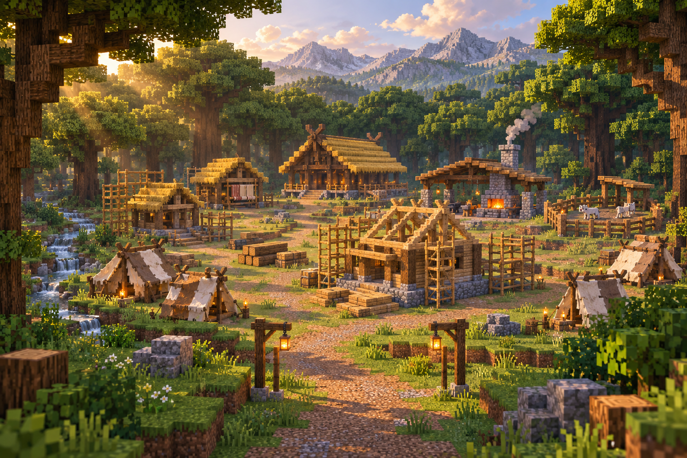

# Tempest

## Designed site

- Anchor: `tempest`; region `J`; proposed centre **(0, 0)**; SVG y is Minecraft z.
- Site kind: `clearing`; reserved radius **110 blocks**, diameter 220; exclusion margin 64 blocks.
- Relief footprint: lowland / local designed terrace; woodland: light, dark, ancient.
- Approach / facing: **south**. This is our interpretation unless the lore specifies it. Underground rooms use local interior approaches, not separate surface gates.
- The site disc is not a measured blueprint bounding box. Final ground y, cliff cover, lake rim and build fit belong to Claude’s converter and site overrides.

## Scene and terrain integration

A construction site, not a city: hide tents ringing the build area, first log and plank houses with thatch or shingle roofs, some only framed and scaffolded; Kaijin's open forge with anvils and quench tubs; Shuna's weaving house with looms and dye vats; a covered council longhouse on the village green; Rimuru's modest house; a wolf pen; a palisade gate on the forest road. It stands in a cleared hollow of a dense old forest (oak, dark oak, giant ancient-forest trees; Jura is never jungle), with a lake to the west and a pond to the south. Our interpretation: the later rings (137 and 191 blocks wide) turn the green into a trade town with a west gate to Blumund and a north gate to Dwargon, then a festival capital with promenade, guild, inn, bath gardens and Ramiris's entrance court.

Surroundings and the view across the boundary follow [J in the region book](../../../world/regions.md). Keep the build on the reserved dry plate (except the designated water arena), let roots, buttresses, paths and vegetation blend into the local terrain, and keep the designed road corridor open. No isolated square platform or floating foundation. Buildings, palettes and local layout in the concept are **our interpretation**, not a replacement blueprint.

## Block palette

`minecraft:stone`, `minecraft:cobblestone`, `minecraft:oak_planks`, `minecraft:oak_log`, `minecraft:lantern`. These are existing vanilla Minecraft 1.21.1 IDs; decorative variants must be verified before implementation. Use a restrained three-to-six-material palette per building.

## Sources and interpretation

- [Place brief](../../chatgpt/places/tempest.md) and [existing lore](../../../design/lore/tempest.md). Legacy imported-world positions in those documents are not this map’s coordinates.
- [official world guide](https://www.ten-sura.com/map), [episode 9, still 1](https://www.ten-sura.com/4GfGdAp7/wp-content/themes/tensura_portal/anime/tensura-portal-anime-tensura/assets/images/story/no9/img1.jpg), [episode 9, still 2](https://www.ten-sura.com/4GfGdAp7/wp-content/themes/tensura_portal/anime/tensura-portal-anime-tensura/assets/images/story/no9/img2.jpg).
- Concept produced with the built-in image-generation tool from an original written brief; no official frame, mod texture or paid map was used as image input.

EN: Concept of Tempest in its designed terrain.
NL: Concept van Tempest in het ontworpen landschap.
