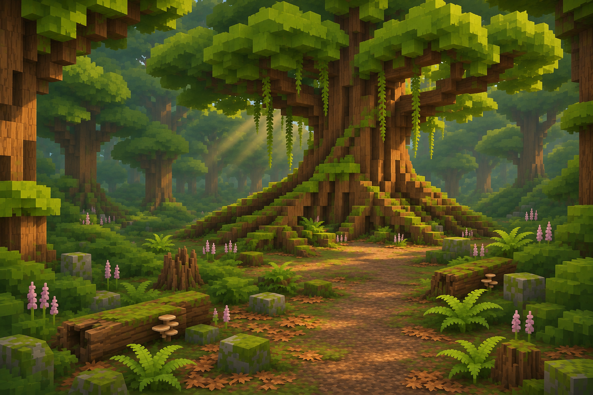

# Ancient landmark tree in old Jura woodland (`treyni_grove`): concept art

- **View / snapshot:** Dry rooted giant tree enclosed by layered old forest. Immediately after Kijin naming, anime S1E10.
- **Facing / ground:** Approach from southeast,camera facing northwest toward the rooted tree and the broader Tempest direction; exact tree rotation is our interpretation.
- **Source scope:** The wiki describes an isolated treant settlement in Jura and dryads acting for its inhabitants; that is secondary geography, not a surveyed tree plan. Official episode12 still1 shows Treyni's green/vine visual language, not a grove exterior. The single mod tree is a project landmark adaptation.
- **Our interpretation:** Remove the invented stream, cascade, lamp boulevard, fences and open hillside. Roots, moss, understory and the partly overgrown approach are original. No altar, ruin, face, portal, Dungeon floor or treant capital is reconstructed.
- **Terrain and fit:** The existing mod structure is described in project lore as up to39×42×41 blocks; the current village-kind reservation radius56 is retained. Perspective art does not prove exact voxel counts, canopy cover or runtime tree fit. The separate shrine is at(500,600),not the retired +38 offset. This tree does not complete settlement coverage.
- **Current reservation:** centre(320,470),radius56.0,kind`village`,margin48. Coordinates/radii are authored server values, not canonical measurements. All58 attributes match map commit48b0846. This art branch stacks on558b032 and retains older map/source files; [map PR74](https://github.com/Yasuke2000/ocs-two-lives/pull/74) governs current terrain.
- **Era:** No named initial resident, later federation insignia, completed future event or fixed active encounter is depicted. Camps and roles remain server adaptations. [Era policy](../../../world/era.md).
- **References:** [Source/design review](jura-route-reference-review.csv) · [project brief](../../chatgpt/places/treyni_grove.md). Imported-map coordinates/audit imagery are historical context.
- **Provenance:** Built-in image_gen edit of our earlier original; its first-generation prompt is unavailable. No copyrighted anime frame,map,texture or third-party build was an image input. The legacy original is preserved. [Exact prompts](jura-route-prompts.json) and [manifest](jura-route-asset-manifest.json) record selected output and own-input hashes. Lossless PNG packaging preserves every selected decoded RGB pixel.
- **Acceptance:** Representative visual design only; exact source/era/voxel fit,terrain/tree/shelter placement,lighting,water/roof handling,residents and runtime acceptance remain open. No world,tool,mod,pack,blueprint,apply or deploy change in this art delivery.

## Exact current edit prompt

Edit our original giant-tree grove concept. Preserve the broad rooted ancient tree, dense forest feeling, coherent voxel materials and gentle shafts of daylight. Remove the entire brook, cascade, pools and wet channel, all fences, stone-post road rails, lantern posts and large paved road. Replace them with DRY mossy forest floor, fallen leaves, ferns, decaying wood and softly rooted earth. The central ancient tree is substantial but buildable, approximately39 blocks canopy width and42 blocks height, not a world tree or colossal Sarion skyscraper. Let surrounding old trees and understory enclose the view on every side; remove the open distant grassy hill/sky corridor on the right, replace with layered shaded woodland. Keep only a narrow partly overgrown ground approach and a modest walkable patch at the roots. No shrine, altar, runes, ritual stone ring, portal, humanoid faces carved into trunks, throne or settlement. No people or dryad figures. This is the server's natural landmark tree, not a surveyed Treant capital or Dungeon floor. Landscape 1536x1024 opaque RGB. Original polished Minecraft voxel environment concept, coherent block scale, natural atmospheric light, detailed but buildable materials. No captions, lettering, logo, UI, collage, map or frame. Baseline immediately after six Kijin are named, anime S1E10; no later Tempest metropolis or federation flags. This is a server interpretation, not a reproduction of anime art.

## Exact readability cleanup prompt

Edit our own original giant-tree concept with a single presentation cleanup. Preserve the exact scene composition, central old rooted tree, tree proportions, dry forest floor, shaded enclosed woodland and narrow approach. Preserve 1536x1024 opaque RGB. Make the painterly Minecraft materials more readable at game scale: broader quieter leaf masses and bark planes, less tiny noisy leaf/grass/bark speckling, softer atmospheric layering and lower contrast on the distant canopy. Keep a few distinct foreground ferns, mossy stones and decaying wood, but let the central dry approach read clearly and retain the surrounding old forest density. Do not add water, buildings, shrine, lamps, fence, faces, people, letters, symbols or any new landmark. Natural gentle light, original coherent voxel concept, not photo-real texture noise. Do not change the footprint or replace the tree with a temple.
