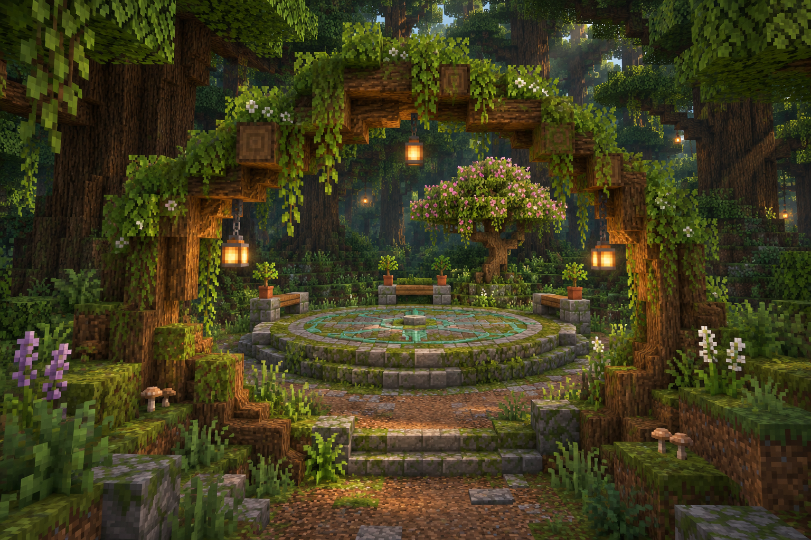

# Treyni's shrine

## Designed site

- Anchor: `treyni_shrine`; region `J`; proposed centre **(540, 470)**; SVG y is Minecraft z.
- Site kind: `clearing`; reserved radius **30 blocks**, diameter 60; exclusion margin 48 blocks.
- Relief footprint: lowland / local designed terrace; woodland: light, old_taiga.
- Approach / facing: **west**. This is our interpretation unless the lore specifies it. Underground rooms use local interior approaches, not separate surface gates.
- The site disc is not a measured blueprint bounding box. Final ground y, cliff cover, lake rim and build fit belong to Claude’s converter and site overrides.

## Scene and terrain integration

A round mossy dais with a ring of green runes; a young azalea tree (seedling of the ancient tree) four blocks north of the arrival stone; three seats for the three sisters, each with a potted sapling; four log posts with lanterns and vines; a living gate of two bent oak logs on the west side. Lit with lanterns, froglight and a shroomlight in the crown. Surrounded by old forest.

Surroundings and the view across the boundary follow [J in the region book](../../../world/regions.md). Keep the build on the reserved dry plate (except the designated water arena), let roots, buttresses, paths and vegetation blend into the local terrain, and keep the designed road corridor open. No isolated square platform or floating foundation. Buildings, palettes and local layout in the concept are **our interpretation**, not a replacement blueprint.

## Block palette

`minecraft:mossy_stone_bricks`, `minecraft:oak_log`, `minecraft:azalea`, `minecraft:oxidized_copper`, `minecraft:lantern`. These are existing vanilla Minecraft 1.21.1 IDs; decorative variants must be verified before implementation. Use a restrained three-to-six-material palette per building.

## Sources and interpretation

- [Place brief](../../chatgpt/places/treyni_shrine.md) and [existing lore](../../../design/lore/treyni_shrine.md). Legacy imported-world positions in those documents are not this map’s coordinates.
- [official world guide](https://www.ten-sura.com/map), [episode 9, still 1](https://www.ten-sura.com/4GfGdAp7/wp-content/themes/tensura_portal/anime/tensura-portal-anime-tensura/assets/images/story/no9/img1.jpg), [episode 9, still 2](https://www.ten-sura.com/4GfGdAp7/wp-content/themes/tensura_portal/anime/tensura-portal-anime-tensura/assets/images/story/no9/img2.jpg).
- Concept produced with the built-in image-generation tool from an original written brief; no official frame, mod texture or paid map was used as image input.

EN: Concept of Treyni's shrine in its designed terrain.
NL: Concept van Treyni's shrine in het ontworpen landschap.

The altar itself has no verified canonical design. The shrine and its grove separation are pack interpretation.
