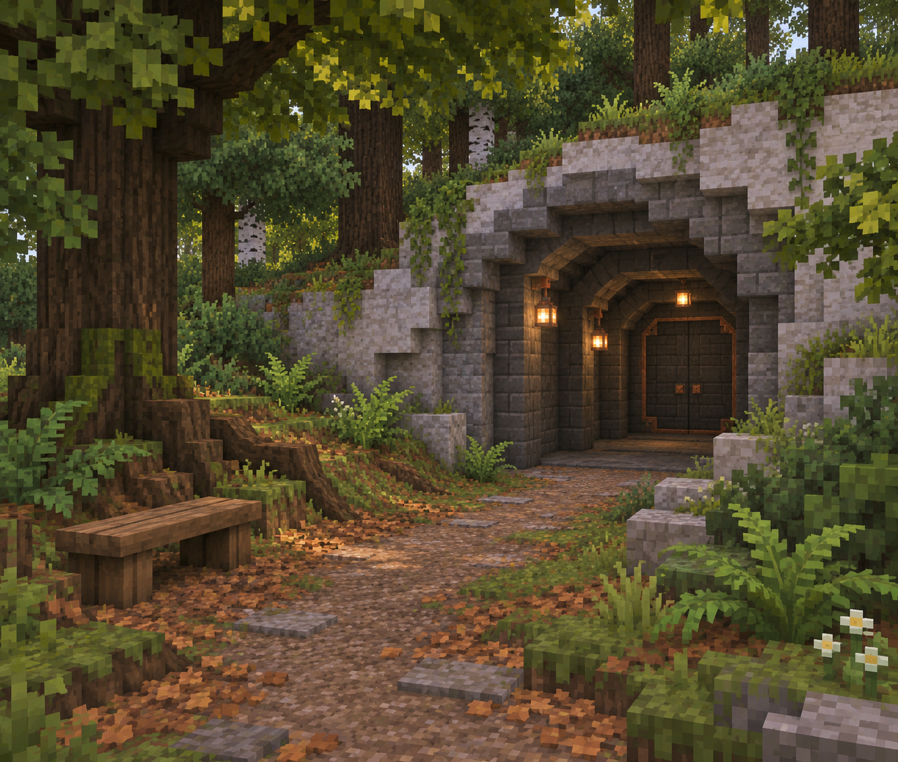

# Ulgr Nature Park / quiet woodland threshold (`ulgr_nature_park`): concept art

- **Brief:** Northern woodland path toward a modest rock-set doorway and short shaded passage. Early snapshot immediately after Kijin naming, anime S1E10.
- **Canon / source scope:** The official map glossary places the park at Ulgracia's northern end and the Spirit Dwelling entrance there (OFF-005/006). Episode22 synopsis identifies the later children/dwelling visit; inspected stills show dark masonry and small warm light cues. They do not verify an exterior entrance layout.
- **Our interpretation and revision:** The low bluff, simple arch/ribs, path, plain bench, closed dark leaves, copper trim, vegetation and practical lights are original interpretation. Existing nearby water can remain outside this camera frame; the image does not relocate a pool or add a new stream.
- **Terrain and fit:** This park reservation is separate from Galut's capital obligation and the server Spirit Gate near Jura. The71x65 project precinct is not the entire park or Ramiris's other realm. Existing C09/C15 location/registration qualifications and threshold/build-fit/runtime access review remain open.
- **Current reservation:** centre(-950,2850), radius63.0, kind`plateau`, margin48. Exact coordinates/radii are server interpretations (SITE records in the main ledger), not surveyed canon. All58 site attributes match current map review`06a0323`; this art branch stacks on`7ece431` and does not carry later map/source commits. Use [map PR74](https://github.com/Yasuke2000/ocs-two-lives/pull/74), not retired Lerfing coordinates.
- **Palette / approach:** Pale stone and restrained gold for Lubelius/shrine; pale masonry, charcoal ribs and rust trim for the tower; woodland, dark masonry and warm lamps for the park. These are authored palettes. Camera direction, apparent dimensions and exact materials are illustrative; no mod IDs or blueprint bounding boxes are asserted. A visible entrance/viewpoint is not a newly registered site.
- **Era limits:** No fixed named early resident roster, later council, student visit, golem encounter, tower damage or later alliance is depicted. The orc crisis remains unresolved. Existing place-brief references to later names/alliances do not establish initial state.
- **References:** [Official episode context](https://www.ten-sura.com/anime/tensura/story/no22) · [project place brief](../../chatgpt/places/ulgr_nature_park.md) · [reference review and confidence](western-sanctuary-reference-review.csv). Official episode22 and50/route54 stills were inspected; public LN6 relevant passage reread. No tower elevation or exact shrine exterior verified. No playback timestamp is claimed.
- **Provenance:** Built-in image_gen original generation from source-qualified written prompts. Existing legacy materials remain untouched; no official/anime image, mod texture or third-party map/build was supplied to image generation. Exact prompt below and in [prompt collection](western-sanctuary-prompts.json). Lossless PNG packaging preserves every decoded RGB pixel of the selected output; original/output/legacy-input hashes are in [manifest](western-sanctuary-asset-manifest.json).
- **Acceptance scope:** Representative concept only. Source fidelity of the full city, shrine, tower or park, structure fit, geometry, foundation/roof/water handling and runtime-era placement require their own review. This delivery edits no SVG, blueprint, tools, runtime or server files.

## Exact original generation prompt

Original Minecraft environment concept of ULGR / ULG NATURE PARK'S WOODLAND APPROACH TO THE DWELLING OF SPIRITS, early post-Kijin time. Landscape1536x1024 opaque RGB, one coherent original painterly voxel environment, no words/letters/inscriptions/UI/panels/logos/watermark. View from a modest northern forest trail toward a small low chalk/grey-rock bluff in mature temperate woodland. A simple shaded stone arch in the bluff leads into a short dark grey masonry passage, two or three restrained structural ribs and a quiet CLOSED dark-stone doorway with modest aged copper trim, warm practical lamps deep within. The official episode22 stills supply only dark masonry/warm-light interior cues, not a surveyed external entrance. All arch/bluff/path/door details are our interpretation of the existing park template. Keep tree roots, leaf litter, ferns, a small plain bench at a path bend, uneven natural edges and a compact roughly71x65-block representative approach, not a capital city or full magical realm. No town, Galut skyline, palace, giant tree-city, grand church, fortress, crystal portal, tall magic gate, large cliff, waterfall, stream, pool or lake in THIS camera view; existing nearby authored water can be outside frame without being moved. No artificial square platform. Clearly a quiet park setting, separate from the SERVER Spirit Gate near Jura; do not imply that gate and this location are the same canon entrance. No Ramiris, students, Rimuru, golem, later visit, active teleportation or realm beyond the threshold shown. Soft shaded daylight and modest warm interior glow, grounded buildable grey stone/pale rock/dark timber/foliage/copper proxies; no copied anime shot.
