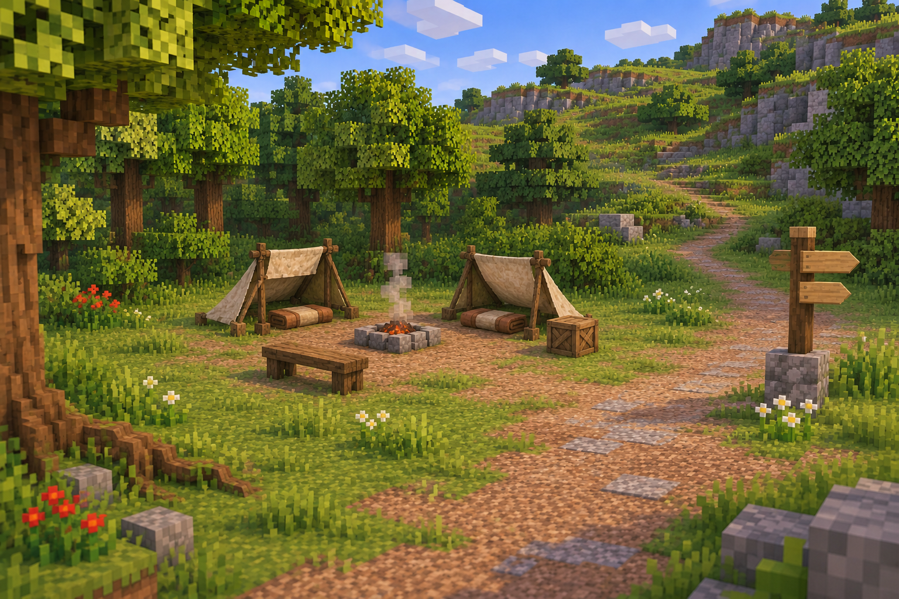

# Wayfarers camp / compact roadside shelter (`wayfarers_camp`): concept art

- **View / snapshot:** Close view of the small camp beside the parent arrival route. Immediately after Kijin naming, anime S1E10.
- **Canon and source limits:** The camp is a project sidequest invention. Episode4 still2 shows a simple outdoor campfire context; it does not establish these tents, a named roadside camp, its coordinates or residents.
- **Our interpretation / correction:** Oversized pavilions, stream, formal stairway, people and emblems are removed. Two plain lean-to shelters, bedrolls, low fire ring, short bench, crate and unmarked direction post are authored incidental shelter.
- **Terrain and fit:** Radius8 denotes a small spot inside arrival's parent clearing. It is not an independent village. Relative offset(+15,+15), not apparent pixel spacing, is authoritative; final micro-layout/fire/route clearance needs review.
- **Current reservation:** centre (15.0, -985.0), radius 8.0, kind `clearing`, margin 24. Exact coordinates/radii are server interpretations, not canon measurements. All 58 site attributes match current main map `e619fb7`. This branch stacks on art commit `d8a6355` and retains older map/source files; use [map PR74](https://github.com/Yasuke2000/ocs-two-lives/pull/74) for current terrain.
- **Palette:** Dull canvas, dark rough wood, grey stone, earth and muted foliage. Two simple shelters instead of market stalls. Materials are visual proxies, not unverified mod IDs.
- **Era:** No fixed named resident, golem/student visit, later federation insignia or encounter outcome is depicted. The orc crisis is unresolved. Other brief references to later structures/residents do not prove initial state.
- **References:** [Project place brief](../../chatgpt/places/wayfarers_camp.md) · [source/design review](jura-approach-reference-review.csv) · [current era policy](../../../world/era.md). Legacy imported-map coordinates do not govern this concept.
- **Provenance:** Built-in image_gen edits only our earlier original candidate. Exact current edit prompt below and in [prompt collection](jura-approach-prompts.json); the earlier first-generation prompt is unavailable. No copyrighted image, mod texture or third-party build was an input. The legacy candidate stays intact. [Manifest](jura-approach-asset-manifest.json) records selected-output and own-input hashes; lossless PNG packaging preserves every selected decoded RGB pixel.
- **Acceptance:** Representative visual reference only. Full site/structure/source fit, foundation/roof/water handling, lighting, residents, runtime access and in-game acceptance remain open. No SVG, blueprint, technical tool, runtime or deployment change is made by this art delivery.

## Exact current edit prompt

Edit this original Minecraft wayfarer camp concept. Keep natural forest-edge/foothill setting, painterly cubic material style, daylight and grounded path. Landscape1536x1024 opaque RGB. Replace all large pavilion tents and stalls with a VERY SMALL two-person wayside camp that fits roughly a16-block-diameter spot inside the parent arrival clearing: TWO plain small canvas lean-to shelters, low cold or gently smouldering fire ring, one short rough bench, two bedrolls, one small crate. Remove ALL people and banners/emblems. Remove the entire foreground stream/waterfall/pond and replace with dry grass/earth and roots continuous with the camp; no water in this frame. Remove broad formal stone stair boulevard and oversized terraced plaza; use one modest worn roadside path at the camp edge, rising gently toward the rocky northern hills. Avoid a separate town gate, fortress, tower, inn, palisade or large shelter. A small unmarked wooden direction post may remain, no letters. Keep the camp a quiet incidental shelter beside an open arrival clearing, not a settlement. Canvas dull flax/cream, dark rough timber, grey stones, muted forest greens. No named NPCs, monsters, later Tempest insignia or active quest event. Both camp and location are server adaptations, not an anime location or surveyed geography. No text/UI/multiple panels/logos.
