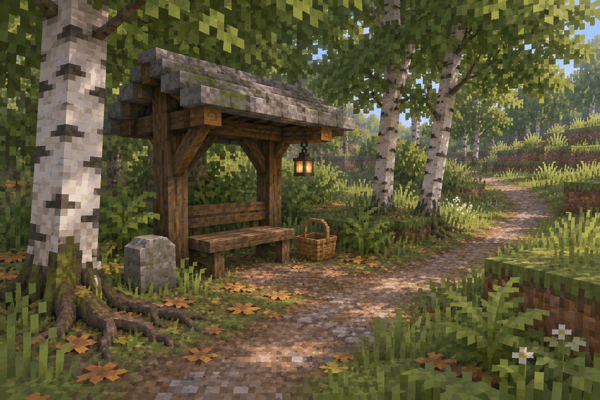

# Yggdonia / small birch-edge resting place (`yggdonia`): concept art

- **View / snapshot:** Close roadside pause beneath sparse birch canopy. Immediately after Kijin naming, anime S1E10.
- **Source scope:** The later-map country name/order remains secondary evidence. The birch-forest epithet and exact terrain around the server pin are authored; no directly verified canonical national biome or city plan is claimed.
- **Our interpretation:** Small timber resting shelter, unmarked stone and basket are original environmental interpretation. No giant sacred tree,palace,temple,portal or settlement skyline is inferred.
- **Terrain and fit:** Radius8 marks a small reservation only. Exact boundaries,capital,early buildings and residents remain unknown; this vignette supplies no whole-country or new-structure acceptance.
- **Current reservation:** centre (-2150, -80), radius 8.0, kind `clearing`, margin 24. These are server coordinates/radii, not canon measurements. All58 site attributes match main map `13f4cfb`. This art branch stacks on `f335f38` and retains older map/source files; [PR74](https://github.com/Yasuke2000/ocs-two-lives/pull/74) governs current geography.
- **Era:** No named character, liberation memorial, post-film cure, later federation insignia, event outcome or fixed initial resident is shown. Project roles/props are not proof of S1E10 country development.
- **References:** [Source/design review](western-states-reference-review.csv) · [project place brief](../../chatgpt/places/yggdonia.md) · [era policy](../../../world/era.md). Retired imported-map coordinates do not govern this concept.
- **Provenance:** Built-in image_gen new original generation from source-qualified written brief. No copyrighted frame,texture,third-party map/build was an image input. Existing legacy materials remain untouched. [Exact prompts](western-states-prompts.json) and [manifest](western-states-asset-manifest.json) record current instruction,selected output hashes. Lossless packaging preserves every selected decoded RGB pixel.
- **Acceptance:** Representative visual reference only. Whole-country/source/early-state/structure fit,ground/roof/water/lighting and runtime placement remain open. This art delivery changes no SVG,blueprint,technical tool,runtime or deployment.

## Exact generation prompt

Original Minecraft painterly voxel environmental vignette for YGGDONIA, a small authored western map PIN, early post-Kijin snapshot. Landscape1536x1024 opaque RGB, single scene, no lettering/UI/logos/panels. Quiet narrow woodland-edge footpath under a few slim birch trees and muted green canopy on gently rolling ground. A very small roofed timber resting bench/waypost, one unmarked low marker stone and a plain small basket occupy a roughly16-block-diameter roadside pause. Natural roots, leaf litter, low grass/ferns and mottled daylight, grounded modest light-grey stone and dark rough timber; no grand monument. This is explicitly an original environmental interpretation of the project's birch-woodland epithet; the later council-map name does not prove a canon biome, city or country architecture. No lake, river, mountain precipice, giant sacred tree, elven tree palace, temple, portal, castle, town panorama or royal border/crest. No people, monsters, named residents or active event. Keep the scene small and organic, useful as atmosphere around an8-radius reservation, not a whole kingdom compressed into the pin.
