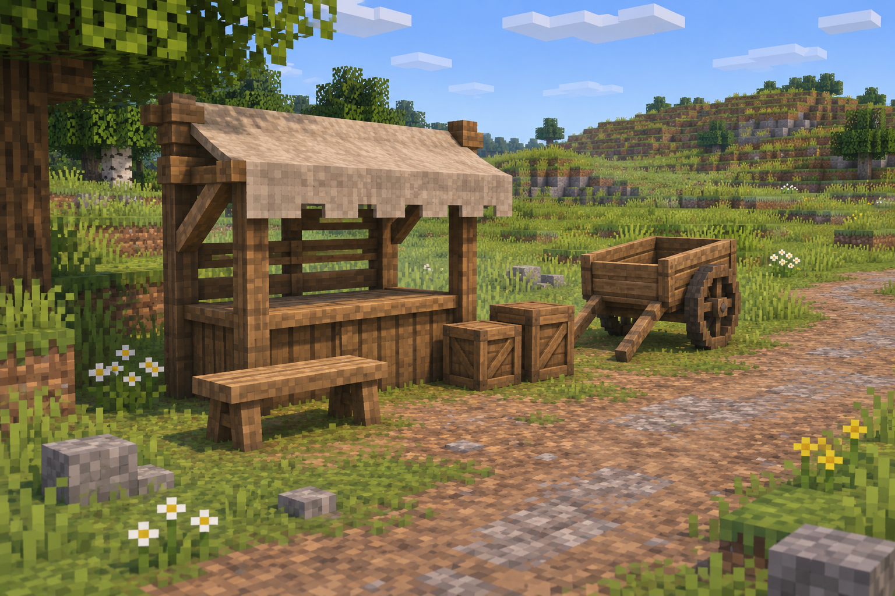

# Yuzalgh / small roadside trading pause (`yuzalgh`): concept art

- **View / snapshot:** Close view at the dry current map pin. Immediately after Kijin naming, anime S1E10.
- **Source scope:** The country name/order is reported in the secondary council-map comparison. The old brief's lakeside trading epithet is project invention, not a verified canonical capital or coast.
- **Our interpretation:** One small plain awning/stall, bench, crates and unmarked cart are a representative server micro-scene. No lake,harbour,new sovereign marker or major settlement is introduced.
- **Terrain and fit:** Radius8 is a pin-sized reservation, not an entire country compressed into a16-block site. This is atmosphere around the pin, not an approved new blueprint,initial merchant roster or runtime economy.
- **Current reservation:** centre (-2350, 300), radius 8.0, kind `clearing`, margin 24. These are server coordinates/radii, not canon measurements. All58 site attributes match main map `13f4cfb`. This art branch stacks on `f335f38` and retains older map/source files; [PR74](https://github.com/Yasuke2000/ocs-two-lives/pull/74) governs current geography.
- **Era:** No named character, liberation memorial, post-film cure, later federation insignia, event outcome or fixed initial resident is shown. Project roles/props are not proof of S1E10 country development.
- **References:** [Source/design review](western-states-reference-review.csv) · [project place brief](../../chatgpt/places/yuzalgh.md) · [era policy](../../../world/era.md). Retired imported-map coordinates do not govern this concept.
- **Provenance:** Built-in image_gen new original generation from source-qualified written brief. No copyrighted frame,texture,third-party map/build was an image input. Existing legacy materials remain untouched. [Exact prompts](western-states-prompts.json) and [manifest](western-states-asset-manifest.json) record current instruction,selected output hashes. Lossless packaging preserves every selected decoded RGB pixel.
- **Acceptance:** Representative visual reference only. Whole-country/source/early-state/structure fit,ground/roof/water/lighting and runtime placement remain open. This art delivery changes no SVG,blueprint,technical tool,runtime or deployment.

## Exact generation prompt

Original Minecraft painterly voxel environment vignette for YUZALGH's small SERVER MAP PIN, early post-Kijin time. Landscape1536x1024 opaque RGB, single scene, no text/UI/logos/panels. Close eye-level view of a TINY roadside trading pause occupying only roughly a16-block-diameter spot on dry gently grassy ground. One plain small timber stall with muted flax awning, a low simple rough bench, two small closed crates and a single unmarked cart parked beside an ordinary dirt/gravel path. No town, harbour, hall, castle, city gates, sovereign boundary markers, royal architecture, lake/stream/waterfall or distant capital panorama. Older brief says 'lakeside trading kingdom' but current pin is a dry clearing, not a canonical shoreline: do not invent water. Exact trade props are our interpretation, not canon national industry or a newly approved structure plan. Keep open meadow/low western hills with sparse tree edge, earth/grass transitions, a few flowers and stones, practical daylight. No people, named merchants, armed guards, monsters, later federation flags or emblems. Empty quiet representative micro-scene, no lore event or fixed initial resident roster.
