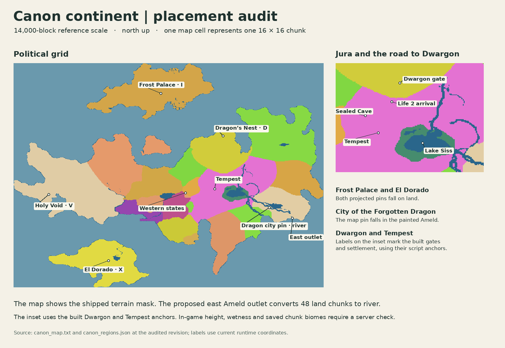

# Canon world audit · November 2026

Audited `main` at `963c524` offline. Coverage includes the 22 territory selectors, 43 geographic pins, both bespoke settlements, all 12 canon build manifests and all seven Tensura jigsaws. The Spirit Corridor test hut is included as a control. The five landmarks under review in PR #6 were absent from this base. Each world coordinate is X,Z unless Y is shown. Blueprint coordinates are local X,Y,Z.

**Wrong** marks a contradiction or reproducible defect. **Missing detail** marks an absent feature, unresolved attribution or a claim that needs more evidence. **Polish** marks a legibility or presentation improvement. “Fixed” means corrected in source and regenerated offline. The deployed world still needs an in-game check.

### Ten findings for review

| Severity | Finding | Disposition |
| --- | --- | --- |
| Wrong | The eastern Ameld reach ended upstream of its estuary. A path to open sea existed only via the other branch. | Reconnected the eastern channel with one paint waypoint, changing 48 chunks on regeneration. |
| Wrong | Coordinates in the atlas used the old 10,000-block scale. The current Frost Palace and El Dorado pins both resolve to dry land. Clayman’s override and the Forgotten Dragon City placement also used earlier geography. | Corrected the atlas, removed the castle override and moved the dragon city to a dry Milim site near its river marker. |
| Wrong | Dwargon's advertised arrival was inside a fence and lantern, and rails blocked the turns from ladders onto bridges. | Opened the crossover and landings, supported the lamps and verified a route to each of the four bridges. |
| Wrong | The Spirit Dwelling’s dome covered its lower staircase. The two spirit sites also used an active Tensura praying block in decorative paths. | Carved and oriented the stair after building the dome and used inert paving for the custom portal approach. |
| Wrong | Treyni’s shrine had zero eligible survey offsets for a nominal tree. The arrival itself was inside foliage/wood. | Cleared the standing route and enlarged the shrine search. Every tree offset now leaves multiple legal geometric candidates. |
| Wrong | Explicit air was excluded from the city light check. The model found 798 covered dark-floor positions in Englassia and 86 in Lubelius. | Fixed the candidate scan. Both counts fell to zero under the same model. |
| Wrong | Blumund and Marris emitted 284 fence blocks with wall properties and 28 beds with mismatched halves. | Corrected the shared helper, supported three altar candles and bumped both towns. |
| Wrong | Twenty Laura ladders faced their houses incorrectly. A turret blocked Clayman’s gallery stair; both granary roofs in the Forgotten Dragon City had continuous slots. | Checked the repaired ladders, gallery headroom, entrance and roof ridges in the regenerated templates. |
| Wrong | Fulbrosia’s tropical patches contradicted the official description of a cold mountain country. | Changed the H selector to cold uplands, retaining the regional mountain bias. |
| Wrong · follow-up | The template placers test a void command result for failure; jigsaw surface fallbacks and pairwise collisions also deserve a shared runtime pass. | A logged placement alone is insufficient. Check the stored geometry and actual jigsaw bounds. Stage a shared return-value/keepout fix with live failure tests. |

**Unresolved regional findings.** **Missing detail** covers the Kusha mountain corridor (J/S), the unpinned Dragon’s Nest peak (D) and E’s volcanic relief. Survey the named coordinates first; consider bounded local relief in a separate worldgen change. **Polish** covers the western political labels and naming variants where the anime, localization and fan polygons differ. Preserve stable lookup names until their exact-string consumers are migrated together. The region and landmark tables below give the individual evidence.

### Reading the evidence

The portal world guide supplies named places, terrain and relative geography. The publisher identifies the world map in the official volume 8.5 setting book. Its catalogue does not credit Fuse personally with drawing the map or provide surveyable country borders. The complete political input was recovered and retraced; the illustrated file called `16.png` has no authenticated original in this checkout. Its depiction of individual peaks and volcanoes remains provisional. The manga, anime and web novel comparisons are linked under the relevant builds. [Official world guide](https://www.ten-sura.com/map/) · [Volume 8.5, official publisher](https://gcnovels.jp/book/47) · [Central World, Tensura Wiki](https://tensura.fandom.com/wiki/Central_World) · [Exact political source](https://i.redd.it/q1p4ksudqyah1.png)

The region tables and Java measurements below describe the supplied grid. Relative palette weights describe selection frequency before local terrain overrides. The landmark table separately identifies the two edited pins and the newly connected estuary. The placement inventory uses the corrected source and regenerated grid.

## Shipped territory masks

World ranges include the last block. The span is the bounding rectangle, not usable area or coastline length. Neighbours touch by a full cardinal cell edge. A sea contact counts even when an enclosed bay or small hole supplies it. Fragments are four-connected components of the same letter; river channels may split a mainland selector.

|Region|Occupied chunks|Bounds x / z (blocks)|Span x × z|Land contacts|Sea / inland-water edges (chunk faces)|Fragments (largest in chunks)|
|---|---:|---|---|---|---:|---|
|J Jura-Tempest Federation|22,577|-1216…2815 / -1488…1679|4032 × 3168|A B D E F H M P Q R S W Y|13 / 684|8 (22,376)|
|W Lizardmen's Marsh of Lake Siss|1,412|336…1535 / -176…575|1200 × 752|J|0 / 271|5 (1,190)|
|D Armed Nation of Dwargon|13,831|-1120…1695 / -2720…-689|2816 × 2032|E F J|91 / 258|1 (13,831)|
|E Eastern Empire|25,137|976…4607 / -3760…-1025|3632 × 2736|D J P|258 / 664|1 (25,137)|
|P Land of Puppets Jistav|10,083|2496…4911 / -1296…447|2416 × 1744|E J M|77 / 178|1 (10,083)|
|M Milim's Domain|9,649|1696…4335 / -112…1519|2640 × 1632|B J P|71 / 727|5 (9,558)|
|B Beast Kingdom of Eurazania|5,520|576…2575 / 672…2271|2000 × 1600|H J M|51 / 264|4 (4,815)|
|H Harpy Queendom of Fulbrosia|10,669|-352…1407 / 992…3871|1760 × 2880|B J|102 / 307|1 (10,669)|
|S Sorcerous Empire of Sarion|5,896|-2608…-737 / 1168…2447|1872 × 1280|J O U Y|30 / 128|1 (5,896)|
|U Ulgracia|982|-1424…-705 / 1984…2527|720 × 544|S|39 / 67|1 (982)|
|R Kingdom of Blumund|1,762|-1472…-657 / -544…335|816 × 880|F G J Q Y|0 / 0|1 (1,762)|
|F Kingdom of Falmuth|5,485|-2080…-321 / -1888…-97|1760 × 1792|D G J R|8 / 102|1 (5,485)|
|G Kingdom of Englassia|9,545|-4144…-1425 / -1056…511|2720 × 1568|F L N O R V Y|40 / 136|1 (9,545)|
|L Holy Empire of Lubelius|20,195|-5760…-1953 / -2496…335|3808 × 2832|G V|202 / 620|3 (17,138)|
|V Holy Void of Damargania|33,030|-9088…-4081 / -2096…1599|5008 × 3696|G L O|341 / 1050|1 (33,030)|
|O Morgdahl|3,942|-4496…-2337 / 480…1583|2160 × 1104|G N S V Y|80 / 333|1 (3,942)|
|N Nostraille|2,660|-3536…-2289 / 288…1087|1248 × 800|G O Y|0 / 62|1 (2,660)|
|Y Yuzalgh|4,498|-2400…-1089 / 96…1391|1312 × 1296|A G J N O Q R S|0 / 85|1 (4,498)|
|Q Yggdonia|135|-1360…-1057 / 176…399|304 × 224|J R Y|0 / 0|1 (135)|
|A Raja|480|-1312…-929 / 560…1071|384 × 512|J Y|0 / 0|1 (480)|
|I Ice Continent|28,362|-5792…-33 / -5680…-3153|5760 × 2528|—|427 / 1212|1 (28,362)|
|X El Dorado|19,058|-7504…-2961 / 2272…4447|4544 × 2176|—|332 / 825|1 (19,058)|

## Regional climate and ordinary inland biomes

T is temperature, V vegetation, E erosion and S strength. Lower E favours mountains. A dash retains the input noise. The lists give relative weights, not measured cover. A t: prefix denotes a Tensura biome; the others are vanilla.

|Key|T / V / E / S|Inland palette × weight|Replacement peaks|
|---|---|---|---|
|J|0.0 / 0.45 / 0.3 / 0.85|forest ×4, birch_forest ×3, old_growth_birch_forest ×2, flower_forest ×2, plains ×2, swamp ×1|stony_peaks ×2, windswept_forest ×1|
|W|0.35 / 0.4 / 0.75 / 0.9|mangrove_swamp ×4, swamp ×4|native|
|D|-0.3 / — / -0.72 / 0.85|meadow ×3, grove ×2, windswept_hills ×2, windswept_forest ×2, snowy_slopes ×2, old_growth_spruce_taiga ×1, taiga ×1, windswept_gravelly_hills ×1|native|
|E|0.1 / 0.0 / 0.45 / 0.6|plains ×3, forest ×2, taiga ×2, birch_forest ×1, meadow ×1, sunflower_plains ×1, windswept_hills ×1, old_growth_pine_taiga ×1|native|
|P|0.0 / 0.2 / -0.3 / 0.65|dark_forest ×3, taiga ×2, windswept_hills ×2, t:miasmic_plains ×2, old_growth_spruce_taiga ×1, swamp ×1|native|
|M|0.6 / -0.4 / -0.1 / 0.8|savanna ×2, badlands ×2, savanna_plateau ×2, wooded_badlands ×1, windswept_savanna ×1, t:barren_land ×1, desert ×1|native|
|B|0.7 / 0.35 / 0.4 / 0.75|sparse_jungle ×3, savanna ×3, jungle ×2, plains ×1, bamboo_jungle ×1, savanna_plateau ×1|stony_peaks ×2, windswept_savanna ×1|
|H|-0.3 / 0.3 / -0.6 / 0.75|windswept_hills ×3, windswept_forest ×2, meadow ×2, old_growth_pine_taiga ×2, grove ×1, snowy_slopes ×1|native|
|S|0.15 / 0.45 / 0.3 / 0.65|t:ancient_forest ×3, forest ×2, flower_forest ×2, birch_forest ×2, old_growth_birch_forest ×2, cherry_grove ×1, plains ×1|native|
|U|0.25 / 0.2 / 0.3 / 0.5|plains ×3, flower_forest ×2, sunflower_plains ×1, forest ×1, meadow ×1, cherry_grove ×1|native|
|R|0.05 / 0.15 / 0.45 / 0.4|plains ×3, forest ×3, birch_forest ×2, flower_forest ×1, sunflower_plains ×1|native|
|F|0.1 / -0.1 / 0.6 / 0.5|plains ×3, forest ×2, birch_forest ×1, sunflower_plains ×1, meadow ×1, windswept_hills ×1, taiga ×1|native|
|G|0.0 / 0.0 / 0.5 / 0.5|plains ×4, forest ×2, sunflower_plains ×1, flower_forest ×1, birch_forest ×1, meadow ×1|native|
|L|-0.15 / 0.1 / -0.4 / 0.65|meadow ×3, forest ×2, plains ×2, taiga ×1, windswept_forest ×1, flower_forest ×1, grove ×1|native|
|V|0.85 / -0.8 / 0.5 / 0.9|t:desert_of_death ×4, t:barren_land ×3, desert ×2, badlands ×1, eroded_badlands ×1|native|
|O|0.15 / 0.1 / 0.4 / 0.4|plains ×3, forest ×2, birch_forest ×1, swamp ×1, savanna ×1|native|
|N|0.1 / 0.0 / 0.4 / 0.4|plains ×2, meadow ×2, forest ×2, windswept_hills ×1|native|
|Y|0.15 / 0.1 / 0.4 / 0.4|forest ×2, plains ×2, birch_forest ×2, flower_forest ×1|native|
|Q|0.1 / 0.2 / 0.4 / 0.4|old_growth_birch_forest ×2, birch_forest ×2, flower_forest ×1|native|
|A|0.3 / 0.1 / 0.4 / 0.4|plains ×2, forest ×1, meadow ×1, windswept_hills ×1|native|
|I|-0.95 / — / -0.4 / 0.95|snowy_plains ×3, ice_spikes ×2, snowy_slopes ×2, snowy_taiga ×1, grove ×1|native|
|X|0.7 / 0.6 / 0.1 / 0.8|sparse_jungle ×2, jungle ×2, savanna ×2, wooded_badlands ×2, badlands ×1, bamboo_jungle ×1, windswept_savanna ×1|native|

## Hydrology evidence

The mask contains 8,147 inland-water cells across 1254 four-connected components. Below, the nearest inland-water cell within five chunks of each centre/endpoint identifies the connected component, using chunk-centre distance.

|Point|Target x,z|Sampled water chunk NW x,z|Component size|Component touches sea|
|---|---|---|---:|---|
|Siss centre|889,203|880,192|2604 (component 608)|yes|
|Ameld upper end|1337,-1106|1328,-1104|2604 (component 608)|yes|
|Main lower end|3423,1085|3408,1072|2604 (component 608)|yes|
|SE branch upper end|1540,336|1536,336|2604 (component 608)|yes|
|SE branch lower end|2268,1239|2208,1184|2604 (component 608)|yes|

The Great Ameld actually joins Lake Siss. The upper endpoint's nominal cell is J, eight adjacent wet cells lie in its 5×5 sample, and the named lower endpoint is wet. The southeastern endpoint is already open sea; the generator only paints existing land. Wet cells near both endpoints and the lake belong to a 2,604-cell component. Its exit beside the southern branch does not demonstrate a local outlet for the eastern branch. The 48-cell repair below was verified separately with a valley-constrained flood fill. The 1,254 inland-water components include tiny coastal pockets which the tracer's two-chunk near-land rule separates from open sea. Do not read that count as 1,254 lore lakes.

At width 14,000, the painted ellipse is centred at (889,203) with nominal axes about 851 × 314 blocks before the sinusoidal shoreline wobble. Its marsh ring is nominally 179 blocks wide. The two river polylines use a nominal 50-block channel with local meanders; water placement stops at existing water and sea. The raw J coastline has only 13 direct sea edges, so its broad forest reaches the coast locally without turning the whole federation into a coastal biome. The northern I and southwest X are each entirely water-separated from all other regional land letters. The official glossary confirms freshwater Ameld flows through Jura into Siss, together with wetland and caves around Siss. It does not specify the exact origin, eastern lake, fork positions, ocean mouth, or cave spawn. [Ameld](https://www.ten-sura.com/map/#A-32) · [Siss](https://www.ten-sura.com/map/#A-49)

## Jura and arrival, checked with the shipped Java

Distances are blocks from Tempest (0,0), tested in 8-block increments with the actual CanonGrid.depthBelowBorder and charAt. Each row gives the first nominal rim and first external cell sampled. J, W and inland water count as interior for border depth. The zone selection itself is owned by J, so W and preserved river biomes on any given ray can interrupt its visible forest. The core nominal radius is 200 in every direction. The ±50 world-block patch transition and coordinate warp make the borders variable.

|Ray|Core ends|Rim begins|First external cell|Middle width|Rim width|Next selector|
|---|---:|---:|---:|---:|---:|---|
|North|200|520|808|320|288|D|
|Northeast|200|600|1,184|400|584|D|
|East|200|1,792|2,352|1,592|560|M|
|Southeast|200|952|1,248|752|296|B|
|South|200|928|1,216|728|288|H|
|Southwest|200|968|1,456|768|488|A|
|West|200|384|664|184|280|R|
|Northwest|200|584|864|384|280|F|
|Toward arrival (271,−624)|200|488|768|288|280|D|

The 72-ray Java self-check gives rim min 264, median 320 and P90 584 blocks along rays; middle min 184, median 584 and max 2,488. The perpendicular depth of the rim is the same nominal 280 on each side. Oblique border crossings and promontories make long radial runs. At 651 sampled border columns at depth ≤178, every tested patch chose rim. At (271,−624), Java reports J, distance 680 from Tempest and border depth 80. A square of ±48 blocks stayed in the rim for all 500 tested seeds and the sampled ±128 square contained no water or marsh cells. The configured natural surface search is 40 blocks. These are model and cell checks. Verify final arrival platform Y, reachable clearings and first-session mobs on the server.

The core picks ancient forest 6 / dark forest 3, middle dark forest 7 / ancient forest 2 and rim forest 4 / birch 3 / old-growth birch 2 / flower forest 2 / plains 2 / swamp 1. The outer mix gives ordinary 500-magicule biomes; the two dark choices carry about 2,000 and 20,000 respectively in the pack lore. Poison eligibility starts at 1,000 in energy_config.toml and depends on entity-specific conditions. A safe rim does not promise freedom from night mobs or safety in a cave. The ring design expresses gameplay progression inspired by Veldora's influence; the franchise maps give the broad central forest and trading federation, not three precise concentric territorial boundaries. [Great Jura Forest](https://www.ten-sura.com/map/#A-17) · [Tempest](https://www.ten-sura.com/map/#A-112)

## Regional readings and evidence

|Selectors|What the grid and palette do|Canon check and uncertainty|
|---|---|---|
|J / W|Central forest, eastern lake, encircling wetlands on J only. The two joined channel arms and lake fragment the W mask. The 1,412 W chunks make the old “new and not painted yet” description obsolete.|Central forest, river into Siss, wet surround and caves have primary support. The exact mud, mangrove, rings and scale are pack choices. [Forest](https://www.ten-sura.com/map/#A-17) · [Lake](https://www.ten-sura.com/map/#A-49)|
|D / E|D spans the northern side of Jura as its coldest strongly mountainous mainland neighbour. E extends far to the east and northeast, with broadly temperate lowland cover. Ridges still need vanilla noise.|Dwargon's mining and metalworking and the empire's large eastern territory are official. Neither the mountain crest, summit altitude, underground city void nor empire's volcanic cone is pinned by a national erosion value. [Dwargon](https://www.ten-sura.com/map/#A-30) · [Eastern Empire](https://www.ten-sura.com/map/#A-21) · [Canaat range](https://tensura.fandom.com/wiki/Great_Canaat_Mountains)|
|P / M|Jistav occupies the eastern strip between Empire and Milim; darker hill and miasma palettes. M has semi-arid plateaux, broken by the Ameld course.|Clayman's territory and Milim's Forgotten Dragon City are authenticated. Neither a universal miasma biome nor badlands over the whole domain follows from the official entries. [Jistav](https://www.ten-sura.com/map/#A-117) · [Forgotten Dragon City](https://www.ten-sura.com/map/#A-128)|
|B / H|B south of Jura has warm fruit-growing country represented by tropical forest, savanna, open plains and its own peaks. H to its west forms a long, high coastal strip with cold peaks and upland meadows.|The official entry calls B warm and renowned for orchards. It explicitly calls H cold and high (寒冷な高山地帯). The audit changes H from +0.30 to −0.30 and replaces sparse jungle / savanna plateau (1 each) with grove / snowy slopes. Existing mountains, pine valleys, strength and weights remain. [Eurazania](https://www.ten-sura.com/map/#A-64) · [Fulbrosia](https://www.ten-sura.com/map/#A-140)|
|S / U|Forested S meets Jura across the southwest and U lies immediately south, with S as U's only land contact. U is small coastal meadow/farmland. Both erosion values (+0.30) favour gently rolling terrain.|U's position south of Sarion, northern Ulg Nature Park and spirit entrance are explicit. The official Kusha range runs from Jura to Sarion, but the engine has no oriented relief paint and no guaranteed ridge between them. Lowering all S or J would damage the rest; survey the corridor, then consider a bounded highland paint. [Sarion](https://www.ten-sura.com/map/#A-111) · [Ulgracia](https://www.ten-sura.com/map/#A-72) · [Park](https://www.ten-sura.com/map/#A-73) · [Kusha mountains](https://www.ten-sura.com/map/#B-172)|
|R / F / G|Small landlocked agricultural R directly adjoins J; larger F stretches northwest to D; G is the larger western cultural heartland. Palettes share temperate lowland cover at moderate strength.|Canon specifically places small R beside Jura and describes its agriculture. F is a former trade intermediary and G a western cultural centre; label history accounts for Falmuth/Farmenas. No source fixes the forest-to-field percentages. [Blumund](https://www.ten-sura.com/map/#A-18) · [Falmuth](https://www.ten-sura.com/map/#A-63) · [Farmenas](https://www.ten-sura.com/map/#B-182) · [Ingrassia](https://www.ten-sura.com/map/#A-42)|
|L / V|L includes disconnected islands and western upland; V occupies the broad far west and has the strongest hot, dry climate on this map. Its desert mix recovers the Desert of Death motif. L's −0.40 erosion only biases hills and cannot force a solitary sacred peak.|The official entry confirms Lubelius's church and political role. Dagruel's desert and tower are associated, while exact desert margin and national coastline follow the creator's plate. The large northern island's attribution to L was explicitly the cartographer's choice. [Lubelius](https://www.ten-sura.com/map/#A-110) · [Damargania](https://tensura.fandom.com/wiki/Holy_Void_of_Damargania)|
|O / N / Y / Q / A|Small western parcels make a fertile belt. O alone touches open-sea cells, N has inland-water edges, Y spans inland woodland and assorted borders, Q is a 135-cell woodland pocket and A a 480-cell pocket between J and Y. Q is small enough that a single roughly 240-block biome patch can occupy much of it.|S4 episode 4's map is evidence for the four western names and west-to-east layout. The still is available in Taiqi_'s comparison; exact polygons, English transliterations, climate and labels remain interpretations. Raja's existence comes from Scarlet Bond; its precise location on the traced fan map is speculative. [Official #76](https://www.ten-sura.com/anime/tensura/story/no81) · [Frame comparison](https://www.reddit.com/r/TenseiSlime/comments/1suz7yb/new_countries/) · [Film](https://movie.ten-sura.com/)|
|I / X|Two water-separated continents. Northern I has a strongly negative temperature and a mainly snowy array, while southwest X has warm humid jungle and badland gold pockets. X's single traced land component shows that claims about every offshore island need cell checks.|I is officially northern permafrost housing the White Ice Palace. X's national rainforest/badlands mix, volcano shape and exact capital pixel are interpretative. Keep named volcano separate from a generated cone. [Ice Continent](https://www.ten-sura.com/map/#A-130) · [El Dorado](https://tensura.fandom.com/wiki/Golden_City_of_El_Dorado)|

## Provenance, runtime and unresolved work

- Tinseluwu's second gallery plate (2800×2050), SHA256 541a784d6c567c235796b90bcc902b86924a24f9cbcdbcae2e45504165657c7f, retraces exactly to the shipped grid, SHA256 19558c53e35282b9062ca492ba6a65290a40812d1a3d0c8fd2197832e7ecface. The first variant differs in 13,793 cells. Land bounding rectangle at width 14,000 is x −9,088 to +4,912 and z −5,680 to +4,448, with maximums exclusive. The raster is 876 × 633 including the extra east column. Origin pixel is (1792,1141); grid NW at column 568, row 355 is world (0,0). Scale is ~5.44747 blocks per source pixel. The old 10,000 / 3.89 scale applied to the prototype atlas. [Author and limitations](https://www.reddit.com/r/TenseiSlime/comments/1um7i81/i_created_a_bunch_of_tensura_political_maps/) · [Exact plate](https://i.redd.it/q1p4ksudqyah1.png)
- The author says they estimated Filtwood, Raja, Doran, Rostia and Ghastone, moved Coleus away from its OVA map position, assigned a northern island to Lubelius and three offshore islands to El Dorado. They permit reuse informally and credit Fuse. No source art is included in this audit. The fan cartographer links the wiki map and credits the discussion of the episode 76 western map. KartoffelChipss' separate interactive map explicitly traces polygons manually from wiki material and cannot serve as an independent primary or exact political-plate provenance. Exact creator and identity of the illustrated “16.png” remain unverified; avoid attributing it to Tinseluwu without a source match. [Wiki map](https://tensura.fandom.com/wiki/Map:Central_World) · [Interactive map](https://tensura.j4n.net/) · [Author's method](https://github.com/KartoffelChipss/TensuraMap)
- CanonGrid computes signed distance across cells with a two-pass eight-neighbour chamfer, bilinear cell-centre interpolation and vanilla continentalness contribution up to 8%. The inland/coast boundary is −0.11 and the shore transition has a 700-block exponential e-folding. Climate uses strength-weighted temperatures, vegetation and erosion with two 3-cell-radius box passes; water inherits the nearest nation's input. Climate fades seaward on a 300-block scale. Owner lookup treats waters within 128 blocks as territorial, with dithered boundaries for biome choice. The 1,600-block full-strength rule and 800-block transition are distances outside the outer land bounding rectangle; they do not add two padding rings around each individual coast. CanonBiomes selects at quart centres (block +2), keeps shore/river/cave/mushroom biomes and most peaks, and can map underlying ocean to river/frozen river where the inland-water sample is ≥0.5. J and B override peaks, and I qualifies for frozen inland channels by its temperature.
- Pure-Java self-check (tracked CanonGrid, CanonZones, CanonPalette, CanonConfig; compiled the exact standalone RegionTitles.Tracker from its source to avoid Minecraft runtime dependencies) passed on the actual grid/config/arrival. A zero vanilla continentalness input at cell centres produced 198,856 deep ocean, 96,581 ocean, 24,163 coast and 234,908 inland cells. Zero is the vanilla continentalness input, not a world seed. An exact route, chunk Y, crest, aquifer, cave, ocean temperature, forest density, vegetation density and final spawn cannot be established from these selector masks. New chunk generation and an in-game pass remain necessary.

## All 43 geographic markers

The cell column samples the supplied baseline grid at the final marker coordinates, including the corrected Yggdonia and river-mouth references. The final source overlay adds 48 wet cells in the estuary and changes none of the 43 displayed cell codes. World positions use the shipped 14,000-block width and the reference origin (1792, 1141). For each axis the generator rounds (pixel − origin) × 14000 / 2570. The grid lookup then adds the signed chunk coordinates to column 568 and row 355. All 43 markers fall inside the grid. Forty occupy land, three occupy inland water (`~`), and zero occupy open sea (`.`). The coordinates below are marker centers. The game can place doors, structures and terrain surveys elsewhere. [Exact source plate][plate] · [Mapping commentary][cart].

The second plate in the map gallery reproduces the shipped raster exactly. It provides evidence for the cartographer’s marked cities and countries. Named sites without a printed dot use approximate pack placements. The grid merges several small western polities into larger runtime zones. For quoted distances, a water/land boundary is the nearest block belonging to a matching chunk, rather than its center.

| # | Landmark | Reference pixel | World x, z | Cell | Geographic interpretation and action |
|---:|---|---|---|:---:|---|
| 1 | Tempest (Rimuru, capital of the Federation) | 1790, 1122 | -11, -104 | `J` | Rimuru city dot in central Jura. The built capital uses the independent (0, 0) anchor. [Jura and Tempest][jura]. |
| 2 | Sealed Cave (Veldora's prison, Rimuru's birthplace) | 1745, 1078 | -256, -343 | `J` | Forest with no cave symbol at this pixel. Jura prison is supported by [episode 1][ep1]. Its exact cave entrance is a pack choice. |
| 3 | Old goblin village (Rigurd's tribe) | 1762, 1098 | -163, -234 | `J` | Forest north-west of Rimuru; Rigurd’s settlement is supported by [episode 2][ep2]. No village symbol here. The old village and later capital are separate markers. |
| 4 | Lake Siss | 1955, 1178 | 888, 202 | `~` | Water near the printed lake. A wet center is appropriate for the lake itself. The separate lizardman village uses (700, 344). [Lake and Ameld][ameld]. |
| 5 | Lizardmen's caverns (Gabiru, Avalos) | 1962, 1214 | 926, 398 | `W` | Marsh south of the lake, a defensible site for the limestone caverns. No entrance dot. Official entry supports the habitat. English character sources use Abil/Abiru for Gabiru’s father. Keep “Avalos” as legacy pack wording pending a coordinated exact-name migration. [Caverns][caverns] · [Names][cast]. |
| 6 | Orc War battlefield (Lake Siss marsh) | 1995, 1240 | 1106, 539 | `J` | Forest cell, 28 blocks south of the nearest W marsh cell at (1106, 511). The battle covered the lake approaches. Retain the event marker and document the forest fringe. [Caverns and marsh][caverns]. |
| 7 | Great Ameld River source (Canaat foothills) | 2037, 938 | 1335, -1106 | `J` | At the head of a painted tributary, two blocks from mapped water at z = −1104. Retain the foothill bank. The official glossary establishes the river entering Lake Siss; it does not specify this source. [Ameld][ameld]. |
| 8 | Great Ameld River mouth | 2434, 1384 | 3497, 1324 | `~` | Mouth moved from the upstream bank to the last wet chunk at the source plate’s estuary. One eastern paint waypoint restores the traced outlet’s local connection to sea. [Ameld][ameld]. |
| 9 | Hidden ogre village (Kijin homeland, burned) | 2060, 965 | 1460, -959 | `J` | Jura forest beside the upper tributary. The destroyed village belongs to the ogre survivors’ story; no settlement dot or surveyed ruins here. [Jura][jura]. |
| 10 | Treyni's grove (Dryad sanctuary) | 2150, 1100 | 1950, -223 | `J` | Jura forest near a painted river. A dryad sanctuary is a pack interpretation, with no grove dot at this point. [Jura][jura]. |
| 11 | Dwargo (Dwargon cavern capital) | 1869, 836 | 419, -1661 | `D` | Printed Dwargon city dot. Use it for the cavern capital’s regional position. The actual throne room belongs to the separate gate-anchored build. [Dwargon][dwarf]. |
| 12 | Dwargon main gate | 1872, 868 | 436, -1487 | `D` | South of the Dwargon city dot, with no independent gate symbol. The physical build fixes its gate at (435, −1000); this marker is 487 blocks farther north. Preserve the independent anchors. [Dwargon][dwarf]. |
| 13 | Dragon's Nest (highest peak of the Great Canaat Mountains) | 1860, 700 | 370, -2402 | `D` | Painted mountain range north of Dwargon with no nest dot or elevation at this pixel. Highest-peak lore supplies the regional target; local summit selection remains a build decision. [Canaat][canaat]. |
| 14 | Marris (Falmuth capital) | 1556, 950 | -1286, -1040 | `F` | Marris city dot in Falmuth. Falmuth/Farmenas depends on the story era; the marker uses the former kingdom. [Falmuth][falmuth]. |
| 15 | Siltrosso | 1420, 972 | -2026, -921 | `G` | Siltrosso dot inside its own small coastal polygon. G represents the merged grid, while the setting describes a small kingdom bordering Englassia and Falmuth. [Geography][jp]. |
| 16 | Blumund capital (Londo) | 1604, 1119 | -1024, -120 | `R` | Londo city dot within Blumund. Canon confirms the kingdom. Londo is the fan plate’s city label; its spelling and status as capital are unverified from the official glossary. [Blumund][blumund]. |
| 17 | Ballachia | 1538, 1102 | -1384, -212 | `F` | Ballachia dot in its own small political polygon; the grid assigns F. Preserve the separate settlement marker and distinguish the coarser runtime zone. [Plate][plate]. |
| 18 | Englassia capital (Lura): Freedom Academy, Free Guild HQ | 1310, 1086 | -2626, -300 | `G` | Lura city dot. The official map supports the capital’s Free Guild connection; the plate supplies its point and spelling. The academy and guild are represented by one marker. [Englassia][eng]. |
| 19 | Holy City Lubelius (Lune) | 1062, 1020 | -3977, -659 | `L` | Lune city dot in Lubelius. Its location supports the religious capital. This fan-map spelling serves as the marker alias. [Lubelius][lub]. |
| 20 | Sacred Mountain (Inner Sanctum, Luminous) | 980, 905 | -4423, -1286 | `L` | Inland uplands northwest of Lune with no sanctum symbol. Use as an approximate gate to Luminous’s domain; exact mountain and subterranean layout remain unverified. [Lubelius][lub]. |
| 21 | Coleus | 1030, 1209 | -4151, 370 | `V` | Coleus dot on a distinct border territory; V is the containing Damargania grid cell, about 35 blocks from L. The anime places the kingdom between the West and the Barren Lands. The fan author explicitly moved it. Preserve dot, identify it as an independent kingdom. [Anime][coleus] · [Map author][cart]. |
| 22 | Morgdahl | 1056, 1325 | -4009, 1002 | `O` | Point by the Morgdahl symbol and label, in O. Retain the fan-map position, with canon borders and city scale unverified. [Plate][plate]. |
| 23 | Nostraille | 1322, 1207 | -2560, 360 | `N` | Nostraille country’s dot in N. Its western position is a fan-map reference. [Plate][plate]. |
| 24 | Ghastone | 1358, 1231 | -2364, 490 | `N` | Ghastone dot on a distinct small territory, combined into N in the grid. The Rosso material names the kingdom; the author describes its plotted location as speculative. [Setting][jp] · [Map author][cart]. |
| 25 | Rostia | 1344, 1320 | -2440, 975 | `N` | Rostia dot in its own small territory, combined into N. Rosso-related kingdom in the setting, with a speculative location on this plate. [Setting][jp] · [Map author][cart]. |
| 26 | Yuzalgh | 1448, 1200 | -1874, 321 | `Y` | Point by the symbol in the Yuzalgh country, in Y. Exact settlement location is fan-derived. [Plate][plate]. |
| 27 | Yggdonia | 1548, 1174 | -1329, 180 | `Q` | Yggdonia country lettering near the Blumund border, with no city dot at the pin. Move reference (1550, 1174) to (1548, 1174) so the marker lands in its own Q zone. This is a two-pixel pack correction, independent of the cartographer’s city symbols. [Plate][plate]. |
| 28 | Filtwood | 1597, 1254 | -1062, 616 | `A` | Filtwood dot on a small separate territory within the runtime A region. The author describes its location as conjectural. [Map author][cart]. |
| 29 | Raja | 1593, 1281 | -1084, 763 | `A` | Raja dot in A. The kingdom features in Scarlet Bond; the film does not supply this exact location, which the cartographer identifies as speculative. [Film][raja] · [Map author][cart]. |
| 30 | Sainte Malukshure | 1242, 1378 | -2996, 1291 | `O` | Sainte Malukshure dot in its own southern polygon within runtime O. Keep fan-map spelling and location; the exact political geography is unverified. [Plate][plate]. |
| 31 | Elmine (Sarion capital in the Divine Tree) | 1522, 1440 | -1471, 1629 | `S` | Elmine dot in Sarion. The Divine Tree belongs to the capital’s setting. Tree footprint and vertical extent remain interpretations. [Sarion][sarion]. |
| 32 | Galut / Ulgr Nature Park (Ulgracia) | 1577, 1536 | -1171, 2152 | `U` | Dot specifically labeled Ulgr Nature Park. The official glossary places the park in the far north of Ulgracia and the Spirit Dwelling entrance there. Nothing here establishes Galut at exactly the same point. [Ulgr Nature Park][park]. |
| 33 | Heaven Tower (Dagruel, Damargania) | 414, 1186 | -7507, 245 | `V` | Dot labeled Damargania. Heaven Tower’s association with Dagruel supports siting it in this country; the dot itself does not identify a tower. [Geography][jp] · [Plate][plate]. |
| 34 | Golden City of El Dorado (Leon) | 910, 1736 | -4805, 3241 | `X` | City dot in X, 643 blocks from the nearest sea cell. The official episode identifies Leon’s Golden City. No land relocation is required by the current model. [Episode 87][eld]. |
| 35 | El Dorado volcano | 860, 1690 | -5077, 2991 | `X` | Undotted island relief northwest of the city. Exact caldera and volcanic status at this pixel remain an interpretation of the illustrated terrain. [Plate][plate]. |
| 36 | Frost Palace (Guy Crimson) | 1345, 349 | -2435, -4314 | `I` | Frost Palace dot in I, 497 blocks from the nearest sea cell. The official glossary places Guy’s palace on the northern ice continent. [White Ice Palace][ice]. |
| 37 | Nasca (Eastern Empire capital) | 2275, 763 | 2631, -2059 | `E` | Nasca city dot in E. The official glossary verifies the Eastern Empire and its long imperial name. The dot and short capital label come from the fan map. [Empire][empire]. |
| 38 | Great Holy Mountain (Velgrynd) | 2230, 680 | 2386, -2511 | `E` | Undotted relief in the empire northwest of Nasca. Velgrynd’s mountain is a regional lore reference. This exact summit and elevation are unverified. [Empire][empire] · [Plate][plate]. |
| 39 | Amrita (Jistav capital) | 2444, 1012 | 3552, -703 | `P` | Amrita city dot in P. The setting describes Jistav’s capital and its ancient underground ruins. These can coexist at one map point. [Jistav][jistav] · [Geography][jp]. |
| 40 | Clayman's Castle | 2470, 965 | 3693, -959 | `P` | Undotted uplands northeast of Amrita. Exact castle site is inferred. The current build uses this original point on dry P land. [Jistav][jistav]. |
| 41 | City of the Forgotten Dragon (Milim) | 2244, 1295 | 2462, 839 | `~` | City dot on the shore in the artwork, resolving to inland water on the raster. Keep the city marker. The dry build anchor is (2502, 607) in M, about 235 blocks away. [Forgotten Dragon City][forgotten]. |
| 42 | Laura (Eurazania capital, rebuilt) | 2102, 1380 | 1689, 1302 | `B` | Laura city dot, dry B. The region association is supported by the Eurazania glossary. Distinguish the story’s ruined and rebuilt capitals in descriptions. [Eurazania][eura]. |
| 43 | Jia (Fulbrosia capital, Frey) | 1856, 1475 | 349, 1819 | `H` | Jia city dot, dry H. The official glossary supports Frey’s high, cold mountain country. The plate supplies the point and the name Jia. [Fulbrosia][ful]. |

**Wrong, fixed — atlas scale and reported sea placements.** Under the previous 10,000-block projection, El Dorado yields (−3432, 2315) and Frost Palace (−1739, −3082). Both positions return sea if sampled against the current 14,000-block raster. Applying the current projection to the same original pixels puts both original dots on dry land. A separate castle entrance chosen for an earlier build can remain a deliberate design choice. The Forgotten Dragon City genuinely samples inland water with today’s projection. Its marker and dry construction anchor serve separate purposes.

**Wrong, fixed — border reference.** Yggdonia previously resolved to (−1318, 180) in Blumund (R). The 11-block shift west retains the fan country label while bringing its center into Yggdonia (Q). No bespoke manifest or licensed-structure manifest uses that exact landmark name. The BlueMap marker follows the corrected reference on regeneration. The Ameld head, Orc battlefield, and bespoke city markers keep their original pixels.

**Wrong, fixed — eastern Ameld outlet.** The old marker at reference (2420, 1340), world (3421, 1084), was on a painted lower reach 244 blocks from the nearest sea cell. The supplied baseline raster and the corrected source overlay both already classify the new marker itself as inland water. The exact fan plate shows a narrow, dark-outlined channel bending southeast at pixel (2428, 1368) and entering the sea around (2434, 1384). The trace dropped parts of the narrowest channel. Moving the mouth to that estuary pixel puts it on a wet chunk at (3497, 1324), four blocks north of open sea. Extending the east-branch paint by one waypoint, (2498, 946) at paint_width 10000, connects that wet chunk. Regenerating the full grid from the source diagram changed exactly 48 Milim cells to inland water, confined to columns 781–788 and rows 421–437 inclusive, with the same origin and dimensions. A four-neighbor walk restricted to the outlet valley from the old pin reaches the new pin and adjacent sea after the extension. It reached neither before. Only the BlueMap marker consumes the changed landmark name/reference pair. [Source plate][plate].

[plate]: https://i.redd.it/q1p4ksudqyah1.png
[cart]: https://www.reddit.com/r/TenseiSlime/comments/1um7i81/i_created_a_bunch_of_tensura_political_maps/
[jp]: https://ja.wikipedia.org/wiki/転生したらスライムだった件
[cast]: https://en.wikipedia.org/wiki/List_of_That_Time_I_Got_Reincarnated_as_a_Slime_characters
[coleus]: https://www.ten-sura.com/anime/coleus
[raja]: https://movie.ten-sura.com/
[eld]: https://www.ten-sura.com/anime/tensura/story/no92
[ep1]: https://www.ten-sura.com/anime/tensura/story/no1
[ep2]: https://www.ten-sura.com/anime/tensura/story/no2
[canaat]: https://tensura.fandom.com/wiki/Great_Canaat_Mountains
[jura]: https://www.ten-sura.com/map#A-112
[ameld]: https://www.ten-sura.com/map#A-32
[caverns]: https://www.ten-sura.com/map#A-49
[dwarf]: https://www.ten-sura.com/map#A-30
[falmuth]: https://www.ten-sura.com/map#A-63
[blumund]: https://www.ten-sura.com/map#A-18
[eng]: https://www.ten-sura.com/map#A-42
[lub]: https://www.ten-sura.com/map#A-110
[sarion]: https://www.ten-sura.com/map#A-111
[park]: https://www.ten-sura.com/map#A-73
[ice]: https://www.ten-sura.com/map#A-130
[empire]: https://www.ten-sura.com/map#A-21
[jistav]: https://www.ten-sura.com/map#A-117
[forgotten]: https://www.ten-sura.com/map#A-128
[eura]: https://www.ten-sura.com/map#A-64
[ful]: https://www.ten-sura.com/map#A-140

## Placement inventory and block-state checks

The anchor cell, nominal worked rectangle and search settings below are independent quantities. For bespoke and survey builds the rectangle includes the terrain margin at zero offset. Fixed builds receive no survey. Jigsaw rectangles use their conservative maximum reach rather than an individual generated structure box. Counts in the final column are intersected *chunks*, including those touched at the edge; they are independent of how many cells the blueprint explicitly fills. The server rejects wet samples and competing bounds, then chooses a height; no offline rectangle can give its eventual Y. [Coordinate and footprint conversion](../../tools/gen_data.py) · [Candidate selection](../../pack/kubejs/server_scripts/ttl/life/builds.js) · [Jigsaw starts](../../design/data/landmarks.toml)

| Build or jigsaw | World x,z · cell | Local anchor · size X×Y×Z | Nominal bounds x / z | Search | Chunk cells |
| --- | --- | --- | --- | ---: | --- |
| [tempest](../../blueprints/tempest.py) | 0,0 · J | 45,5,57 · 91×40×91 | -53…53 / -65…41 | 0 | J 64 |
| [dwargon](../../blueprints/dwargon.py) | 435,-1000 · D | 74,4,120 · 148×92×168 | 351…518 / -1130…-943 | 0 | D 156 |
| [blumund](../../design/builds/blumund.toml) | -1024,-120 · R | 62,5,72 · 124×52×116 | -1094…-955 / -200…-69 | 64 | R 90 |
| [clayman_castle](../../design/builds/clayman_castle.toml) | 3693,-959 · P | 54,6,102 · 109×66×109 | 3631…3755 / -1069…-945 | 64 | P 72 |
| [dragons_nest](../../design/builds/dragons_nest.toml) | 370,-2402 · D | 36,9,62 · 73×46×73 | 326…414 / -2472…-2384 | 32 | D 42 |
| [englassia](../../design/builds/englassia.toml) | -2626,-300 · G | 64,5,92 · 128×60×112 | -2698…-2555 / -400…-273 | 64 | G 80 |
| [forgotten_dragon_city](../../design/builds/forgotten_dragon_city.toml) | 2502,607 · M | 60,5,118 · 121×44×125 | 2432…2572 / 479…623 | 32 | M 90 |
| [laura](../../design/builds/laura.toml) | 1689,1302 · B | 56,5,108 · 113×46×113 | 1625…1753 / 1186…1314 | 64 | B 81 |
| [lubelius](../../design/builds/lubelius.toml) | -3977,-659 · L | 60,5,98 · 120×64×120 | -4045…-3910 / -765…-630 | 64 | L 81 |
| [marris](../../design/builds/marris.toml) | -1286,-1040 · F | 68,5,66 · 136×64×112 | -1362…-1211 / -1114…-987 | 64 | F 99 |
| [sealed_cave](../../design/builds/sealed_cave.toml) | -256,-343 · J | 44,5,82 · 88×50×88 | -308…-205 / -433…-330 | 64 | J 64 |
| [spirit_dwelling](../../design/builds/spirit_dwelling.toml) | 0,0 · — | 44,41,66 · 89×64×89 | -44…44 / -66…22 | 0 | ttl:spirit_domain |
| [spirit_gate](../../design/builds/spirit_gate.toml) | -210,130 · J | 28,5,24 · 57×40×57 | -246…-174 / 98…170 | 64 | J 30 |
| [test_hut](../../design/builds/test_hut.toml) | 2500,0 · — | 2,1,2 · 5×6×5 | 2490…2510 / -10…10 | 0 | ttl:spirit_corridor |
| [treyni_shrine](../../design/builds/treyni_shrine.toml) | 1988,-223 · J | 16,5,16 · 33×22×33 | 1964…2012 / -247…-199 | 132 | J 16 |
| [goblin_village](../../design/data/landmarks.toml) | -163,-234 · J | jigsaw | -211…-115 / -282…-186 | 64 | J 49 |
| [lizardmen_village](../../design/data/landmarks.toml) | 700,344 · ~ | jigsaw | 652…748 / 296…392 | 64 | W 21, ~ 28 |
| [lizardmen_caverns](../../design/data/landmarks.toml) | 926,398 · W | jigsaw | 870…982 / 342…454 | 64 | W 55, ~ 9 |
| [orc_camp](../../design/data/landmarks.toml) | 1106,539 · J | jigsaw | 1066…1146 / 499…579 | 64 | J 32, W 4 |
| [dwarf_village](../../design/data/landmarks.toml) | 250,-740 · D | jigsaw | 134…366 / -856…-624 | 64 | D 139, J 101 |
| [ogre_village_ruin](../../design/data/landmarks.toml) | 1460,-959 · J | jigsaw | 1436…1484 / -983…-935 | 64 | J 16 |
| [treyni_grove](../../design/data/landmarks.toml) | 1950,-223 · J | jigsaw | 1902…1998 / -271…-175 | 64 | J 49 |

No two nominal overworld template rectangles overlap each other. The tree and shrine nominal reach rectangles overlap before surveying; their resolved separation is evaluated below. The sealed cave and old goblin village are only 47 blocks apart at their nearest nominal worked edges. A displaced village can invalidate some cave candidates. The dwarf village’s nominal reach rectangle is 86 blocks from Dwargon’s worked rectangle. Test the dry route from arrival after both pieces exist. Distinct spirit dimensions are compared separately. Rotation is fixed by the authored template and the south-facing approach where specified; region letters do not predict the direction of a generated road.

Every serialized vanilla ID/property from the 15 audited templates was compared with the Java 1.21.1 block-state definitions. The baseline emitted illegal properties for spruce fences in two towns and illegal Boolean side values for walls in the spirit gate and Dragon’s Nest. The regenerated templates passed. All used Tensura and Create IDs had a matching blockstate asset in the pinned jars; modded neighbour updates, block entities and lighting still require the server. The named light scans below use repo-defined passability and emitter assumptions. [Vanilla 1.21.1 block definitions](https://github.com/misode/mcmeta/blob/1.21.1-summary/blocks/data.json) · [Tensura: Reincarnated](https://modrinth.com/mod/tensura-reincarnated) · [Create](https://modrinth.com/mod/create)

## Settlement and landmark reviews

### Early Tempest and Dwargon

| Build | Placement, interior and terrain audit |
| --- | --- |
| Early Tempest | Four slabs, 91 × 40 × 91; arrival (45,5,57) at world (0,0), nominal build box x −45…45, z −57…33. The 8-block terrain margin expands it to x −53…53, z −65…41. The whole 91² base is dirt and grass with an irregular clearing painted **inside** it. All four template corners contain ground, so surveying and filling still make a rectangular earthwork on a steep hill. Confirm native tree edges and road joins after placement. The ordinary route from the green reaches the goblin campfire, the two small tents and the western work areas. All eight authored resident cells have floor and two air blocks. A conservative standing-player walk could reach within 2–3 blocks of the chief hut and medical-tent residents, and within 4 of the tower resident; sightlines through the thatch and interaction in those four cases need server checks. All 4 chest lids have air immediately above; 17 barrels are independent of lid clearance; all 97 lanterns have a block on their attachment side and all 11 ladder rungs have backing. Five campfires and the smithy's lava cauldron are intentional hazards. The hostile-spawn/poison refuge is a 56-block **circle** around (0,0), not the whole square footprint. Outside, the 20,000-magicule inner Jura biome is intentional. Life 2 starts on the rim; a new Java biome map does not replace already-generated biomes. See `blueprints/tempest.py:35,184,590,846,899,929`, `life/tempest.js:29,52,119`, `life/mortal_spawns.js:8`, `life/mortal_immunity.js:26`, `CanonGrid.java:495`. |
| Dwargon | Three slabs, 148 × 92 × 168; southern courtyard anchor (74,4,120) at world (435,−1000). Worked box with 10-block margin x 351…518, z −1130…−943. The cave and mountain are drawn together. The gate tunnel, smithy and four-block royal terrace have an upright route from the queue lanes to the throne approach at (74,9,12); neither lava cauldrons nor the forge magma block are on that route. Open-sky cuts can change the terrain around the carved opening. The four street bridges at y 24 are **all walkable in the corrected NBT** at centerline z 33, 47, 61 and 89. Generated totals: 31 wall homes, 19 full-height ladder runs, 4 bridges; that count does not establish an independent ladder for every home. All 8 chest lids have air above; 9 barrels, 591 backed ladder rungs, 242 supported lanterns, 4 lava cauldrons, 1 magma block and 17 campfires in the revised slabs. Check airborne smoke, stair head height, the skylight and crown of the mountain against the live heightmap. See `blueprints/dwargon.py:113,190,271,356,563,694,927,1039`, `life/dwargon.js:40,94,143,185`. |

**Wrong, fixed.** Dwargon's previous arrival cell was a fence at the player's feet with a lantern at head height. Queue lanes now have a crossover at (74,4,120) while the published x/z remains fixed. Nineteen unsupported lanterns were found in the previous NBT. Twelve hung in midair above balcony-rail gaps after ladder installation. The road tower had four unsupported corner lanterns plus one hanging lamp below empty space; two lamps on the checkpoint arch were affected by the parity of its merlons. The revised blueprint moves/supports them before the lighting pass. A second rail at the turn off each ladder trapped visitors between fence corners. Clearing the adjoining rail at each successful landing made every bridge reachable; for example the turn at (55,24,31) now opens toward (54,24,31). Air-attachment failures fell from 19 to zero. Personal changes to a previously placed Dwargon may be overwritten when v5 runs and Gazel is reseated. Regenerate fresh slabs and footprints before deploying the new version. See `blueprints/dwargon.py:617,634,1068,1096,1102,1118`, `life/dwargon.js:19,215,288`.

**Wrong, fixed — chronology.** The atlas previously assigned the arrival of the ogres to volume 1. The relevant story is in volume 2. [Yen Press](https://yenpress.com/titles/9781975301118-that-time-i-got-reincarnated-as-a-slime-vol-2-light-novel)

**Visual and story evidence.** The early Tempest redesign is pre-metropolis. Season 1 episodes 3 and 9 show the primitive goblin community, the surrounding forest and a furnished timber interior. Episode 10's images contrast the ogres' burned settlement with the developing village. Season 1 episode 4 shows the travelling party beside a pale cliff and the urban entertainment interior. Episode 5 establishes the court scene with Gazel. These references support an underground armed kingdom and a road drawn through rock; their preview frames do not specify the gate's four towers, its exact width, the banners' palette, or the bridges. Treat those and the Create workshop as pack design. Kaijin works with three brothers who are his childhood friends. His own brother is Kaido; Dwargon's lore was corrected. The bespoke settlement anchors are deliberate gameplay positions. The political-map markers for Tempest's capital (−11,−104), Dwargo (419,−1661) and Dwargon's main gate (436,−1487) do not coincide with the built arrival points; label them separately wherever coordinates are shown to players. [Episode 3](https://www.ten-sura.com/anime/tensura/story/no3) · [Episode 4](https://www.ten-sura.com/anime/tensura/story/no4) · [Episode 5](https://www.ten-sura.com/anime/tensura/story/no5) · [Episode 9](https://www.ten-sura.com/anime/tensura/story/no9) · [Episode 10](https://www.ten-sura.com/anime/tensura/story/no10) · [Official Kaijin profile](https://www.ten-sura.com/character/kaijin) · [Official world map](https://www.ten-sura.com/map/)

### Seven runtime jigsaw landmarks

The following coordinates use the 14,000-block map. Region counts cover all 17 candidate centres (nominal plus 32/64-block rings), before keepout filtering. All seven structure IDs and their start pools exist in the pinned Tensura 2.0.1.5 jar. Radius pairs show the manifest reach followed by the jar's `max_distance_from_center`. The latter constrains jigsaw expansion; the actual start piece, orientation and terrain need an in-game bounding box. Six structures project the start to WORLD_SURFACE_WG. The giant tree uses OCEAN_FLOOR_WG. See `design/data/landmarks.toml:23`, `tools/gen_data.py:341`, `life/landmarks.js:47,72,112,135,183`. [Pinned mod and author](https://modrinth.com/mod/tensura-reincarnated)

| Entry | Nominal world x,z; candidates | Particular check after placement |
| --- | --- | --- |
| Old goblin village | −163,−234; 17 Jura (`J`); 48 / 30 | Runtime oak village with loot and separate goblin spawn pieces. This is the old tribe's village; the bespoke site at 0,0 represents the next stage in development. Verify the outer streets clear trees and the chief's hut stands on continuous ground. |
| Lizardmen's village | 700,344; 10 water (`~`), 7 marsh (`W`); 48 / 30 | Explicit shore coordinate; the target itself is water. The rule asks for 5–22 wet samples out of 25, not a guarantee of land beneath a particular hut or a navigable jetty. Inspect shore-to-deck access and piling contact. |
| Lizardmen's caverns | 926,398; 16 marsh, 1 water; 56 / 40 | The underground pool starts at the projected surface. Check that its entrance shaft opens on dry ground and descends into the cavern. One outward potential reach rectangle overlaps the lake village's by six blocks in x. |
| Orc War camp | 1106,539; 13 Jura, 4 marsh; 40 / 20 | The nominal camp is on dry Jura at the marsh perimeter. The map pin represents the war site, not a canon surveyed military camp. Check horde spawns and road access. Its reach square and the cavern's can overlap by six blocks on the diagonal. |
| Dwarf village | 250,−740; 14 Dwargon (`D`), 3 Jura; 116 / 100 | Biggest jigsaw. The bespoke keepout admits 15 of 17 starts. The note about 60 blocks west describes offset from the straight road, not guaranteed nearest road access. Compare actual generated BB against the mountain and the Life 2 arrival road. |
| Burned ogre village | 1460,−959; 17 Jura; 24 / 10 | The actual template is the mod's burned wizard tower, a visual substitute for the destruction in episode 10; the canon source does not identify this coordinate or a wizard tower. Start Y is −1 relative to surface. Check its threshold. [Episode 10](https://www.ten-sura.com/anime/tensura/story/no10) |
| Treyni's grove | 1950,−223; 17 Jura; 48 / 30 | Pinned pool has six ordinary trees (weight 25 each) and two labyrinth trees (weight 1 each), e.g. no guaranteed individual tree/doorway. Start is five blocks down from OCEAN_FLOOR_WG. Record actual canopy, root clearance, BB and nearby custom shrine. |

**Missing detail, follow-up — reciprocal keepouts.** All nominal centres clear the two bespoke settlements. The jigsaw placer checks their worked bounds but does not consult the other six jigsaws or already placed custom builds. The two adverse reach-square pairs are (764,344)/(862,398) for lake village/caverns and (971,443)/(1061,494) for caverns/orcs. These are risk envelopes, not observed NBT collisions. Compare actual registered boxes and skip conflicting later candidates; implement the same reciprocal check when an operator replaces a landmark after new custom builds exist. `landmarks.js:48,183,234`; `builds.js:171,187`.

**Wrong, fixed — Treyni companion placement.** The old shrine's search radius 48 and target offset of 38 east allow 0/441 custom candidates if the tree places at nominal. Nine of the tree's seventeen placements have zero candidates, even before water or terrain filtering: the generic placer always uses tree reach ±48, plus the shrine's footprint, margin and 24-block separation. The audit branch's search radius 132 leaves at least 107 of 377 geometrically admissible candidates in every tree position checked. Actual survey height and surface still require a live check.

**Wrong, follow-up — surface and placement status.** `landmarks.js:121,153,221` measures water but treats lava and ice as dry land. It samples only the inner 60% of each reach. When every candidate fails the land/shore rule, the placer knowingly tries mismatches. A failed structure-start registration still records the placed version, so NPC respawn or locate behavior may differ even when blocks are present. Keep the distinction visible in placement output, check the registered BB and actual spawning, and restrict fallback by surface policy in a follow-up. The two bespoke placers and the generic template placer also use `runCommandSilent` where they test the return value for failure. The repository records that this KubeJS build returns nothing there. Use `TtlCmd.run` for the individual slab command and stop before recording the version if placement fails. Check the actual terrain via server 1:1 verification after regeneration. See `life/state.js:104`, `life/tempest.js:245,271`, `life/dwargon.js:202,217`, `life/builds.js:410`.

**Missing detail — permission record.** All seven files in `blueprints/assets/goblin_village/` match corresponding Tensura jar members byte for byte. The entire `blueprints/assets/gazel_throne.nbt` also matches `data/tensura/structure/dwarf_village/building/dwarf_arena.nbt` byte for byte, SHA-256 `ad5e3ae10519e1a42dbe782921786be82618cf7d6a0e7ba75b249d476a99b7e4`. Dwargon rotates/modifies the dais half. Tempest rotates and stamps the goblin pieces. The pinned jar declares All Rights Reserved; neither a redistribution licence nor an author permission record was located in this checkout. Crediting the authors and promising removal do not establish that permission. Confirm specific permission for source NBT and generated derivatives, or replace them with original assets / use installed mod pieces at runtime. The seven runtime jigsaw placements reference the installed mod by ID and contain no copied jigsaw NBT of their own. `CREDITS.md:8`, `blueprints/tempest.py:96,595`, `blueprints/dwargon.py:929`. [Mod and licence listing](https://modrinth.com/mod/tensura-reincarnated)

## Wilderness and spirit builds

All five templates built successfully. Both generated views of each build were inspected. The cave hill and island hide their interiors in the public previews, so route, stair and light checks also decoded the actual placed-part NBT. Walkability used two open blocks above a floor and cardinal moves with at most one block of height change. Light was checked with the blueprint library's block-light model. Survey counts below compare grid water and nominal settlement/jigsaw exclusions. World coordinates are nominal public anchors, not measured server placements. No game client was available.

### Sealed cave · Wrong, fixed

88 × 50 × 88, world (−256, −343), anchor (44, 5, 82), region J. In blueprints/sealed_cave.py:246–247 the old left rubble tip hung in air and the right one was buried in the slope. Two tips now connect high-side-first to the pillars at local (41, 8, 74) and (47, 8, 74). The south entrance leads past the herb pond (50, 5, 55) to the seal chamber near (42, 6, 28). The glass arc occupies the middle of the seal as intended. Zero dark spots among 881 interior samples. The nominal site clears nominal keepouts. Of 197 survey offsets, 48 overlap the goblin village exclusion. Check the mouth against live terrain, water retention and herb survival after block updates. Manifest version 2.

Episode 1 shows the blue-green cave and describes Rimuru eating herbs and ore and meeting Veldora. Episode 2 shows Veldora against the luminous seal. Broken rings and ruin architecture are interpretation. The previous short Iron's Spells henge ID was incomplete. Verified visual references include irons_spellbooks:ice_spider_den/cavern/cavern_extension/circle_henge, irons_spellbooks:mountain_tower, tensura:charybdis_cave/charybdis_entrance and tensura:ruin/tower/ruined_wizard_tower. [Episode 1](https://www.ten-sura.com/anime/tensura/story/no1) · [Episode 2](https://www.ten-sura.com/anime/tensura/story/no2)

### Spirit gate · Wrong, fixed

57 × 40 × 57, world (−210, 130), local anchor (28, 5, 24), region J. In blueprints/spirit_gate.py:42,172,228, the former decorative centreline used tensura:labyrinth_praying_path. Inspection of the pinned block and block-entity classes showed it runs a server-side ticker affecting crouching players, including blindness and spirit progression. Replaced with passive chiseled stone bricks on the approach and portal paving. Corrected obsolete false wall-side states to none. The public anchor is about ten blocks south of the portal slab (x25–31, z14–15) with room to turn or approach. All 197 survey offsets pass the screened keepouts and water proxy. Zero dark spots among 672 plaza and path samples. Check life eligibility, crouch behaviour, facing and return trips on the server. Manifest version 2.

The historical pack decision chose a Life 2 access point near Tempest. The early children's story enters through Ulg Nature Park in northern Ulgracia. The U region and Galut/Ulg marker both exist in this pack. Kept the deliberate Jura gateway and documented original geography, later chronology and pack interpretation in design/lore/spirit_domain.md:11. Five elemental plinths and the outdoor avenue are the pack's design. Pinned visual references include tensura:ruin/warp/cold_warp_pad and kaisyn:village/flower_forest_japanese/flower_forest_gate_1. [Official country entry](https://www.ten-sura.com/map/#A-72) · [Park entry](https://www.ten-sura.com/map/#A-73) · [Episode 22](https://www.ten-sura.com/anime/tensura/story/no22)

### Spirit dwelling · Wrong, fixed

89 × 64 × 89 in ttl:spirit_domain. The fixed anchor (44, 41, 66) maps to world (0, 64, 0). At blueprints/spirit_dwelling.py:289–310, the grotto carve had erased three rows of five treads and created a four-block drop. Surviving treads faced downhill. The stair now runs after the carve and dressing, restores all 45 south-facing treads, fills their supports and clears overhead obstructions. The covered portion has three clear blocks of headroom. Removed flowers from the roof over the stair cut and replaced active praying path blocks at the return apron. The NBT route reaches the central beacon area at (44, 33, 44), including the return ascent. The central shaft, white glass lid and three-by-three iron beacon base are present. The return portal near (44, 41, 72) is reachable on the same surface as arrival. Zero dark spots among 385 grotto samples. No overworld conflicts in this void dimension. Verify the beam, stair collision and cross-dimension persistence in game. Manifest version 2.

Episode 22 supplies a stone interior and guardian. Episode 23 supplies the children's pedestal encounter. The island exterior, projected light and portal architecture are pack interpretations. Reference NBT includes tensura:labyrinth/tree/labyrinth_tree_bottom_1 and kaisyn:village/modded/waystones/waystone_default. [Episode 22](https://www.ten-sura.com/anime/tensura/story/no22) · [Episode 23](https://www.ten-sura.com/anime/tensura/story/no23)

### Treyni's shrine · Wrong, fixed

33 × 22 × 33, world (1988, −223), local anchor (16, 5, 16), region J. The trunk occupied the landing, including the admin teleport's two-block lift. At blueprints/treyni_shrine.py:65–94 the seedling now grows at (16, 5, 12), leaving the original arrival and route clear. Moss supports the eight formerly stone-planted azure bluets. Three east-side seats face inward with their high backs adjoining the pots. A chain at (2, 9, 16) secures the west arch lantern. Corrected obsolete wall-side states. The west entrance, landing and seats connect in NBT. Zero dark spots in 249 sampled positions on the dais and entrance.

At design/builds/treyni_shrine.toml:12 the old 48-block search could not clear the tree's nominal reach, shrine half-width, margin and 24-block keepout. The original centre offset is 38, so even the farthest east candidate was only 86 blocks away and clearance needs more than 96 on an axis. A 132-block search retains the placement signature and yields 125 of 377 sample candidates clear of nominal keepouts and grid water. The final tree and shrine positions depend on their live surveys. Manifest version 2.

Treyni’s official art and the dryad sisters inform the plant motifs and seat count. The altar layout is interpretation. The separately placed ancient tree is the mod's own intentionally referenced jigsaw. No part of it was copied into the shrine. Reference templates include tensura:ancient_forest/ancient_forest_tree_1 and kaisyn:village/forest_ruins/houses/forest_animal_pen_1. [Official Treyni art](https://www.ten-sura.com/character/treyni) · [Dryad sisters](https://ja.wikipedia.org/wiki/転生したらスライムだった件#トレイニー)

### Dragon's nest · Wrong, fixed

73 × 46 × 73, world (370, −2402), local anchor (36, 9, 62), region D. In blueprints/dragons_nest.py:140–162 the perch used to sit up to three blocks off the bowl floor, including gravel at (36, 9, 34) that could fall. Added support down to the bowl beneath the perch and nest dressing. The original light checker missed upper rib and rim spots, including (17, 13, 28), (18, 14, 31) and (24, 17, 19). Twenty dark spots appeared in the inner radius-21 scan. The generator now considers the wall to radius 25.5 and the full vertical profile. Higher repairs sit flush with the rock or bone. Zero dark spots in the independent 1,135-position inner scan. The approach, bowl, hoard and roost connect. The high ornamental perch remains above the reachable ring. All 197 survey offsets pass the screened keepouts and grid water. The survey prioritises dry, relatively flat land and does not choose a summit by elevation. Check the actual peak, skirt, snow and joins in game. Manifest version 2.

The official map confirms Dwargon's mining identity. Regional mountain geography comes from pack tracing and previously cited wiki extracts. The Great Canaat wiki page returned HTTP 402 on this audit, so the actual roost layout and species remain interpretation. Inspected references include irons_spellbooks:battleground/branch_1, irons_spellbooks:citadel/citadel and kaisyn:outpost/forts/badlands/base_plate. [Official map](https://www.ten-sura.com/map/#A-30) · [Great Canaat Mountains](https://tensura.fandom.com/wiki/Great_Canaat_Mountains)

#### Site assets and evidence

Tensura 2.0.1.5 and Iron's Spells 3.16.3 are All Rights Reserved. Towns and Towers 1.13.11 is CC BY-NC-ND 4.0, with kaisyn as the packaged structure namespace. The NBTs above were reference only. These five templates contain no imported third-party structures. [Tensura project](https://modrinth.com/mod/tensura-reincarnated) · [Iron's Spells](https://modrinth.com/mod/irons-spells-n-spellbooks) · [Towns and Towers](https://modrinth.com/mod/towns-and-towers)

Public previews for each are `docs/previews/<build>-iso.png` and `docs/previews/<build>-top.png`.

## Western cities

### Londo, Blumund

- **Wrong, fixed.** Red beds in 18 houses had a foot pointing away from its head, e.g. (18,9,44). The shared helper also wrote wall-only properties such as east=none and up=true into 104 spruce fence posts, e.g. (34,5,7). blueprints/_town_lib.py:118,333 now emits the post's default state and points each foot toward its existing head. Rebuilt NBT has zero invalid states and zero mispaired bed feet. Fuze's bespoke blue cot was already paired.
- **Wrong, fixed.** The comment at design/builds/blumund.toml:3 used old map-scale coordinates. The capital anchor is R (−1024,−120), local (62,5,72), 124×52×116. design/lore/blumund.md:8 now cites independent secondary identification of Londo. Fuze and the guild branch have story support. The castle, market awnings, guild layout and repeating timber gables are the builders’ interpretation. [Kingdom of Blumund](https://tensura.fandom.com/wiki/Kingdom_of_Blumund) · [Manga chapter 44](https://tensura.fandom.com/wiki/In_the_Kingdom_of_Blumund_%28Part_One%29) · [Fuze](https://tensura.fandom.com/wiki/Fuze)
- **Visual and placement check.** docs/previews/blumund-{top,iso}.png show the south road between fields, axial fountain and royal enclosure. Internal corrections leave both previews pixel-identical. Local arrival (62,5,108), plaza anchor, Fuze (107,11,61) and clerks (103,5,68/76) have floors and two clear air blocks. Six-step guild ascent starts at (98,5,57). In game follow the guild entrance to Fuze, interact with a house bed, and check ploughland/skirt edges against terrain. blueprints/blumund.py:205,511.

### Marris, Falmuth

- **Wrong, fixed.** The shared bed/post defects affected 10 bed feet and 180 invalid spruce-fence states, e.g. (45,9,27) and (10,5,7). Both counts are now zero. **Wrong, fixed.** Three altar candles rested on bottom-half quartz slabs and could disappear on a neighbour update. blueprints/marris.py:186 gives (26,7,56), (26,7,62), (26,8,59) full quartz supports. Rebuilt template retains all three lit candles.
- **Wrong, fixed.** The map-coordinate comment at design/builds/marris.toml:3 now points to F (−1286,−1040), local (68,5,66), 136×64×112. design/lore/marris.md:8 now cites secondary sources naming the capital, including under Farmenas. Episode 28 supports the kingdom's political role. The asymmetric white church, copper turrets, customs gate and plaza are authored. [Kingdom of Falmuth](https://tensura.fandom.com/wiki/Kingdom_of_Falmuth) · [Kingdom of Farmenas](https://tensura.fandom.com/wiki/Kingdom_of_Farmenas) · [Official episode 28](https://www.ten-sura.com/anime/tensura/story/no30)
- **Missing detail, deferred.** blueprints/marris.py:202 calls the NE church tower x46–52,z44–50 a belfry but its NBT contains zero bells. Add a bell and supporting crossbeam or change the description. The pews at blueprints/marris.py:175 have their stair high sides toward the western altar. Use east-facing stairs for seats facing the altar.
- **Visual and placement check.** docs/previews/marris-{top,iso}.png show a civic square between monarchy and church, with the south avenue between farms. Both images remain pixel-identical. Arrival (68,5,106), plaza and church entrance (47,5,59) have floors plus two clear air blocks. Test candle survival and walk through the gate on real terrain. blueprints/marris.py:46,105,310.

### Lura, Englassia

- **Wrong, fixed.** At blueprints/englassia.py:402 the Academy hall cut through only one of the two adjoining walls in each wing. (43,5,22) and (85,5,22) were solid stone behind visible openings. Continued two 5×5 portals through the adjoining walls. Centerlines now have clear head and feet blocks across both joints. The only use of Site.staircase is the paired two-wide Academy stair from z14 to z19 at x26–27 and x87–88. Corrected uphill facing in blueprints/_citylib.py:249. See blueprints/englassia.py:377.
- **Wrong, fixed.** Explicit air in hollowed rooms escaped the lighting scan. Both candidate and placement tests now handle absent and explicit air at blueprints/_citylib.py:275,288. A separate roofed, full-floor, light-zero scan of the emitted templates dropped from 798 cells to zero, e.g. hall (60,5,10). Check occupied floors at night on a server.
- **Missing detail, deferred.** Four west-row houses (x24–36,z67–99) have five upper floors with no ladder, stair or floor opening. blueprints/englassia.py:169,207. Add a backed ladder and walk-off landing on each level. In the first house x25–35,y5–7,z68–74, 229 of 231 cells are absent from emitted NBT. Trees or hills can remain inside when a roof is written overhead. Add bounded room air before placing floors/furniture and inspect the result on a wooded slope.
- **Missing detail, deferred.** Three gate chains at (64,12,99/102/105) float one block below the ceiling. blueprints/englassia.py:150. Extend each chain by one segment at y13.
- **Visual/canon check.** G (−2626,−300), local (64,5,92), arrival (64,5,109), 128×60×112. Both have floors and two clear air blocks. docs/previews/englassia-{top,iso}.png show a U-shaped Academy around a garden and a separate Free Guild beside the square. The renderer maps copper to orange even for waxed oxidized copper. Academy, Free Guild and Yuuki connect the district to the story. The wings, clock and street plan are interpretation. Test both portal routes in game. [Kingdom of Englassia](https://tensura.fandom.com/wiki/Kingdom_of_Englassia) · [Official episode 20](https://www.ten-sura.com/anime/tensura/story/no20)

### Lune, Lubelius

- **Wrong, fixed.** The shared explicit-air lighting omission affected 86 covered full-floor positions, including (41,5,55) beneath the western belfry. Rebuilt total zero under the offline model. blueprints/_citylib.py:275,288.
- **Missing detail, deferred.** In a bounded nave sample x52–68,y5–9,z52–60, 694 of 765 cells remain absent from NBT. On uneven ground existing trees/hills can remain under the cathedral roof. blueprints/lubelius.py:97,118; terrain cutter pack/kubejs/server_scripts/ttl/life/builds.js:322. Write bounded nave, transept and side-hall interiors before furnishing, preserving the crossing piers. Avoid any blanket clearing across the district. **Missing detail, deferred.** Holy Gate chains at (60,14,104/106) have a one-block gap to the lintel. Extend each at y15. blueprints/lubelius.py:430.
- **Visual/canon check.** L (−3977,−659), local (60,5,98), arrival (60,5,114), 120×64×120. Both have floors and two clear air blocks. docs/previews/lubelius-{top,iso}.png show a cruciform cathedral, dome, twin blue-windowed towers and concentric gold paving. Bells at (44,46,58)/(76,46,58) have overhead quartz supports. The city is the seat of the Western Holy Church. The dome, footprint and paving are interpretation independent of the mountain sanctum. Verify nave clearance and the transition to the local road. [Holy Empire of Lubelius](https://tensura.fandom.com/wiki/Holy_Empire_of_Lubelius) · [Western Holy Church](https://tensura.fandom.com/wiki/Western_Holy_Church)

**Cross-build findings.** Englassia and Lubelius are the only importers of _citylib. Gable and hip edge stairs have their raised half facing outward at blueprints/_citylib.py:137,180. **Polish, deferred.** Surface issue across Academy, Guild and ecclesiastical roofs. Reface straight slopes toward their ridge and rebuild all four hip corners with corresponding handedness in a separately reviewed roof pass. The renderer does not draw detailed stair shapes. Blumund and Marris are the only importers of _town_lib.

**Rebuild.** All 12 uncompressed slabs changed. All eight previews were inspected in top and isometric views. Both views changed for Englassia and Lubelius. All four manifests are now version 2. Build commands ran in an isolated output tree. Each manifest uses survey and search 64. The offline light model shares the repository's optical and spawn-floor assumptions. It does not establish in-engine lighting, survival after neighbour updates, terrain grades or pathfinding.

**Resource investigation.** Towns and Towers 1.13.11 embeds CC BY-NC-ND 4.0. Candidate interiors under data/kaisyn/structure/village/exclusives/ include tudor/houses/tudor_library_1.nbt for Blumund, classic/houses/classic_church_1.nbt for Marris, classic/houses/classic_library_1.nbt for Englassia, and swedish/houses/swedish_library_and_temple_1.nbt for Lubelius. Tensura 2.0.1.5 embeds All Rights Reserved. Its data/tensura/structure/dwarf_village/building/dwarf_library_1.nbt and plaza/dwarf_village_plaza.nbt are civic furnishing references. Iron’s Spellbooks 3.16.3 also embeds All Rights Reserved; data/irons_spellbooks/structure/priest_house.nbt is a clergy-room reference. No NBT was copied. [Towns and Towers](https://modrinth.com/mod/towns-and-towers) · [Tensura](https://modrinth.com/mod/tensura-reincarnated) · [Iron’s Spellbooks](https://modrinth.com/mod/irons-spells-n-spellbooks)

## Demon Lord seats

### Clayman’s Castle, Jistav

- **Wrong, fixed — stale build anchor.** The old override (2930, −685) was dry but roughly 811 blocks from the current political-map pin (3693, −959). Its comment described an obsolete conversion. Version 2 uses the exact named landmark. The entire 109 × 109 footprint and the rectangle expanded by the 64-block search and 8-block margin are on P. At this size the placer has 197 candidate offsets before wet-ground and keepout checks. See `design/builds/clayman_castle.toml:3`, `blueprints/clayman_castle.py:26`. [Regional geography](https://ja.wikipedia.org/wiki/転生したらスライムだった件#ジスターヴ)
- **Wrong, fixed — gallery stair.** The southwest turret crossed the foot of the keep’s gallery stair. Blocks at (42,10,59), (43,10,59) and (43,9,60) left three treads without headroom, blocking the second tread in both lanes. Carved a two-block clearance above the stair while retaining the outside turret wall. All 24 gallery treads and 40 wall-walk treads now have two clear blocks above them. See `blueprints/clayman_castle.py:172` and `:376`.
- **Wrong, fixed — bridge entrance.** A full-width plinth at (54,8,89) forced a jump at the gate. A four-block lamp post stood on the bridge centre at (54,8,94), and a full-height block interrupted the two-step ascent at z99. Levelled the gate threshold, rebuilt the two north-facing entrance treads and set a pair of lights flush with the bridge deck. The three central lanes now run directly through the gate. See `blueprints/clayman_castle.py:141` and `:483`.
- **Polish, fixed — throne-hall fittings.** Three marionette controllers ended one block below the roof at (46,28,42), (62,28,42) and (54,28,44). Their chains now meet the solid ceiling at y30. The pierrot masks, moat, curtain walls, lamps and spires are our interpretation. The official gallery establishes the Adalman encounter. The geography source distinguishes the magical defences of underground Amrita from this above-ground castle landmark. Iron’s pinned `citadel/citadel.nbt` (51 × 70 × 51) contains 11,017 polished blackstone-brick and 6,822 deepslate-brick blocks. We compared its fortress palette as a reference under All Rights Reserved. See `blueprints/clayman_castle.py:420`, `design/lore/clayman_castle.md:7`. [Official episode gallery](https://www.ten-sura.com/anime/tensura/story/no48) · [Iron’s Spells](https://modrinth.com/mod/irons-spells-n-spellbooks)

### City of the Forgotten Dragon, Milim’s domain

- **Wrong, fixed — river and wrong-region footprint.** At the old (1780,684), the 121 × 125 template covered 506 blocks marked water and 1,712 marked Jura. The current landmark (2462,839) lies in an Ameld water cell. Version 2 surveys the Milim bank around (2502,607), 235 blocks from the marker. All 182 chunks touched by the footprint plus the 32-block search and 10-block fitting margin are M. Forty-nine survey offsets remain available on dry fixtures. The old 8-block margin produced a two-block step at the outer south approach on the valley fixture, while the 10-block margin passed all three lanes. See `design/builds/forgotten_dragon_city.toml:3`, `blueprints/forgotten_dragon_city.py:50`. [Milim’s territory and its neighbours](https://ja.wikipedia.org/wiki/転生したらスライムだった件#竜の都)
- **Wrong, fixed — open granary roofs and hanging fittings.** The paired sheds had continuous two-block-wide roof slots at x39–40 and x80–81 from z73 to z95. The last opposing pair of thatch stairs now closes each ridge at y16. Crossbeams support four granary pendants; eight short extensions connect the distribution hall’s lamps to its ceiling. Checks found no chain tops terminating in air. Two accessible gates now serve the fenced animal pens at (41,5,108) and (81,5,108). See `blueprints/forgotten_dragon_city.py:208`, `:302`, `:317` and `:359`.
- **Verified — temple, settlement and sources.** The three-lane stair flights on both temple faces retain 90 correctly ascending treads with two clear cells overhead. All 30 round huts have a two-cell doorway, matched bed halves and a furnished interior. The top and isometric views show the granaries beside the rib-lined avenue and the skull gate in front of the temple. Milim’s central temple, the priests’ redistribution of goods and the population below 100,000 have a named published geography entry. The skeletal architecture and stepped pyramid are our interpretation. The pinned Tensura lizardman house (8 × 9 × 7) contains 38 thatch and 22 mud-brick blocks. The Towns and Towers jungle house (8 × 8 × 7) contains 78 hay and 14 stripped-jungle-log blocks. Both are palette and massing references. The blueprint uses a registered Tensura thatch block and stair, independently placed. Tensura is All Rights Reserved and Towns and Towers is CC BY-NC-ND 4.0. See `blueprints/forgotten_dragon_city.py:78`, `:326`; `design/lore/forgotten_dragon_city.md:7`. [Tensura](https://modrinth.com/mod/tensura-reincarnated) · [Towns and Towers](https://modrinth.com/mod/towns-and-towers)

### Laura, rebuilt Eurazania

- **Wrong, fixed — twenty unusable house ladders.** All 80 rungs were oriented toward the house. In the saved build 75 had air behind their actual attachment face, including (16,5,22) and (27,5,60). Each four-rung ladder now faces outwards and is backed along its full height by a doorway support post and the existing floor sill. All 80 attachment positions and 40 bed halves passed the follow-up geometry check. See `blueprints/laura.py:358`, `design/builds/laura.toml:9` (version 2).
- **Wrong, fixed — floating approach lamps.** The front terrace row started one block above its floor, including a post directly across the central approach at (56,9,46). Six posts now stand on the terrace in two groups flanking the route. Across the eleven central lanes the grand stair has 33 north-facing treads with full headroom. The top preview also confirms eight fruit stalls surrounding the fountain; four positions on the nominal twelve-position ring are deliberately omitted to keep the roads open. Corrected the prose. See `blueprints/laura.py:10`, `:88`, `:98` and `:313`; `design/lore/laura.md:15`.
- **Verified — map and art direction.** The named anchor (1689,1302) and complete 113 × 113 footprint with search and fitting allowance are on B (197 possible survey offsets). The geography entry supports Eurazania’s agriculture, capital destruction, and Tempest's offer to help rebuild. Carrion’s official portrait supports his beastman identity and colour direction. The lion-emblem longhouse, thatch roofs on stilts, orchard spacing, fountain and stall plan remain interpretations. Tensura’s water-village house and the Towns and Towers jungle house supplied comparative timber/thatch shapes, with the same licences as above. See `design/builds/laura.toml:3`, `design/lore/laura.md:7`. [Eurazania](https://ja.wikipedia.org/wiki/転生したらスライムだった件#ユーラザニア) · [Official Carrion art](https://www.ten-sura.com/character/carrion)

### Test hut, Spirit Corridor

- **Verified — noncanon placement fixture.** This 5 × 6 × 5 hut belongs to a fixed void-dimension regression test. World anchor (2500,64,0), corner (2498,63,−2), two-block south doorway at (2500,64,2), roof-supported lantern at (2500,66,0) and solid roof at y67 agree with the existing RCON assertions. Same SHA-256 after independent regeneration. The lantern illuminates the interior. The exterior plank roof should be checked separately if players ever use the fixture. The surrounding void and intentional lack of a road, furniture or terrain skirt are appropriate for this fixture. No canon art or mod structure is used. See `blueprints/test_hut.py:13`, `design/builds/test_hut.toml:6`, `tests/ingame/builds.rcon:3`.

**Cross-check and limits.** Top and isometric views of all four builds were reviewed, including close crops of the castle entrance, granary ridge, stilt house and hut cutaway. All four generated successfully to a separate output directory. The three large builds passed their own scoped block-light checks. Replaying the actual survey and terrain commands on flat, gently rising and valley heightfields gave 27/27 south approach lanes with two-cell headroom and at most a one-block change in support height through the exterior seam. The runtime uses a full rectangular terrain box. Podzol around the castle, packed mud around the dragon city and grass around Laura can still form distinct straight edges in the real biome; the simulation evaluates traversability, not texture blending. Inspect lighting, world height, erosion, water spread, neighbours, server-side block updates and the terrain skirt in game. The two relocated seats also need an inspection of their former sites in a persistent world: a survey assigns the new placement but does not remove old blocks.

## Regeneration and server acceptance

Keep stored-world changes separate from the source review. The two relocated builds can leave old copies. Upgrading the other templates can overwrite local block edits within their former footprints. Inspect old and new corners against a backup and record any manual cleanup before enabling placement. New biome settings affect newly generated chunks; the source patch cannot rewrite the old arrival biome.

1. Regenerate the political grid with `python tools/canon_map.py <exact-second-plate.png>` (source URL above), then run `python tools/build_structures.py`, `python tools/gen_data.py` and `(cd pack && packwiz refresh)`. Review the generated diff before deploy. In the offline regenerated checkout, `python tools/validate.py` and the Python unit tests passed. A build check directly against the deliberately source-only commit will report stale outputs.
2. Check successful terrain completion and recorded versions. Run `python tools/verify_build.py <name> --log --min 98` for each overworld blueprint, including Tempest and Dwargon. For the other dimensions use `python tools/verify_build.py spirit_dwelling --log --dimension ttl:spirit_domain --min 98` and `python tools/verify_build.py test_hut --log --dimension ttl:spirit_corridor --min 98`. By default log capture assumes the Overworld. Inspect the mismatch locations even above the pass mark, especially doorways, ladders and stairs. The seven jigsaws have no fixed layout to compare against a compiled blueprint; inspect their registered start, bounding box, dry entry, loot and NPCs instead.
3. Use `/ttlmap 271 -624` at Life 2 arrival and `/ttlmap 0 0` at Tempest. Compare map prediction with the stored biome at those coordinates, then walk the road to Dwargon. Check the marsh beside (888,202), the eastern outlet (3497,1324), Fulbrosia near (349,1819), and each surveyed anchor returned by `/ttl build where <name>`. At the map’s cave, mountain and volcano pins, record actual terrain height rather than inferring it from the label.
4. Walk the four Dwargon bridges, interact with town beds, climb Laura’s ladders and the spirit staircase in both directions, and verify the return portal. Check roofs and dark rooms after neighbour updates at night. Take a screenshot from the approach and from each failed interaction, with local/world coordinates for the next repair. [Live verifier](../../tools/verify_build.py) · [Map command](../../mod/src/main/java/com/yasuke/ttl/world/CanonMapCommand.java) · [Server procedure](../server.md)
