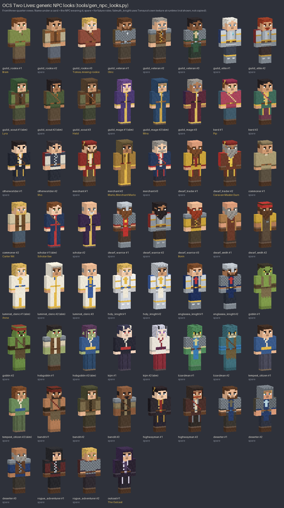

# Art guide: style, skins and image deliverables

For ChatGPT's creative work: the style of the world, the NPC skin system, and exactly what an image deliverable looks like (size, name, folder).
Back to the [knowledge pack](README.md).

## 1. The art style: Minecraft-scale, Tensura medieval fantasy

The game is Minecraft 1.21.1. Everything we draw must be something a builder can **translate into blocks** (or a 64 x 64 skin). Concept art is
allowed to be beautiful, but it must be buildable.

**Minecraft-scale rules**
- One block is one metre. A player is 1.8 blocks tall and 0.6 wide; a door is 1 x 2; rooms are at least 3 blocks high; a stair step or slab is half a block.
- Nothing smaller than a block (curves are staircases, ornament is made of stairs, slabs, walls, fences, trapdoors, banners, lanterns, vines).
- Silhouette first: roofs, towers, domes, arches and gates are readable from 50 blocks away. Use big shapes, few materials, strong value contrast.
- 3 to 6 materials per building, not 20. Warm light from lanterns, campfires and glow berries; cold light from sea lanterns and amethyst for magic.
- Terrain is part of the design: say where the hill, the slope, the water, the trees are. The owner's rule is **no structures pasted on**: a place grows out of its ground.
- Show **one clear view per image**: a three-quarter view from a walking height or a high isometric view. No text, no captions, no logos, no UI, no watermarks.

**Tensura medieval fantasy**
- The Western Nations are late-medieval European: stone and timber, slate and tile, banners, guild halls. The monster nations are rustic and handmade (Tempest is wood, thatch and hide at first); Tempest, the ogres' kijin and the Eastern lands carry a Japanese influence (kimono, obi, lanterns, torii-like gates, curved roofs).
- Magic is quiet and visual: glowing runes, floating lamps, crystal, amethyst, an eerie teal or violet glow. No guns, no modern things.
- The anime's look is warm and slightly saturated; our Minecraft version flattens it to a few colours per material.

**House palettes** (from the faction heraldry and the lore pages; our interpretation, not official)

| Place | Colours and materials |
|---|---|
| Tempest | Light blue and sage green with gold, a storm-eye emblem; oak, dark oak, thatch, hide tents; later white plaster and blue roofs. Japanese touches for the kijin |
| Dwargon | Red anvil on warm yellow; grey stone (gravel, tuff, cobble), white gate wall, copper bulbs, forge glow |
| Blumund | Red and cream banners, ear of grain; a compact walled market town |
| Falmuth / Marris | Blue and white banners (bridge under a crown), pale stone, white quartz, verdigris copper roofs |
| Englassia | Navy with crimson, teal copper roofs on the Academy, slate on the Guild and the gate |
| Holy Church / Lubelius | Ivory and white with gold, a gold cross, light-blue banners |
| Lizardmen | Green and teal with a blue band, reeds, stilts, bone |
| Orc Horde | Dark field, ochre, pale tusks; mud, bone, crude timber |
| Eurazania / Laura | Gold and brown, lion totems, thatch, jungle wood, fruit |
| Milim / Forgotten Dragon | Mud brick, thatch cones, bone and skull, pink banners (her colour) |
| Jistav / Clayman | Gloom: dark forest, moat, bone, soul lanterns, pierrot masks |
| Eastern Empire | Red flame devices, dark green roofs with copper scrolls, amber glass |
| El Dorado / Leon | White and gold, red runner, six-pointed star, purple-red upholstery |
| Frost Palace / Guy | Blue ice over white masonry, violet lamps, quartz |
| Outcast Society | Deep purple hooded cloak, a broken pale star |

The full colour reasoning is in [`design/lore/heraldry.md`](../../design/lore/heraldry.md) (the eight faction shields: [`docs/previews/heraldry.png`](../previews/heraldry.png)),
[`design/lore/skins.md`](../../design/lore/skins.md) and each place's lore page.

## 2. Concept art per place

One image and one short note per place, for the 58 places of [world.md](world.md). The place page says what the place is; this folder says how it looks.

```
docs/art/places/<id>.png        the concept art
docs/art/places/<id>.md         its note (what it shows, references, interpretation marks)
docs/art/places/<id>-plan.png   optional: a top-down plan sketch (for builds)
```

- `<id>` is the anchor id exactly as in [`places/`](places/) and in `design/data/anchors.toml`: `tempest`, `sealed_cave`, `ogre_village_ruin`, ... lowercase, underscores, no spaces.
- **Image**: PNG, landscape **1536 x 1024** (the native size of ChatGPT's image generator; do not upscale), RGB, no alpha, no text. Keep each file under **3 MB** (optimise it); the whole `docs/art/` folder must stay small. A plan sketch is the same size or square 1024 x 1024.
- **View**: a three-quarter view from the approach path at walking height for a small place; a high isometric view for a town or a mountain. Show the terrain, the sky, the vegetation, the light.
- **Style**: section 1. Painterly is fine, photoreal is not. It should read as "this could be built in Minecraft".
- **Original work only.** Do not trace or reproduce official art, anime frames, other maps, mods or builds. Use them as references (list them in the note), not as a source image. No Tensura mod textures (All Rights Reserved).

The note `<id>.md` has this shape:

```markdown
# <place name> (`<id>`): concept art


- **Brief**: one sentence (what the picture shows, from where, at what time of day).
- **Canon**: what the series or novel says (with links), kept apart from ...
- **Our interpretation**: ... everything we invented. Mark it.
- **Block notes**: main materials and colours, 3 to 6 blocks; the silhouette; the lighting.
- **Terrain**: where it sits (hill, cliff, lake, forest edge) and what the ground should do.
- **Prompt**: the image prompt used (so it can be repeated or improved).
- **References**: links to stills, official art, novels, real buildings. Reference only.
```

Start from the places with an open problem (the audit marks them): `ogre_village_ruin`, `orc_camp`, `dwarf_village`, `tempest`, `treyni_shrine`, `dwargon`, `dwarven_arena`, then the rest.

## 3. Blueprint-oriented art

Blueprints are code ([builds.md](builds.md)). For a new or improved build a good ChatGPT deliverable is a **plan and elevation sketch** plus a short **block brief**:
`docs/art/places/<id>-plan.png` (top-down plan with the main axes and approximate dimensions in blocks) and, in the note, a table of rooms and heights. Claude turns it into the blueprint
or reviews a blueprint file ChatGPT writes. The existing previews in [`docs/previews/`](../previews/README.md) show the style of the finished builds.

## 4. NPC skins

NPCs are Easy NPC entities that wear 64 x 64 Minecraft skin textures. There are two kinds:

1. **Named characters** (Rimuru's circle, kings, demon lords, ...): 28 original pixel-art skins drawn by `tools/gen_skins.py`, documented with their reference cues in [`design/lore/skins.md`](../../design/lore/skins.md). (Characters that already have an entity in the Tensura mod use the mod's own entity, never a rebuilt skin.)
2. **Generic NPCs** (guild adventurers, merchants, dwarves, goblins, the Church, knights, citizens): 23 archetypes ("looks") with 50 variants, composed from parts by `tools/gen_npc_looks.py` from the catalogue [`tools/npc_looks.py`](../../tools/npc_looks.py).
   The contact sheet is [`docs/previews/npc_skins.png`](../previews/npc_skins.png).



*The generic NPC looks (original pixel art; one card per variant, the name under a card is the NPC wearing it).*

**Nicer skins by hand** are welcome: the ready-made prompts and workflow are in [`docs/art/npc-skin-prompts.md`](../art/npc-skin-prompts.md) (a shared preamble plus one block per archetype). The deliverable:

- A **64 x 64 PNG** in the standard modern skin layout (head, hat overlay, body, jacket overlay, arms and legs with sleeve and pants overlays), opaque base layer, transparent overlays where unused.
- The arm model of the variant: **classic** (4 px arms) or **slim** (3 px arms). Say which.
- Name `docs/art/npc/hand_<look>_<n>.png`, where `<look>` is the archetype from `tools/npc_looks.py` (`guild_rookie`, `dwarf_smith`, `kijin`, ...) and `<n>` the variant number it replaces or a new one. Claude moves the file into the pack (`pack/kubejs/assets/ttl/textures/entity/npc/`), edits the catalogue and regenerates (`gen_npc_looks.py`, `gen_npcs.py`, `packwiz refresh`).
- Plus a front and back render for review (`docs/art/npc/hand_<look>_<n>-preview.png`).
- **Original only**: no traced official art, no skins from skin sites without a clear licence, no Tensura mod textures (the mod's `falmuth_knight` skin is referenced at run time and never copied). Add the source to the note; Claude adds it to `CREDITS.md`.

Costume ideas for each archetype are in `docs/art/npc-skin-prompts.md`; our palettes follow the heraldry above.

## 5. Other image deliverables

| Deliverable | Location and shape |
|---|---|
| **World map drawing** | The spec follows in [tasks.md](tasks.md) ("World map deliverable spec"). The old world as reference: [source-map/](source-map/README.md) |
| Concept art per place | `docs/art/places/<id>.png` + `.md` (section 2) |
| Plan sketch of a build | `docs/art/places/<id>-plan.png` |
| NPC skin | `docs/art/npc/hand_<look>_<n>.png` (section 4) |
| Faction banner or shield | `docs/art/heraldry/<faction>.png` (a flat 64 x 64 or 128 x 128 pixel shield; see `design/lore/heraldry.md` for the eight existing) |
| Item or icon | `docs/art/items/<name>.png`, 16 x 16 pixel art for a Minecraft item (original; never recolour a mod's texture) |

Always include the credit and the "original, not traced" statement in the note; keep file names lowercase with underscores; one small pull request per item
([README.md](README.md)).
