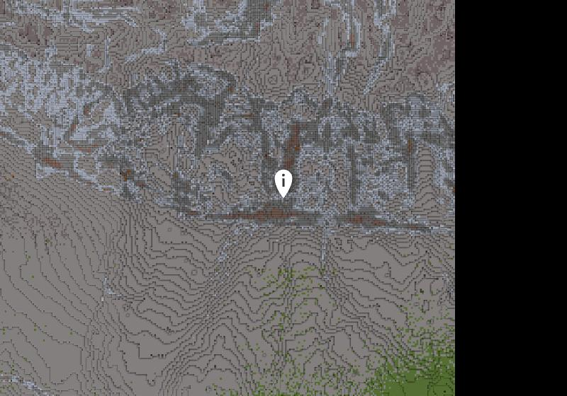

# Great Ameld headwater reservation

`id: ameld_source` · unplated map pin · gameplay region **D**

| Registration | Current authored own-world map |
| --- | --- |
| Centre (x, z) | **200, -1240**; east +x, south +z |
| Normal exported y | **91** |
| Marker | radius8, `clearing`, margin24; `plated=false` |
| Authority | [map.svg](../../../world/map.svg), canonical source `534d07ad` |
| Historical imported anchor | 2500, -200; not the current drawing or a canonical survey |

## Source scope

[Author WN chapter13](https://ncode.syosetu.com/n6316bn/14/#L47) places Dwargon at Canaat's foot near the upper Ameld; [L51](https://ncode.syosetu.com/n6316bn/14/#L51) describes northward travel along it. These are WN claims, not directly verified LN bearings. The [official map glossary](https://www.ten-sura.com/map) independently says the river crosses Jura and enters Siss. Neither source surveys this particular spring.

See [current river source review](../../research/tensura-world-2026-11-19/ameld-current-source-review.md), ledger OFF-001 / WN13-003–004 / WN31-002–003 / DES-002, and [regions](../../../world/regions.md). Equivalent LN passage, exact source/mouth and complete river network remain C03. No verified close-up anime frame or timestamp is claimed.

## Creative direction

A modest rock seep feeding the single authored 10-block channel, with grey foothill stone and low woodland margins. Exact spring, vegetation, water steps and viewpoint are our interpretation. No shrine, dragon nest or separate lake is prescribed.

This is a radius8 location reservation, not the whole landform, a building footprint or a dry terrain plate. Use the normal exported water profile for terrain; the concept image does not prescribe numerical fall heights. Initial era is immediately after Kijin naming (anime S1E10); enduring geography does not authorize later construction.

[Original concept and exact prompt](../../art/places/ameld_source.md). Keep prompt provenance intact. Any player text must be EN+NL.

## Historical BlueMap audit — 19 November 2026

The following describes retired imported terrain. Rendering status, screenshots and pre-generation notes are historical, not current own-world acceptance.

Historical imported map: Tensura by Lerfing. The screenshots are from the public BlueMap; positions and terrain will change with the new world, the lore and the design intent above will not.

- **Status:** OK
- **Placed:** not applicable (no structure: pin)
- Mountain valley in Dwargon; pin only.

  
*Top-down, about 300 blocks across. Historical imported map: Tensura by Lerfing.*

  
*3D perspective, about 100 blocks. Historical imported map: Tensura by Lerfing.*

Back to the [world guide](../world.md) · [knowledge pack](../README.md).
