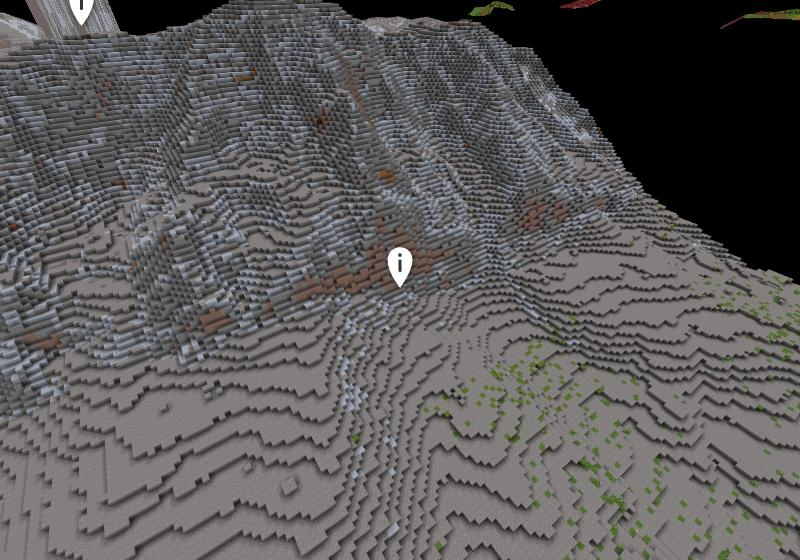

# Great Ameld River source (Canaat foothills)

`id: ameld_source` · map pin only · region **D** (Armed Nation of Dwargon)

| | |
|---|---|
| Anchor (Lerfing's map, x, z) | **2500, -200** (x grows east, z grows south) |
| Audit status (19/11/2026) | **OK** |
| Lore | [`design/lore/world.md`](../../../design/lore/world.md), section D |

## Lore (canon)

The Great Ameld flows from the foot of the Great Canaat Mountains to the southern ocean, feeding the fertile plains of Milim's land (the wiki). Our reading: its brook feeds the Jura lakes and Lake Siss.

## What it should look like

A cold spring in a mountain valley; the first trickle of a long river. Pin only.

Why it stands here (anchor table, Lerfing coordinates): Apron foot; the brook that feeds the Jura lakes (our reading).

## Current state: BlueMap audit of 19/11/2026

Map: Tensura by Lerfing (current, being replaced). The screenshots are from the public BlueMap; positions and terrain will change with the new world, the lore and the design intent above will not.

- **Status:** OK
- **Placed:** not applicable (no structure: pin)
- Mountain valley in Dwargon; pin only.

  
*Top-down, about 300 blocks across. Map: Tensura by Lerfing (current, being replaced).*

  
*3D perspective, about 100 blocks. Map: Tensura by Lerfing (current, being replaced).*

## What ChatGPT can deliver for this place

- Concept art: `docs/art/places/ameld_source.png` + `docs/art/places/ameld_source.md` (see [art.md](../art.md)).
- Lore and quest text in EN and NL for this place (see [tasks.md](../tasks.md)).

Back to the [world guide](../world.md) · [knowledge pack](../README.md)
