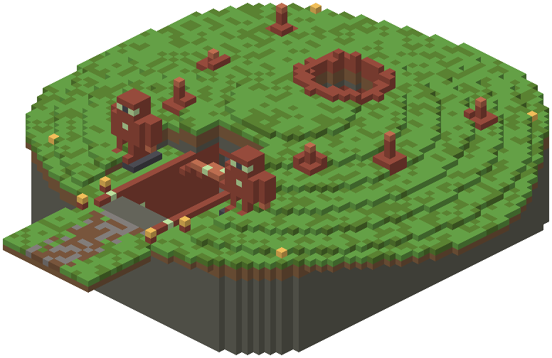

# Amrita (Jistav capital)

**Own-world source correction:** the current circle(3800,-500), radius63, is an eastern **game reservation**, not a verified independent surface-city/entrance coordinate. Official episode81 places the ancient ruins beneath Clayman's former castle. Current rule E350..700 and the existing external mound/shaft need C07 access/marker reconciliation; only an inert alternative is drawn, with no assigned depth. Later expedition/access/NPC states are not the initial post-Kijin world. The positions in the retired Lerfing audit below do not define canonical geography. [Source and placement study](../../../world/amrita-placement-review.md).

`id: amrita` · build (our blueprint) · region **P** (Puppet Nation of Jistav)

| | |
|---|---|
| Anchor (Lerfing's map, x, z) | **6100, -650** (x grows east, z grows south) |
| Audit status (19/11/2026) | **OK** |
| Blueprint | [`blueprints/amrita.py`](../../../blueprints/amrita.py), 69 x 32 x 75 blocks (x, y, z), anchor [34, 16, 68] |
| Preview (blueprint only) |  |
| Lore page | [`design/lore/amrita.md`](../../../design/lore/amrita.md) |

## Lore (canon)

The publisher-hosted [LN10 prologue](https://gcnovels.jp/reading/slime10.htm) describes Kazalim founding Amrita as a refuge-city modelled on the lost homeland after fleeing Soma. It distinguishes the wards/golems defending Amrita from Adalman’s surface-city defence. The checked passage supplies no exact founding year; the earlier 2,000-year figure is unverified here. The [official episode81 synopsis](https://www.ten-sura.com/anime/tensura/story/no86) places the ruins beneath Clayman’s former castle. Exact depth, full extent and initial access remain unverified; later investigation or defense activation is not an initial S1E10 event.

## What it should look like

A grassy mound over the old capital; broken column bases around an open shaft; between two stone wardens a flight of steps descends under three surviving lintels into a vaulted nave with eight memorial alcoves, a sealed door with luminous joints and an oculus letting daylight on a patterned floor.

Why it stands here (anchor table, Lerfing coordinates): Jistav's plain.

## Current state: BlueMap audit of 19/11/2026

Map: Tensura by Lerfing (current, being replaced). The screenshots are from the public BlueMap; positions and terrain will change with the new world, the lore and the design intent above will not.

- **Status:** OK
- **Placed:** 6100 76 -650 (corner 6066 60 -718)
- Buried gallery in badlands; verify 100 %.

  
*Top-down, about 300 blocks across. Map: Tensura by Lerfing (current, being replaced).*

  
*3D perspective, about 100 blocks. Map: Tensura by Lerfing (current, being replaced).*

## What ChatGPT can deliver for this place

- Concept art: `docs/art/places/amrita.png` + `docs/art/places/amrita.md` (see [art.md](../art.md)).
- Blueprint design notes or a Python blueprint in the format of [builds.md](../builds.md) (never the placement data: that is Claude's).
- Lore and quest text in EN and NL for this place (see [tasks.md](../tasks.md)).

Back to the [world guide](../world.md) · [knowledge pack](../README.md)
