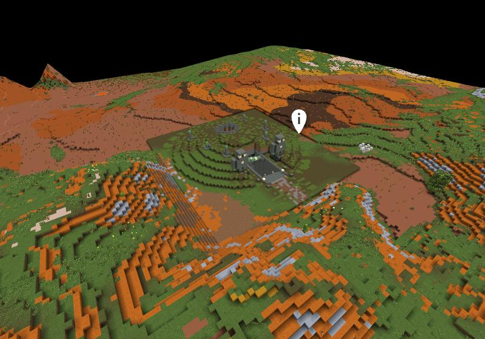

# Amrita (Jistav capital)

`id: amrita` · build (our blueprint) · region **P** (Puppet Nation of Jistav)

| | |
|---|---|
| Anchor (Lerfing's map, x, z) | **6100, -650** (x grows east, z grows south) |
| Audit status (19/11/2026) | **OK** |
| Blueprint | [`blueprints/amrita.py`](../../../blueprints/amrita.py), 69 x 32 x 75 blocks (x, y, z), anchor [34, 16, 68] |
| Preview (blueprint only) |  |
| Lore page | [`design/lore/amrita.md`](../../../design/lore/amrita.md) |

## Lore (canon)

Founded 2,000 years ago as a haven for dark elves, modelled on Soma by Kazalim, with magical defences including golems (light novel vol. 10).

## What it should look like

A grassy mound over the old capital; broken column bases around an open shaft; between two stone wardens a flight of steps descends under three surviving lintels into a vaulted nave with eight memorial alcoves, a sealed door with luminous joints and an oculus letting daylight on a patterned floor.

Why it stands here (anchor table, Lerfing coordinates): Jistav's plain.

## Current state: BlueMap audit of 19/11/2026

Map: Tensura by Lerfing (current, being replaced). The screenshots are from the public BlueMap; positions and terrain will change with the new world, the lore and the design intent above will not.

- **Status:** OK
- **Placed:** 6100 76 -650 (corner 6066 60 -718)
- Buried gallery in badlands; verify 100 %.

  
*Top-down, about 300 blocks across. Map: Tensura by Lerfing (current, being replaced).*

  
*3D perspective, about 100 blocks. Map: Tensura by Lerfing (current, being replaced).*

## What ChatGPT can deliver for this place

- Concept art: `docs/art/places/amrita.png` + `docs/art/places/amrita.md` (see [art.md](../art.md)).
- Blueprint design notes or a Python blueprint in the format of [builds.md](../builds.md) (never the placement data: that is Claude's).
- Lore and quest text in EN and NL for this place (see [tasks.md](../tasks.md)).

Back to the [world guide](../world.md) · [knowledge pack](../README.md)
