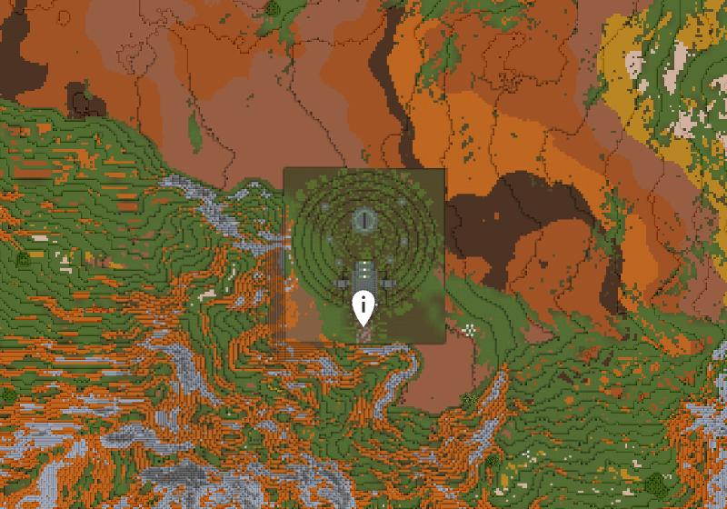

> **Current owner decision:** Amrita is to be nested beneath Clayman's castle;the independent eastern reservation is superseded. [Approved target/technical adoption](../../../world/amrita-approved.md). Existing serialized coordinates and the public-shaft blueprint are migration inputs,not the selected final geography. Exact depth,extent and initial access remain unverified.

# Amrita (Jistav capital)

**Own-world source correction:** the current circle(3800,-500), radius63, is an eastern **game reservation**, not a verified independent surface-city/entrance coordinate. Official episode81 places the ancient ruins beneath Clayman's former castle. Current rule E350..700 and the existing external mound/shaft need C07 access/marker reconciliation; only an inert alternative is drawn, with no assigned depth. Later expedition/access/NPC states are not the initial post-Kijin world. The positions in the retired Lerfing audit below do not define canonical geography. [Source and placement study](../../../world/amrita-placement-review.md).

`id: amrita` · build (our blueprint) · region **P** (Puppet Nation of Jistav)

| | |
|---|---|
| Anchor (Lerfing's map, x, z) | **6100, -650** (x grows east, z grows south) |
| Audit status (19/11/2026) | **OK** |
| Blueprint | [`blueprints/amrita.py`](../../../blueprints/amrita.py), 69 x 32 x 75 blocks (x, y, z), anchor [34, 16, 68] |
| Preview (blueprint only) |  |
| Lore page | [`design/lore/amrita.md`](../../../design/lore/amrita.md) |

## Lore (canon)

The publisher-hosted [LN10 prologue](https://gcnovels.jp/reading/slime10.htm) describes Kazalim founding Amrita as a refuge-city modelled on the lost homeland after fleeing Soma. It distinguishes the wards/golems defending Amrita from Adalman’s surface-city defence. The checked passage supplies no exact founding year; the earlier 2,000-year figure is unverified here. The [official episode81 synopsis](https://www.ten-sura.com/anime/tensura/story/no86) places the ruins beneath Clayman’s former castle. Exact depth, full extent and initial access remain unverified; later investigation or defense activation is not an initial S1E10 event.

## Creative direction and implementation limit

Use the [source-led dormant gallery concept](../../art/places/amrita.md): enclosed old masonry, continuous dark roof, original abstract reliefs, dry patterned floor and a closed door. Exact ribs, alcoves, lighting, guardians and dimensions are our interpretation. The later anime stills provide cavern/mural/warded-door vocabulary, not a surveyed layout or proof of S1E10 access.

The existing blueprint's grassy mound, open shaft, oculus and exterior approach are historical server design. Its `hillside()` routine builds an exposed grassy approach and clears space above it; that code is not evidence of a canonical entrance. Do not recreate those surface openings as canon when converting this map. The concept deliberately excludes them; the technical blueprint is unchanged and still requires reconciliation.

The [current marker-only nesting trial](../../../world/amrita-current-nesting-review.md) shows why simply moving the radius63 circle onto the castle is insufficient: it fails four default rules. Actual depth, complete ruin extent, initial access and a nested carve/parent representation remain unresolved. The castle-centred trial coordinates are our interpretation; the official synopsis does not survey the ruin centre. No final depth or live placement is authorized by this brief.

## Historical BlueMap audit — 19 November 2026

These screenshots and placement coordinates describe retired imported Lerfing terrain. They do not verify the current own-world source, nested geometry or initial-era access.

- **Status:** OK
- **Placed:** 6100 76 -650 (corner 6066 60 -718)
- Buried gallery in badlands; verify 100 %.

  
*Top-down, about 300 blocks across. Map: Tensura by Lerfing (current, being replaced).*

  
*3D perspective, about 100 blocks. Map: Tensura by Lerfing (current, being replaced).*

## What ChatGPT can deliver for this place

- Concept art: `docs/art/places/amrita.png` + `docs/art/places/amrita.md` (see [art.md](../art.md)).
- Blueprint design notes or a Python blueprint in the format of [builds.md](../builds.md) (never the placement data: that is Claude's).
- Lore and quest text in EN and NL for this place (see [tasks.md](../tasks.md)).

Back to the [world guide](../world.md) · [knowledge pack](../README.md)
