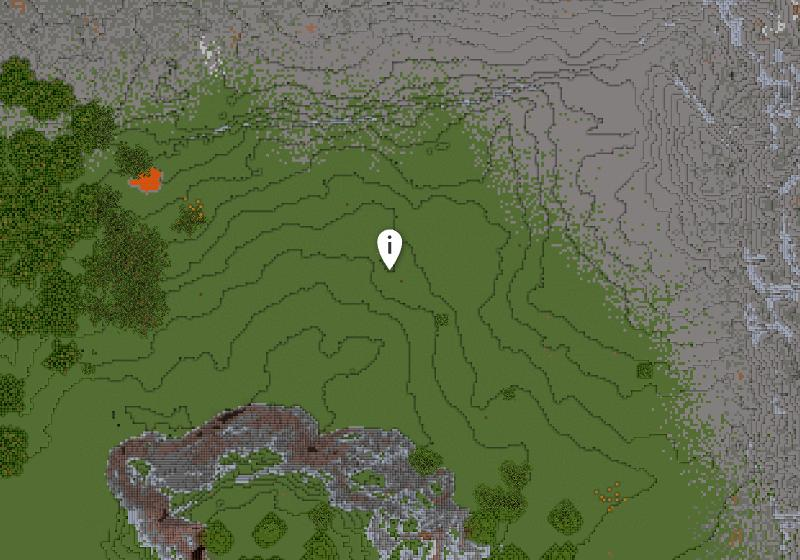
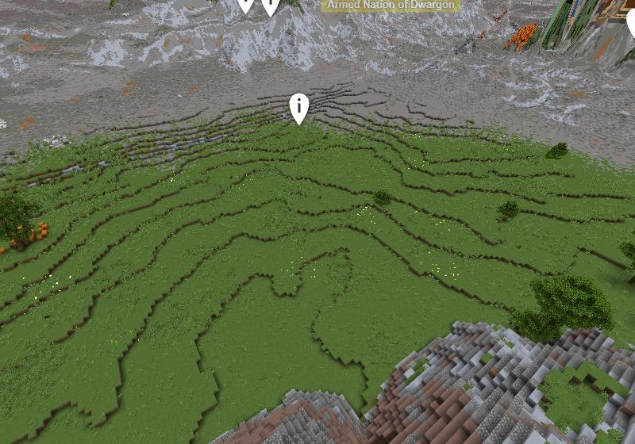

# Life 2 arrival (world spawn), yaw -149

`id: arrival` · Life 2 arrival · region **J** (Jura; future Tempest gameplay region)

| | |
|---|---|
| Anchor (Lerfing's map, x, z) | **1660, -100** (x grows east, z grows south) |
| Audit status (19/11/2026) | **OK** |
| Lore | [`design/lore/world.md`](../../../design/lore/world.md), section J (landmarks), `design/data/arrival.toml` |

## Lore (canon)

Not a canon place: the pack's rule. A reincarnated soul must not appear in the deadly magicule heart of the Jura forest, so souls arrive on the forest's outer rim, 1,000 blocks north of Tempest and about 500 blocks south of Dwargon's gate, facing the gate.

## What it should look like

Open, level, natural ground at the edge of the forest, in a clearing with a spawn-free radius of 48 blocks and the Dwarven Road passing 30 blocks to the east. The newcomer should read two directions at once: the white gate of Dwargon uphill to the north, the dark old forest of Jura to the south. Small wayfarers' camp 15 blocks away. No building: concept art for a quiet, slightly ominous first view is welcome.

Why it stands here (anchor table, Lerfing coordinates): Jura's safe outer rim on the way from Tempest to the Dwargon gate, 1,000 N of Tempest, ~175 blocks inside Jura's border with the Canaat apron; outside the dark band (r 600 + 50). WP-L4 moved it from the design's (1780, -150), where 42 % of the 40-block area was the repainted Canaat apron (stony_peaks: Tensura mountain spawns such as the basilisk) from 6 blocks east: here 100 % plains within 64 blocks and 98 % within 100 (the rest badlands, no stony_peaks), no water within 128, ground y 71/73/75 within 40 on the imported world. Hostile-spawn-free radius 48 (arrival.toml safe_radius, owner 19/11/2026).

## Current state: BlueMap audit of 19/11/2026

Map: Tensura by Lerfing (current, being replaced). The screenshots are from the public BlueMap; positions and terrain will change with the new world, the lore and the design intent above will not.

- **Status:** OK
- **Placed:** 1664 74 -96
- Plains, open ground, grounded at 1664 74 -96 (6 blocks from the anchor). An orange patch (probably surface lava) lies about 100 blocks west at ~1570 -136, outside the 48-block safe radius.

  
*Top-down, about 300 blocks across. Map: Tensura by Lerfing (current, being replaced).*

  
*3D perspective, about 100 blocks. Map: Tensura by Lerfing (current, being replaced).*

## What ChatGPT can deliver for this place

- Concept art: `docs/art/places/arrival.png` + `docs/art/places/arrival.md` (see [art.md](../art.md)).
- Lore and quest text in EN and NL for this place (see [tasks.md](../tasks.md)).

Back to the [world guide](../world.md) · [knowledge pack](../README.md)
