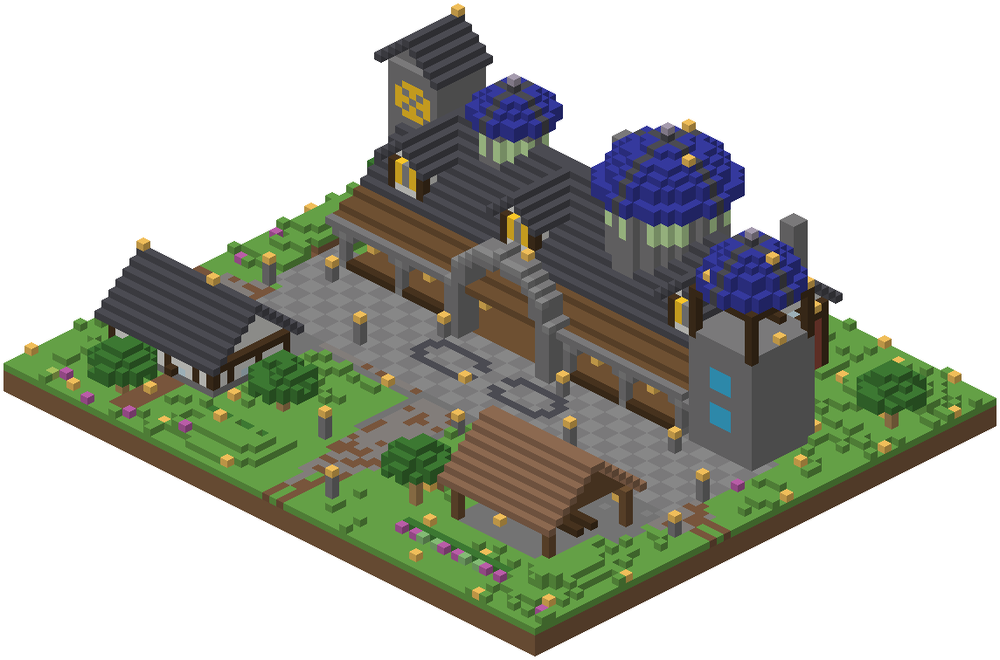
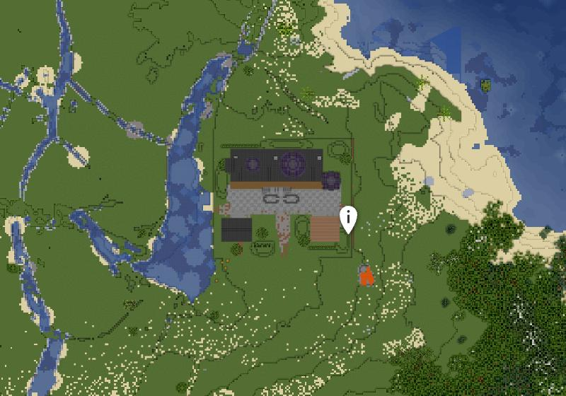

# Ballachia

`id: ballachia` · build (our blueprint) · region **G** (Kingdom of Englassia)

| | |
|---|---|
| Anchor (Lerfing's map, x, z) | **-1660, -460** (x grows east, z grows south) |
| Audit status (19/11/2026) | **OK** |
| Blueprint | [`blueprints/ballachia.py`](../../../blueprints/ballachia.py), 76 x 38 x 66 blocks (x, y, z), anchor [38, 4, 41] |
| Preview (blueprint only) |  |
| Lore page | [`design/lore/ballachia.md`](../../../design/lore/ballachia.md) |

## Lore (canon)

After Masayuki's party exposes Orthrus in the small kingdom of Ballachia, the freed elves need safe passage to the Jura forest (light novel chapter 108, anime episode 65).

## What it should look like

The yard imagines the freed travellers' departure: a colonnade under a long eave, a ribbed slate-blue dome above a ring of tall windows, small domes with slender smoking chimneys, a deep round arch and a glowing circular tracery window; six open bays with remnants of iron partitions; parted chain links in the paving leading to a canvas-topped wagon; an eastbound road, lodging house, carters' shelter and memorial.

Why it stands here (anchor table, Lerfing coordinates): On the eastbound road between Londo and Lura, Englassian side; flat.

## Current state: BlueMap audit of 19/11/2026

Map: Tensura by Lerfing (current, being replaced). The screenshots are from the public BlueMap; positions and terrain will change with the new world, the lore and the design intent above will not.

- **Status:** OK
- **Placed:** -1696 66 -472 (corner -1734 62 -513)
- Plains between a river and the coast; verify 100 %.

  
*Top-down, about 300 blocks across. Map: Tensura by Lerfing (current, being replaced).*

  
*3D perspective, about 100 blocks. Map: Tensura by Lerfing (current, being replaced).*

## What ChatGPT can deliver for this place

- Concept art: `docs/art/places/ballachia.png` + `docs/art/places/ballachia.md` (see [art.md](../art.md)).
- Blueprint design notes or a Python blueprint in the format of [builds.md](../builds.md) (never the placement data: that is Claude's).
- Lore and quest text in EN and NL for this place (see [tasks.md](../tasks.md)).

Back to the [world guide](../world.md) · [knowledge pack](../README.md)
