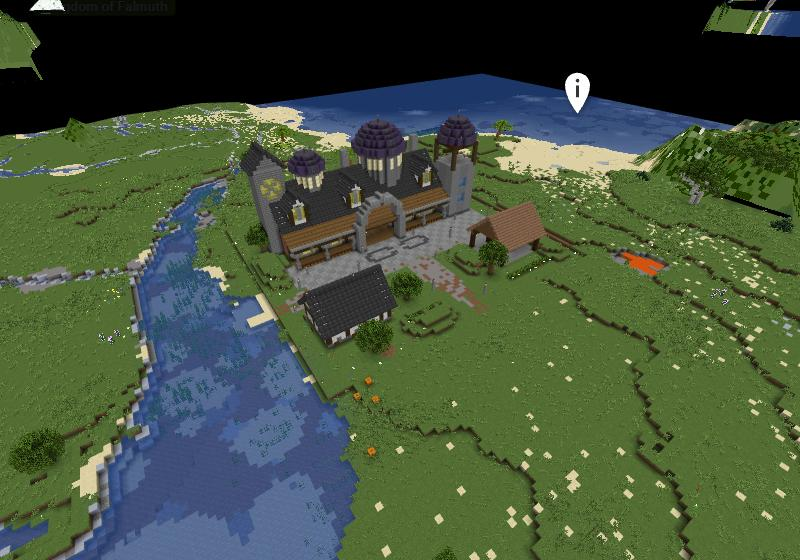

# Ballachia

`id: ballachia` · build (our blueprint) · gameplay region **G** (not a sovereign-country claim)

| | |
|---|---|
| Own-world reservation (x, z) | **-2450, -450**, radius **68**, clearing; authored precinct, not a verified capital |
| Historical Lerfing anchor | **-1660, -460** (retired source map) |
| Historical placement audit (19/11/2026) | **OK on the retired map; not own-world acceptance** |
| Blueprint | [`blueprints/ballachia.py`](../../../blueprints/ballachia.py), 76 x 38 x 66 blocks (x, y, z), anchor [38, 4, 41] |
| Preview (blueprint only) |  |
| Lore page | [`design/lore/ballachia.md`](../../../design/lore/ballachia.md) |

## Source context and initial-era limit

Official [episode65/route69](https://www.ten-sura.com/anime/tensura/story/no69) reports Masayuki's later defeat of Orthrus. The [publisher episode review](https://thetv.jp/news/detail/1211892/p2/) explicitly names Ballachia; this is secondary editorial evidence without a geographical survey. The establishing-frame claim remains unverified; chapter108 is a **manga** chapter, not a light-novel chapter. Its story pages were not read in this pass. These later events do not establish the initial post-Kijin state.

## What it should look like

For the initial snapshot, use a neutral covered cart court with restrained dome/eave/window cues as original architecture. Do not show a completed rescue,broken chains,freed-traveller procession or liberation memorial. The earlier six-bay departure-yard blueprint remains later scenario design requiring era review; its existence does not prove a canonical initial building plan.

[Neutral initial-era candidate and comparison](../../../world/ballachia-initial-r101.md): 142 bounded block replacements; unregistered and not generated or placed. The old registered blueprint remains a later-scenario model. The own-world reservation is an authored design choice; capital, country extent and initial architecture remain open.

## Historical state: BlueMap audit of 19/11/2026

Map: Tensura by Lerfing (historical, being replaced). The screenshots are from the public BlueMap; positions and terrain belong to the retired map. Use the corrected initial-era lore above for the new world.

- **Status:** OK
- **Placed:** -1696 66 -472 (corner -1734 62 -513)
- Plains between a river and the coast; verify 100 %.

  
*Top-down, about 300 blocks across. Map: Tensura by Lerfing (historical, being replaced).*

  
*3D perspective, about 100 blocks. Map: Tensura by Lerfing (historical, being replaced).*

## What ChatGPT can deliver for this place

- Concept art: `docs/art/places/ballachia.png` + `docs/art/places/ballachia.md` (see [art.md](../art.md)).
- Blueprint design notes or a Python blueprint in the format of [builds.md](../builds.md) (never the placement data: that is Claude's).
- Lore and quest text in EN and NL for this place (see [tasks.md](../tasks.md)).

Back to the [world guide](../world.md) · [knowledge pack](../README.md)
