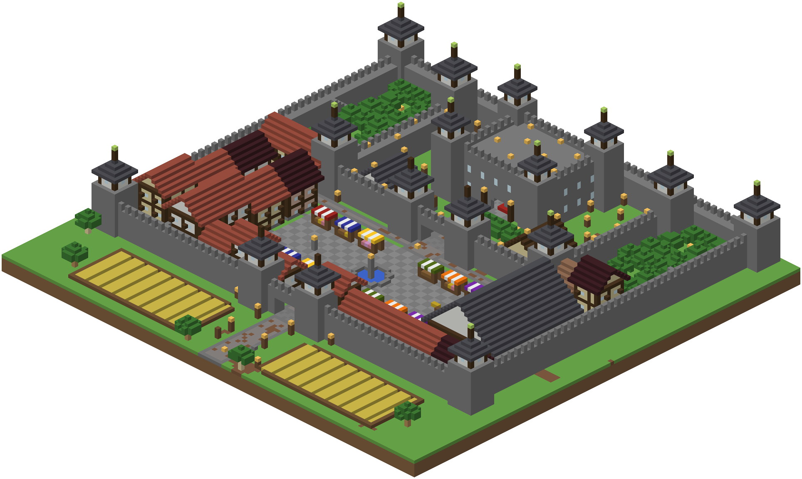
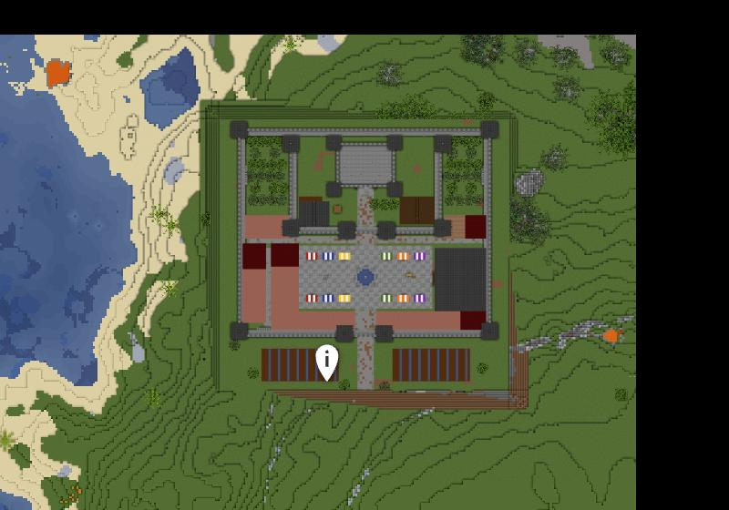
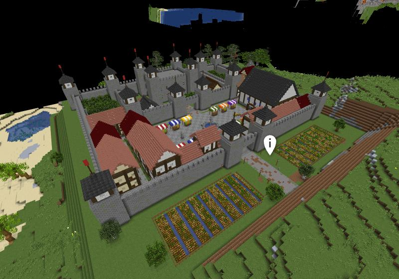

# Blumund capital (Londo): Fuze, the guild

`id: blumund` · build (our blueprint) · region **R** (Kingdom of Blumund)

| | |
|---|---|
| Anchor (Lerfing's map, x, z) | **-450, 150** (x grows east, z grows south) |
| Audit status (19/11/2026) | **OK** |
| Blueprint | [`blueprints/blumund.py`](../../../blueprints/blumund.py), 124 x 52 x 116 blocks (x, y, z), anchor [62, 5, 72] |
| Preview (blueprint only) |  |
| Lore page | [`design/lore/blumund.md`](../../../design/lore/blumund.md) |

## Lore (canon)

A small kingdom on Jura's border under King Drum Blumund, essentially one royal capital. The Free Guild branch here is led by Fuze; Kabal, Eren and Gido are its adventurers.

## What it should look like

A compact walled town on plains by a lake: red and cream banners (colours are ours), a royal castle at the end of the main street, and the guild hall as the biggest civic building on the market square, with a mezzanine office for Fuze (desk, map table, cot).

Why it stands here (anchor table, Lerfing coordinates): The small kingdom right at Jura's door, by the inlet; y 75/79/85.

## Current state: BlueMap audit of 19/11/2026

Map: Tensura by Lerfing (current, being replaced). The screenshots are from the public BlueMap; positions and terrain will change with the new world, the lore and the design intent above will not.

- **Status:** OK
- **Placed:** -434 77 110 (corner -496 72 38)
- Walled town on plains by a lake, 43 blocks from the canon point; verify 100 %.

  
*Top-down, about 300 blocks across. Map: Tensura by Lerfing (current, being replaced).*

  
*3D perspective, about 100 blocks. Map: Tensura by Lerfing (current, being replaced).*

## What ChatGPT can deliver for this place

- Concept art: `docs/art/places/blumund.png` + `docs/art/places/blumund.md` (see [art.md](../art.md)).
- Blueprint design notes or a Python blueprint in the format of [builds.md](../builds.md) (never the placement data: that is Claude's).
- Lore and quest text in EN and NL for this place (see [tasks.md](../tasks.md)).

Back to the [world guide](../world.md) · [knowledge pack](../README.md)
