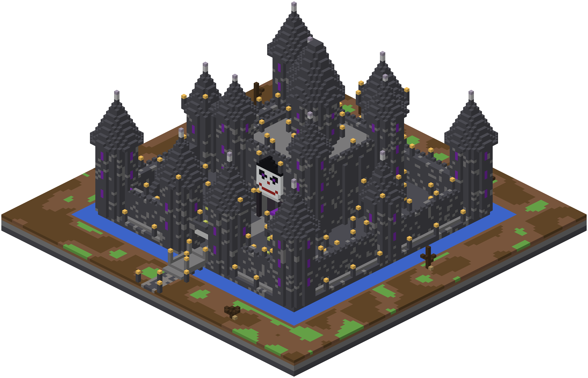
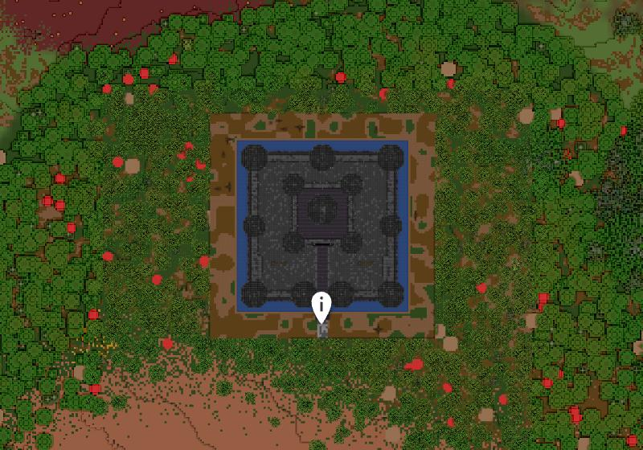
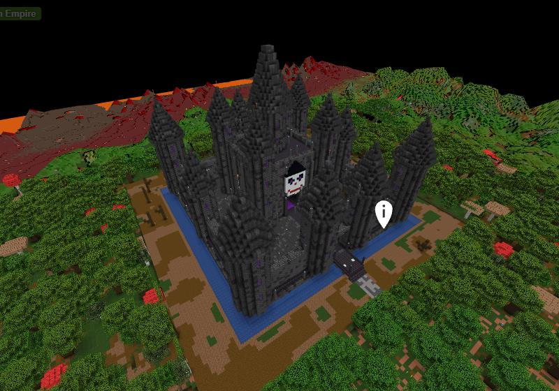

# Clayman's Castle (Walpurgis gate inside)

`id: clayman_castle` · build (our blueprint) · region **P** (Puppet Nation of Jistav)

| | |
|---|---|
| Anchor (Lerfing's map, x, z) | **5620, -900** (x grows east, z grows south) |
| Audit status (19/11/2026) | **OK** |
| Blueprint | [`blueprints/clayman_castle.py`](../../../blueprints/clayman_castle.py), 109 x 66 x 109 blocks (x, y, z), anchor [54, 6, 102] |
| Preview (blueprint only) |  |
| Lore page | [`design/lore/clayman_castle.md`](../../../design/lore/clayman_castle.md) |

## Lore (canon)

At the initial snapshot, the stronghold belongs to Clayman; the later raid by Shuna, Souei and Hakurou has not happened. Its raid/fog reference describes later visual context, not an active initial deployment, defeated garrison or completed capture. A Walpurgis gate inside this build is a server interpretation, not proof that the later banquet or attack is already underway. Exact early garrison and room layout still need source review; see [era policy](../../../world/era.md).

## What it should look like

A full fortress: moat, curtain wall with gatehouse, four corner towers, keep; gloomy palette, dead trees on the bank; a giant pierrot mask over the keep door and on the throne hall's north wall; puppet stands (skulls on posts), gallows frames with chains and soul lanterns in the courtyard; marionette controllers (chains and soul lanterns on an iron crossbar) in the throne hall.

Why it stands here (anchor table, Lerfing coordinates): Jistav, south of the Empire's red crater, flat; WP-L1 repaint spot dark_forest r 180.

## Current state: BlueMap audit of 19/11/2026

Map: Tensura by Lerfing (current, being replaced). The screenshots are from the public BlueMap; positions and terrain will change with the new world, the lore and the design intent above will not.

- **Status:** OK
- **Placed:** 5620 75 -900 (corner 5566 69 -1002)
- Dark castle with moat in a dark forest; verify 100 %, moat water is the build's.

  
*Top-down, about 300 blocks across. Map: Tensura by Lerfing (current, being replaced).*

  
*3D perspective, about 100 blocks. Map: Tensura by Lerfing (current, being replaced).*

## What ChatGPT can deliver for this place

- Concept art: `docs/art/places/clayman_castle.png` + `docs/art/places/clayman_castle.md` (see [art.md](../art.md)).
- Blueprint design notes or a Python blueprint in the format of [builds.md](../builds.md) (never the placement data: that is Claude's).
- Lore and quest text in EN and NL for this place (see [tasks.md](../tasks.md)).

Back to the [world guide](../world.md) · [knowledge pack](../README.md)
