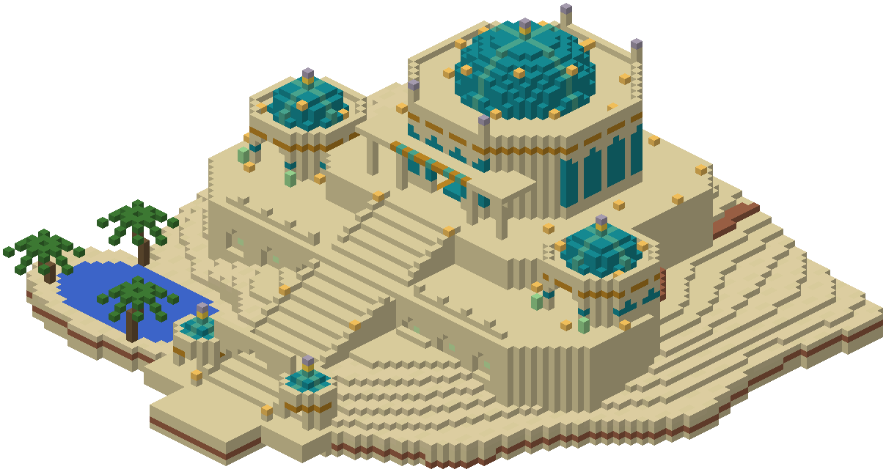
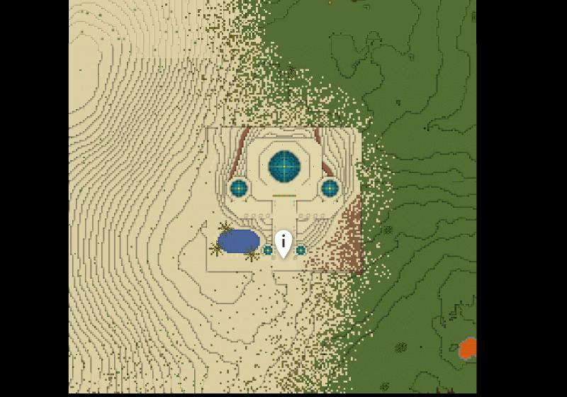
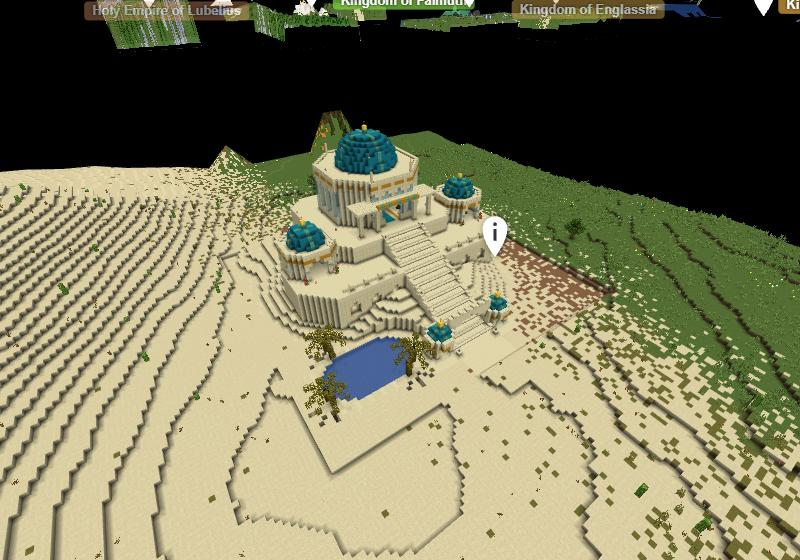

# Coleus

`id: coleus` · build (our blueprint) · region **V** (Holy Void of Damargania)

| | |
|---|---|
| Anchor (Lerfing's map, x, z) | **-3080, 600** (x grows east, z grows south) |
| Audit status (19/11/2026) | **OK** |
| Blueprint | [`blueprints/coleus.py`](../../../blueprints/coleus.py), 85 x 47 x 79 blocks (x, y, z), anchor [42, 4, 72] |
| Preview (blueprint only) |  |
| Lore page | [`design/lore/coleus.md`](../../../design/lore/coleus.md) |

## Lore (canon)

In the Visions of Coleus OVA Yuuki sends Rimuru to settle the succession dispute between two princes; Princess Zenobia lives in the palace.

## What it should look like

A palace high on a banded sandstone hill above a town; from the oasis two turquoise domes frame a straight royal stair that climbs to two garden terraces and a shaded loggia leading into the audience chamber; cyan tile and weathered copper on five domes against ochre stone; roses at the pavilion doors.

Why it stands here (anchor table, Lerfing coordinates): The Damargania border: desert edge, y 72/74/76.

## Current state: BlueMap audit of 19/11/2026

Map: Tensura by Lerfing (current, being replaced). The screenshots are from the public BlueMap; positions and terrain will change with the new world, the lore and the design intent above will not.

- **Status:** OK
- **Placed:** -3080 74 600 (corner -3122 70 528)
- Palace in the desert at the grass edge (Damargania, stored desert); verify 99.99 % (lightning rods).

  
*Top-down, about 300 blocks across. Map: Tensura by Lerfing (current, being replaced).*

  
*3D perspective, about 100 blocks. Map: Tensura by Lerfing (current, being replaced).*

## What ChatGPT can deliver for this place

- Concept art: `docs/art/places/coleus.png` + `docs/art/places/coleus.md` (see [art.md](../art.md)).
- Blueprint design notes or a Python blueprint in the format of [builds.md](../builds.md) (never the placement data: that is Claude's).
- Lore and quest text in EN and NL for this place (see [tasks.md](../tasks.md)).

Back to the [world guide](../world.md) · [knowledge pack](../README.md)

## Own-world correction — 20 November 2026

The new authored map uses Coleus(-3520,-860), radius73. The official outline places the independent kingdom between Ingrassia and Lubelius; V is a terrain selector, not its sovereign affiliation. The coordinates above describe the retired Lerfing-map audit. The succession plot and later OVA character states are not the initial post-Kijin snapshot. [Source review](../../research/tensura-world-2026-11-19/coleus-placement-review.md).
