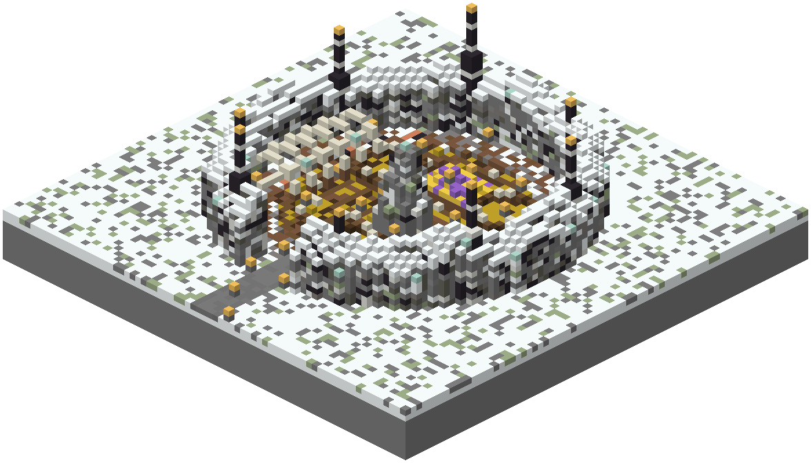
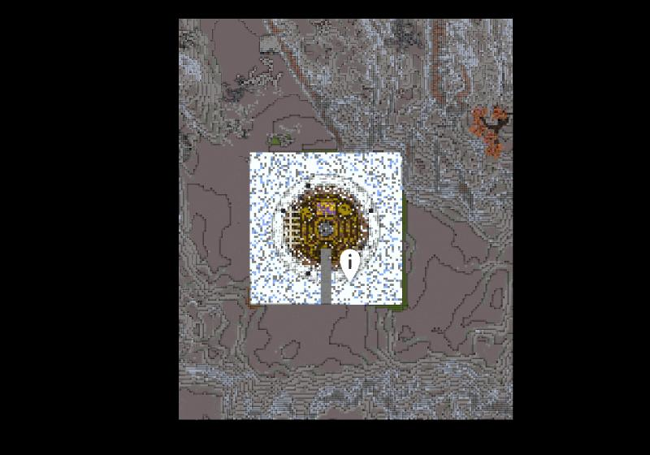
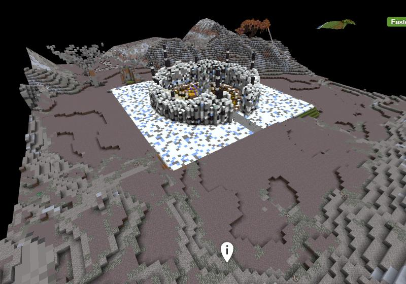

# Dragon's Nest (highest peak of the Great Canaat Mountains)

`id: dragons_nest` · build (our blueprint) · region **D** (Armed Nation of Dwargon)

| | |
|---|---|
| Anchor (Lerfing's map, x, z) | **2420, -1536** (x grows east, z grows south) |
| Audit status (19/11/2026) | **ISSUE, low** |
| Blueprint | [`blueprints/dragons_nest.py`](../../../blueprints/dragons_nest.py), 73 x 46 x 73 blocks (x, y, z), anchor [36, 9, 62] |
| Preview (blueprint only) |  |
| Lore page | [`design/lore/dragons_nest.md`](../../../design/lore/dragons_nest.md) |

## Lore (canon)

The dragon lords rule from the Nest on the tallest mountain; dragons grow stronger with altitude. Canon gives place and existence, not appearance.

## What it should look like

A roosting bowl woven of spruce and dark-oak trunks lined with hay, ringed by a jagged wall of blackstone, stone, tuff and calcite with a south gap and eight broken spires carrying soul lanterns; three smaller roosts for young; scattered bones, a rib cage, scorch marks; a low hoard of gold, raw gold and amethyst; a central perch of stacked rock with a sea lantern; snow everywhere. A five-block stone path leads to the gap.

Why it stands here (anchor table, Lerfing coordinates): Summit shoulder y ~273, relief 4, 100 N of the lava lake under the 316 peak; the 46-high build tops out < 320.

## Current state: BlueMap audit of 19/11/2026

Map: Tensura by Lerfing (current, being replaced). The screenshots are from the public BlueMap; positions and terrain will change with the new world, the lore and the design intent above will not.

- **Status:** ISSUE, low
- **Placed:** 2408 274 -1536 (corner 2372 265 -1598)
- Cosmetic: the nest sits on a bright white square pad (the terrain fit's flat plate) on a brown stony peak, very visible from above.
- verify 100 %, foundation solid, no fluids, 12 blocks from the canon point at y 274.
- Fix: Blend the pad: use the site's own top block (stone/gravel) instead of snow/white on the skirt, or make the blueprint's floor irregular.

  
*Top-down, about 300 blocks across. Map: Tensura by Lerfing (current, being replaced).*

  
*3D perspective, about 100 blocks. Map: Tensura by Lerfing (current, being replaced).*

## What ChatGPT can deliver for this place

- Concept art: `docs/art/places/dragons_nest.png` + `docs/art/places/dragons_nest.md` (see [art.md](../art.md)).
- Blueprint design notes or a Python blueprint in the format of [builds.md](../builds.md) (never the placement data: that is Claude's).
- Lore and quest text in EN and NL for this place (see [tasks.md](../tasks.md)).

Back to the [world guide](../world.md) · [knowledge pack](../README.md)
