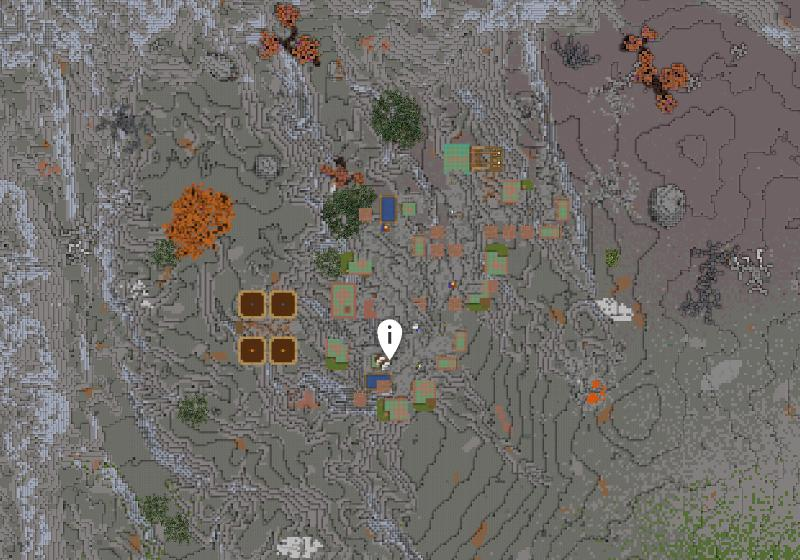
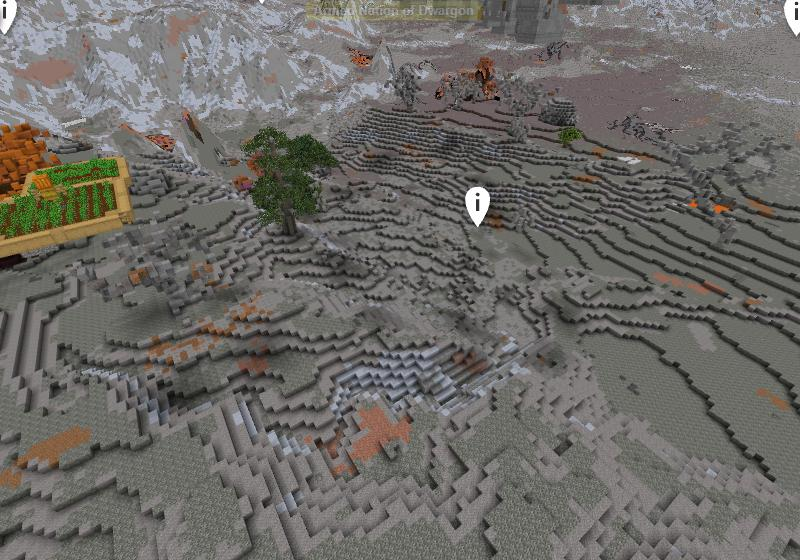

# Dwarf village on the road to Dwargon

`id: dwarf_village` · landmark (a Tensura mod structure placed in game) · region **D** (Armed Nation of Dwargon)

| | |
|---|---|
| Anchor (Lerfing's map, x, z) | **2000, -110** (x grows east, z grows south) |
| Audit status (19/11/2026) | **ISSUE, high** |
| Placed from | Tensura mod structure `tensura:villages/dwarf_village` (`design/data/landmarks.toml`) |
| Lore | [`design/lore/world.md`](../../../design/lore/world.md), section D |

## Lore (canon)

Dwarven miners and farmers living outside the gate (pack interpretation, built from Tensura's own dwarf village structure).

## What it should look like

Tensura's own dwarf village structure: stone and timber houses and farm plots on the grass at the foot of the grey mountain. It must sit grounded on the slope, not float above it.

Why it stands here (anchor table, Lerfing coordinates): 150 east of the road on the apron foot, y 78/81/88, dry.

## Current state: BlueMap audit of 19/11/2026

Map: Tensura by Lerfing (current, being replaced). The screenshots are from the public BlueMap; positions and terrain will change with the new world, the lore and the design intent above will not.

- **Status:** ISSUE, high
- **Placed:** 2000 79 -110 (box 1928 99 -206 2081 176 -75)
- Floating: placed at y 79 but the structure box is y 99..176. 3,808 of 20,328 box columns have an air gap of 3 or more under a solid block (median gap 38 blocks). The 3D view shows raised farm plots and buildings above the stone terrain.
- 380 water and 68 lava cells inside the box above y 78.
- Perimeter sample: 2 of 20 columns air under the lowest solid block.
- Fix: Fix in progress (Claude, technical). Place it with the surveyed ground y instead of the jigsaw's own height (or add a terrain fit/repair pass like the builds), then clean up the lava.
- **After the audit:** PR #57 (open on 19/11/2026) grounds the Tensura landmarks, removes the duplicate goblin village, moves the Dwarven Arena into the dwarf village and retries the orc camp.

  
*Top-down, about 300 blocks across. Map: Tensura by Lerfing (current, being replaced).*

  
*3D perspective, about 100 blocks. Map: Tensura by Lerfing (current, being replaced).*

## What ChatGPT can deliver for this place

- Concept art: `docs/art/places/dwarf_village.png` + `docs/art/places/dwarf_village.md` (see [art.md](../art.md)).
- Blueprint design notes or a Python blueprint in the format of [builds.md](../builds.md) (never the placement data: that is Claude's).
- Lore and quest text in EN and NL for this place (see [tasks.md](../tasks.md)).

Back to the [world guide](../world.md) · [knowledge pack](../README.md)
