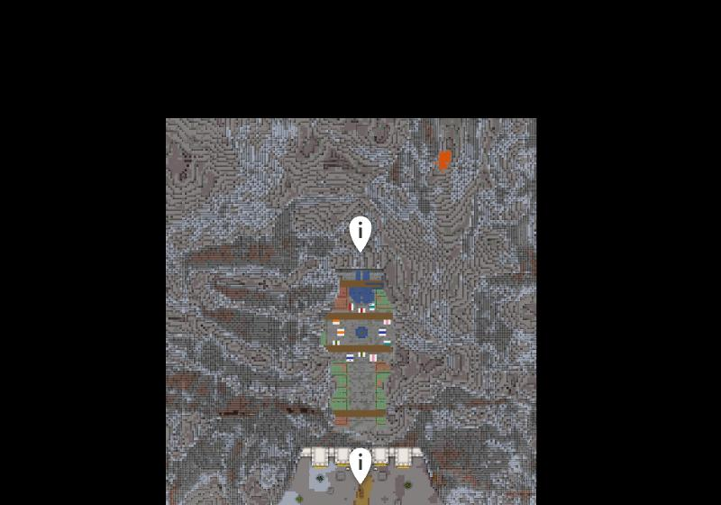
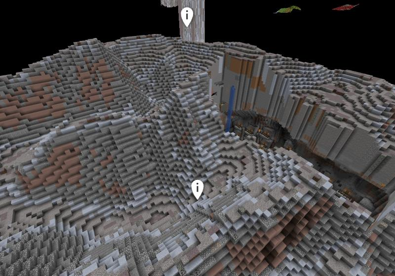

# Dwargo (Dwargon cavern capital)

**Current authored world reservation (R86):** `(780,-1490)`, radius8; [current geography and fit](../../../world/dwargon-relocation-r86.md). Legacy Lerfing coordinates below are historical.

`id: dwargo` · map pin only · region **D** (Armed Nation of Dwargon)

| | |
|---|---|
| Anchor (Lerfing's map, x, z) | **1878, -644** (x grows east, z grows south) |
| Audit status (19/11/2026) | **ISSUE, high** |
| Relative to | `dwargon` + (0, -100) |
| Lore page | [`design/lore/dwargon.md`](../../../design/lore/dwargon.md) |

## Lore (canon)

Dwargo is the dwarf capital's name (after the royal house); the pin marks the centre of the city.

## What it should look like

Pin only. See Dwargon for the city.

Why it stands here (anchor table, Lerfing coordinates): City centre pin, under the mountain.

## Current state: BlueMap audit of 19/11/2026

Map: Tensura by Lerfing (current, being replaced). The screenshots are from the public BlueMap; positions and terrain will change with the new world, the lore and the design intent above will not.

- **Status:** ISSUE, high
- **Placed:** not applicable (no structure: pin)
- Map pin of the capital (1878 -644) sits in the flooded hall area (see Dwargon).
- Fix: Same fix as Dwargon.

  
*Top-down, about 300 blocks across. Map: Tensura by Lerfing (current, being replaced).*

  
*3D perspective, about 100 blocks. Map: Tensura by Lerfing (current, being replaced).*

## What ChatGPT can deliver for this place

- Concept art: `docs/art/places/dwargo.png` + `docs/art/places/dwargo.md` (see [art.md](../art.md)).
- Lore and quest text in EN and NL for this place (see [tasks.md](../tasks.md)).

Back to the [world guide](../world.md) · [knowledge pack](../README.md)
