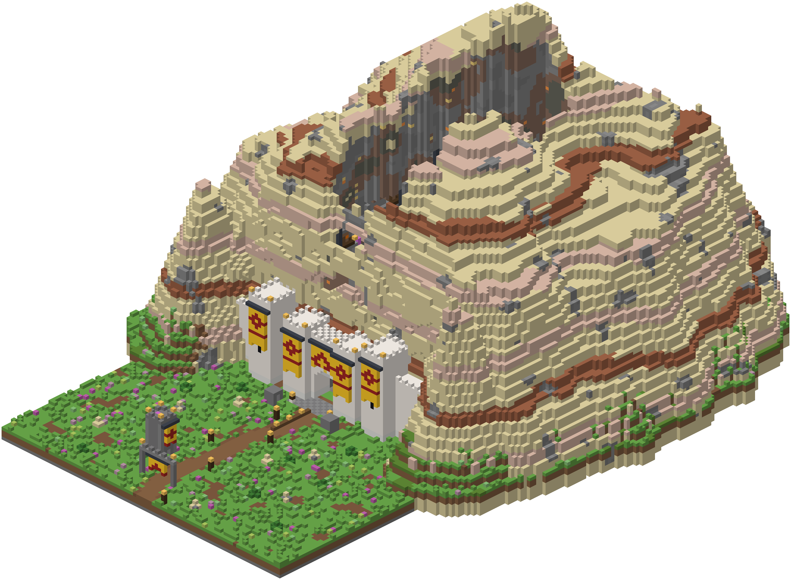
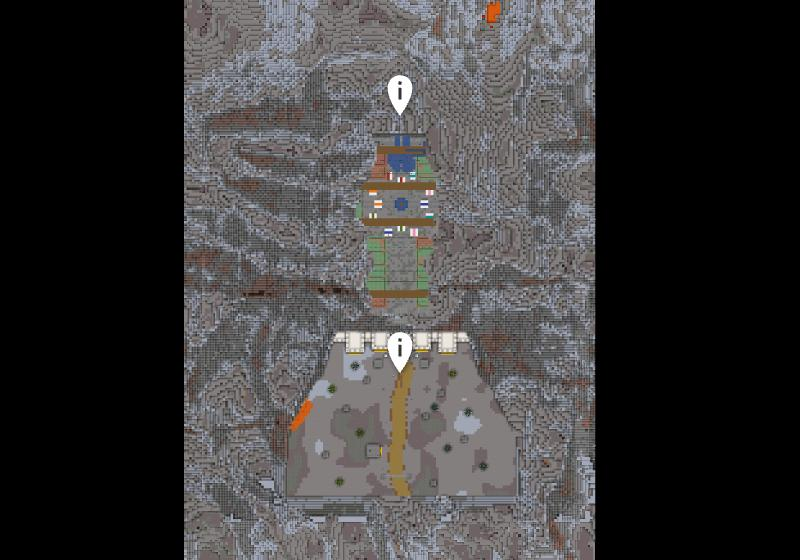
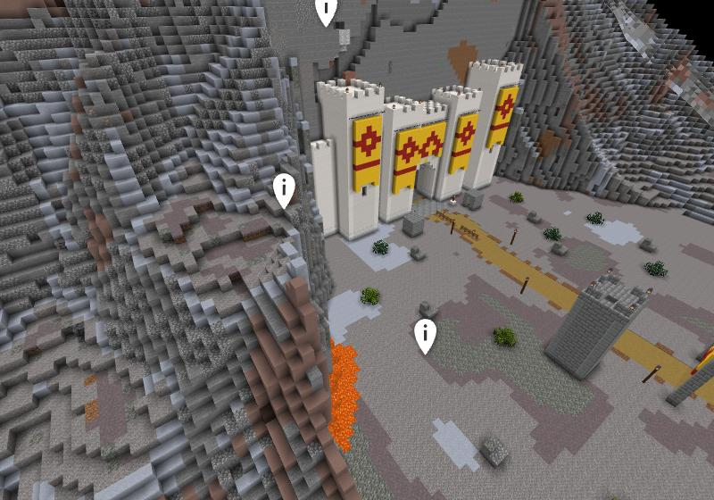
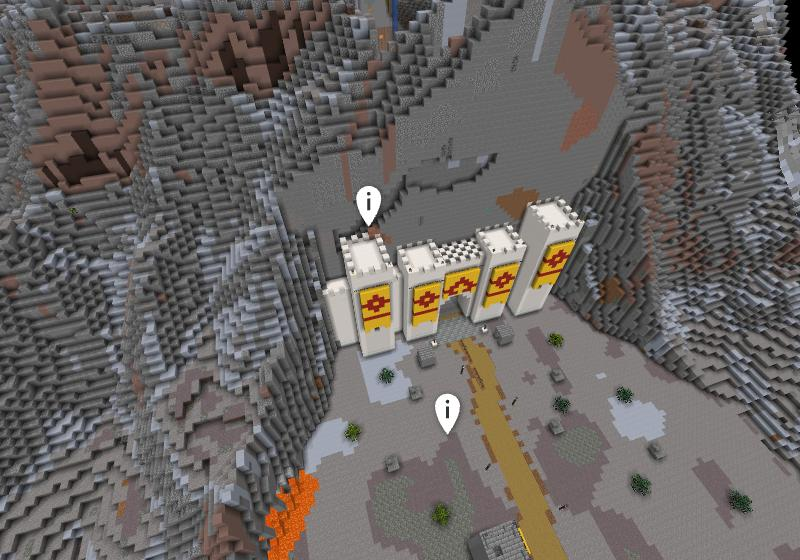

# Dwargon main gate (TtlDwargon.GATE)

**Current authored world reservation (R86):** `(780,-1390)`, radius127; [current geography and fit](../../../world/dwargon-relocation-r86.md). Legacy Lerfing coordinates below are historical.

`id: dwargon` · settlement (own scripts) · region **D** (Armed Nation of Dwargon)

| | |
|---|---|
| Anchor (Lerfing's map, x, z) | **1878, -544** (x grows east, z grows south) |
| Audit status (19/11/2026) | **ISSUE, high** |
| Blueprint | [`blueprints/dwargon.py`](../../../blueprints/dwargon.py), 148 x 92 x 168 blocks (x, y, z) |
| Preview (blueprint only) |  |
| Lore page | [`design/lore/dwargon.md`](../../../design/lore/dwargon.md) |

## Lore (canon)

Gazel Dwargo's kingdom, founded about a thousand years ago by Hero King Guran Dwargo in a natural hollow at the foot of the Great Canaat Mountains: a neutral trade hub and cavern city behind fortified gates, famous for its smiths. Rimuru's scuffle at the gate lands him in a cell; Kaijin was exiled from here.

## What it should look like

Owner: Dwargon stands INSIDE the mountain. From south to north: outer road with a checkpoint arch and road tower, queue lanes with guard booths, a white gate wall with four towers in a cleft cut into the escarpment, a tunnel, a canyon-like south street with wall homes on balconies at three heights, ladders and plank bridges under a skylight crack, a round plaza with fountain and market stalls, the forge street with Kaijin's smithy, a great stair, the royal terrace and King Gazel's throne room (red runner, red nether-brick throne, copper bulb ceiling). The mountain's rock is grey: gravel, clay, tuff, cobble.

Why it stands here (anchor table, Lerfing coordinates): Inside the mountain (§3.3, WP-L7b): the gate at the foot of the escarpment on the Canaat's south flank faces south onto the apron (road y 145), the city lies in a cavern under the plateau (y 200-215) with >= 7 blocks of rock over it (tools/lerfing/dwargon_fit.py). Rotation none.

## Current state: BlueMap audit of 19/11/2026

Map: Tensura by Lerfing (current, being replaced). The screenshots are from the public BlueMap; positions and terrain will change with the new world, the lore and the design intent above will not.

- **Status:** ISSUE, high
- **Placed:** 1878 146 -544 (corner 1804 142 -664)
- Inside the city: 2,253 cells that the structure defines as air are WATER (x 1868..1905, z -658..-603, y 146..201), concentrated in the throne-hall area round 1880 -648 / -656 (560+ cells each); red_carpet -> water x16 at the throne (1876..1880 150 -647). The 3D view shows a waterfall down a shaft in the mountain above the city: Lerfing's terrain water is pouring in.
- LAVA in the gate court: 68 cells (x 1835..1843, z -534..-522, y 146..150), about 40 blocks WSW of the gate (1878 146 -544), visible on the map next to the approach road.
- 86 of 552 footprint-edge columns have air under the lowest block (sample: 3 of 20); rest of the foundation solid.
- verify: 99.67 % (passes the 98 % mark only because the city is so large; the mismatches are almost all the water and lava).
- Fix: Plug the water source in the shaft above the throne hall (around x 1880..1890, z -660..-640, top near y 201) with stone, drain the box (`fill ... air replace minecraft:water` per slab, at most 32,768 blocks per fill) and set the 16 red carpets back; replace the 68 lava cells in the gate court with the court floor. Then re-run `tools/server.sh verify dwargon`. Longer term: let `life/repair.js` also seal water/lava that touches Dwargon's box from above (the ring repair only looks at the sides).

  
*Top-down, about 300 blocks across. Map: Tensura by Lerfing (current, being replaced).*

  
*3D perspective, about 100 blocks. Map: Tensura by Lerfing (current, being replaced).*

  
*Gate court: lava left of the road. Map: Tensura by Lerfing (current, being replaced).*

## What ChatGPT can deliver for this place

- Concept art: `docs/art/places/dwargon.png` + `docs/art/places/dwargon.md` (see [art.md](../art.md)).
- Blueprint design notes or a Python blueprint in the format of [builds.md](../builds.md) (never the placement data: that is Claude's).
- Lore and quest text in EN and NL for this place (see [tasks.md](../tasks.md)).

Back to the [world guide](../world.md) · [knowledge pack](../README.md)

## Direct entrance context and current map interface — round51

[WN14](https://ncode.syosetu.com/n6316bn/15/), selected gate paragraphs, directly distinguishes the usually closed large gate from smaller ordinary access doors and a left-side queue. The right passage serving important visitors is Rimuru's guess; left/right are viewed passage positions, not verified compass directions. The existing blueprint's in/out lane assignment remains our design. This source is WN, not independently verified LN/anime layout.

The [current approach audit](../../../world/dwargon-approach-study.md) measures an unresolved road/template join; do not call the gate walkable or the cavern placed on the basis of the roof-cover pass. Preserve fixed base142 and route the authored approach to its first-air146 before local acceptance. East/West city coordinates and extra tunnel/gate positions remain unverified.
