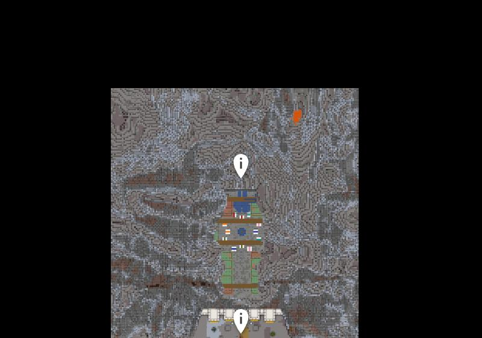
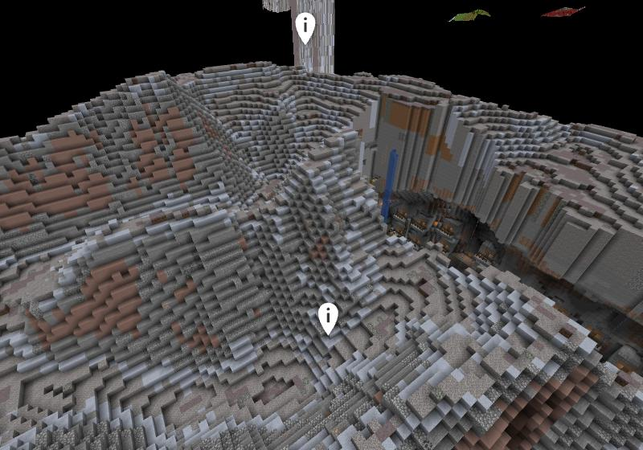

# Gazel's throne room (statue)

`id: dwargon_throne` · spot (NPC, boss or quest point) · region **D** (Armed Nation of Dwargon)

| | |
|---|---|
| Anchor (Lerfing's map, x, z) | **1878, -650** (x grows east, z grows south) |
| Audit status (19/11/2026) | **ISSUE, high** |
| Relative to | `dwargon` + (0, -106) |
| Lore page | [`design/lore/dwargon.md`](../../../design/lore/dwargon.md) |

## Lore (canon)

King Gazel Dwargo, the Hero King, receives Rimuru here. In the pack the room is cut from Tensura's own dwarf arena structure (credited in CREDITS.md).

## What it should look like

A tuff, deepslate and stone-brick hall with a red runner, a red nether-brick throne with a red banner, copper bulb ceiling, candles and campfires; Gazel seated on the throne (a tame, invulnerable statue).

Why it stands here (anchor table, Lerfing coordinates): Dwargon-relative (bosses.toml Gazel statue).

## Current state: BlueMap audit of 19/11/2026

Map: Tensura by Lerfing (current, being replaced). The screenshots are from the public BlueMap; positions and terrain will change with the new world, the lore and the design intent above will not.

- **Status:** ISSUE, high
- **Placed:** not applicable (no structure: spot)
- Throne room flooded: red_carpet -> water at 1876..1880 150 -647 and hundreds of water cells round 1880 -648 (see Dwargon).
- Fix: Same fix as Dwargon (plug, drain, re-lay carpet).

  
*Top-down, about 300 blocks across. Map: Tensura by Lerfing (current, being replaced).*

  
*3D perspective, about 100 blocks. Map: Tensura by Lerfing (current, being replaced).*

## What ChatGPT can deliver for this place

- Concept art: `docs/art/places/dwargon_throne.png` + `docs/art/places/dwargon_throne.md` (see [art.md](../art.md)).
- Lore and quest text in EN and NL for this place (see [tasks.md](../tasks.md)).

Back to the [world guide](../world.md) · [knowledge pack](../README.md)
