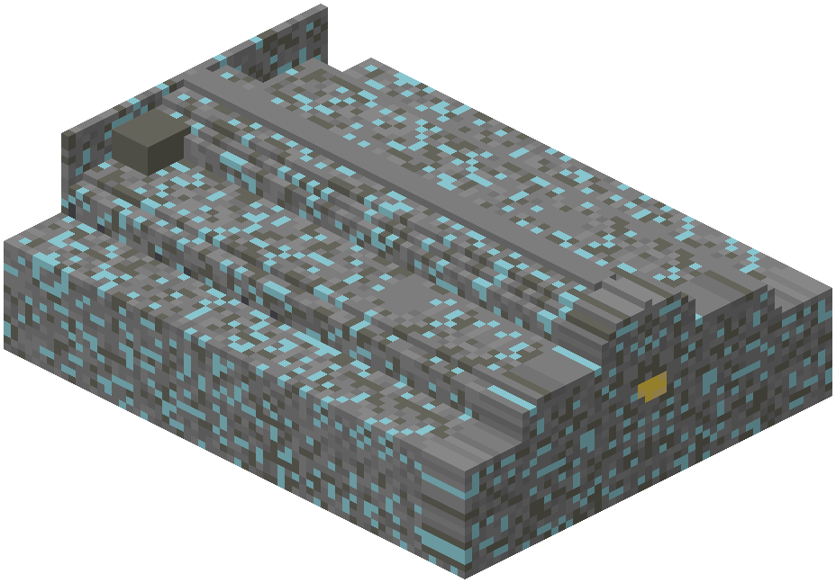
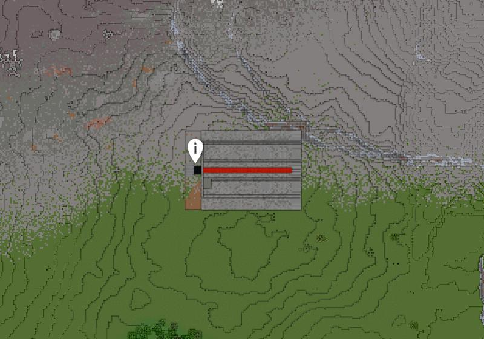
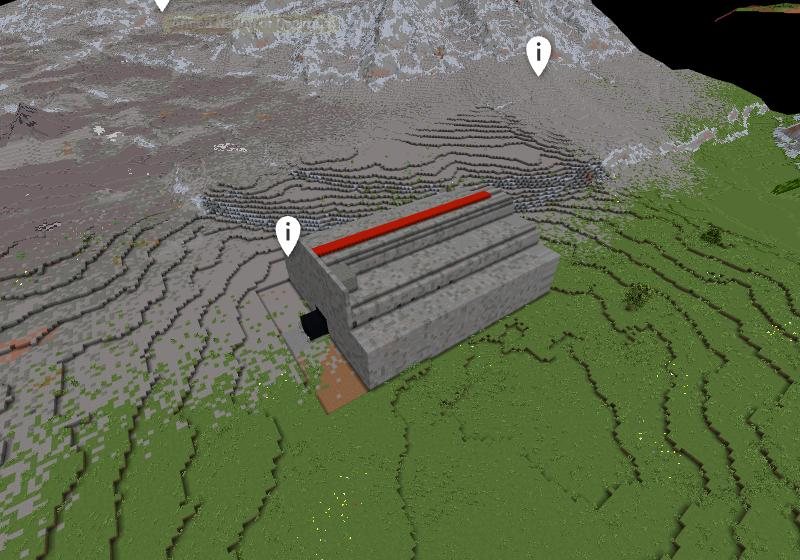

# Dwarven Arena

**Current authored world reservation (R86):** `(1100,-980)`, radius58; [current geography and fit](../../../world/dwargon-relocation-r86.md). Legacy Lerfing coordinates below are historical.

`id: dwarven_arena` · build (our blueprint) · region **D** (Armed Nation of Dwargon)

| | |
|---|---|
| Anchor (Lerfing's map, x, z) | **2260, -80** (x grows east, z grows south) |
| Audit status (19/11/2026) | **ISSUE, medium** |
| Blueprint | [`blueprints/dwarven_arena.py`](../../../blueprints/dwarven_arena.py), 75 x 26 x 51 blocks (x, y, z), anchor [3, 1, 25] |
| Preview (blueprint only) |  |
| Lore page | [`design/lore/dwarven_arena.md`](../../../design/lore/dwarven_arena.md) |

## Lore (canon)

Issue #5 (Yasuke): add the Dwarven Arena to the dwarven village, without the royal warp pad, the Dwargo boss or the black glass layers. It is Tensura's own dwarf arena structure with a door and forecourt of ours.

## What it should look like

A closed grey stone hall (about 75 x 51) with five rows of pillars and a pit floor; a red stripe on its roof; a small stone-brick forecourt. It should read as part of the dwarf village, not a lone hall on the plain.

Why it stands here (anchor table, Lerfing coordinates): East of the dwarf village, in D: WP-L4 moved it 60 east of the design's (2200, -80) so the box + search stays outside the village's keepout (spot + 116 reach + 64 offset + 24) wherever the village lands; box ground y 75/76/77, dry gravel and grass; survey 24.

## Current state: BlueMap audit of 19/11/2026

Map: Tensura by Lerfing (current, being replaced). The screenshots are from the public BlueMap; positions and terrain will change with the new world, the lore and the design intent above will not.

- **Status:** ISSUE, medium
- **Placed:** 2256 77 -76 (corner 2253 76 -101)
- Out of place (known): a closed grey stone hall with a red stripe on a slope at the plains/stone edge, unrelated to anything nearby.
- The anchor (2256 77 -76) is on the west edge of the 75 x 51 build (anchor offset x 3), so the arena's centre is about 30 blocks east of the canon point.
- verify 100 %, foundation solid (0 of 20 air), no fluids.
- Fix: Fix in progress (Claude, technical). When moving it, put the anchor in the middle of the blueprint.
- **After the audit:** PR #57 (open on 19/11/2026) grounds the Tensura landmarks, removes the duplicate goblin village, moves the Dwarven Arena into the dwarf village and retries the orc camp.

  
*Top-down, about 300 blocks across. Map: Tensura by Lerfing (current, being replaced).*

  
*3D perspective, about 100 blocks. Map: Tensura by Lerfing (current, being replaced).*

## What ChatGPT can deliver for this place

- Concept art: `docs/art/places/dwarven_arena.png` + `docs/art/places/dwarven_arena.md` (see [art.md](../art.md)).
- Blueprint design notes or a Python blueprint in the format of [builds.md](../builds.md) (never the placement data: that is Claude's).
- Lore and quest text in EN and NL for this place (see [tasks.md](../tasks.md)).

Back to the [world guide](../world.md) · [knowledge pack](../README.md)
