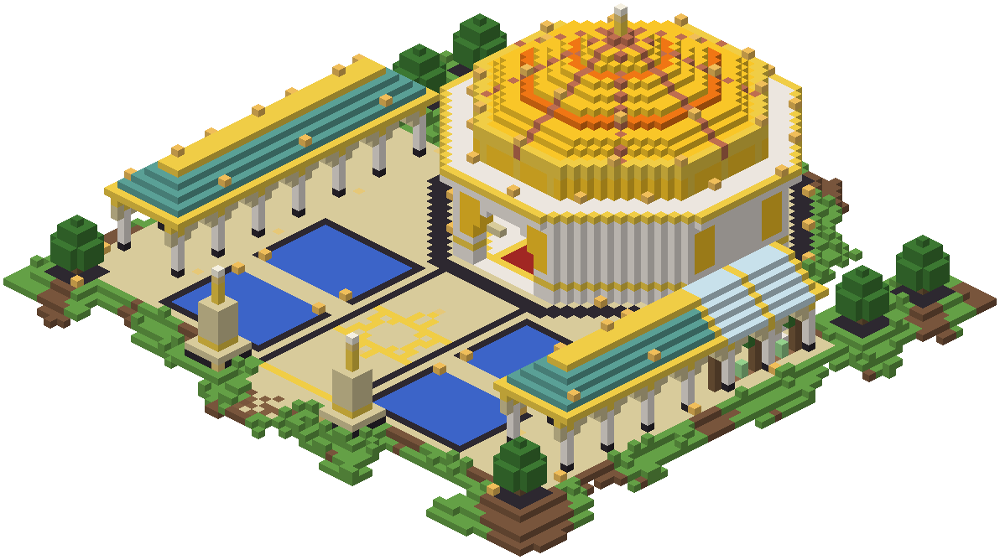
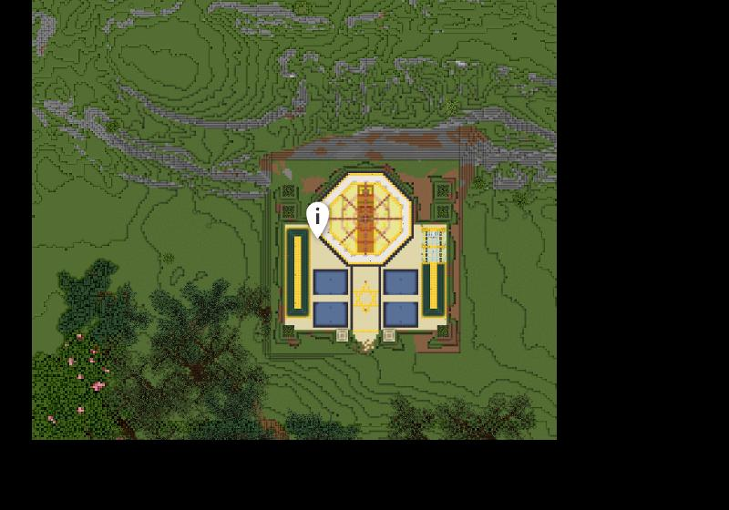
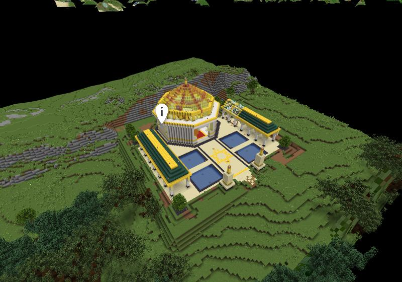

# Golden City of El Dorado (Leon)

`id: el_dorado` · build (our blueprint) · region **X** (El Dorado)

| | |
|---|---|
| Anchor (Lerfing's map, x, z) | **-3300, 4300** (x grows east, z grows south) |
| Audit status (19/11/2026) | **OK** |
| Blueprint | [`blueprints/el_dorado.py`](../../../blueprints/el_dorado.py), 81 x 39 x 83 blocks (x, y, z), anchor [40, 4, 74] |
| Preview (blueprint only) |  |
| Lore page | [`design/lore/el_dorado.md`](../../../design/lore/el_dorado.md) |

## Lore (canon)

A six-pointed city on magically levelled land with streets spiralling up towards a white royal castle; the city plan is a layered defensive spell (light novel vol. 18). A volcano at the centre supplies the metal.

## What it should look like

Leon's audience court: gold-tipped obelisks frame the southern road; two triangles in the paving form a six-pointed star at the crossing between reflecting pools; arcades with white columns and dark green hipped roofs; broad white stairs with a red runner and gold balustrades; a pointed high-backed throne in purple-red upholstery; glazed ribs over climbing roses and a mirror.

Why it stands here (anchor table, Lerfing coordinates): The green plain NW of the island's volcano, y 80/85/91.

## Current state: BlueMap audit of 19/11/2026

Map: Tensura by Lerfing (current, being replaced). The screenshots are from the public BlueMap; positions and terrain will change with the new world, the lore and the design intent above will not.

- **Status:** OK
- **Placed:** -3280 86 4340 (corner -3320 82 4266)
- Golden court on a green hill, 45 blocks from the canon point; verify 100 %.

  
*Top-down, about 300 blocks across. Map: Tensura by Lerfing (current, being replaced).*

  
*3D perspective, about 100 blocks. Map: Tensura by Lerfing (current, being replaced).*

## What ChatGPT can deliver for this place

- Concept art: `docs/art/places/el_dorado.png` + `docs/art/places/el_dorado.md` (see [art.md](../art.md)).
- Blueprint design notes or a Python blueprint in the format of [builds.md](../builds.md) (never the placement data: that is Claude's).
- Lore and quest text in EN and NL for this place (see [tasks.md](../tasks.md)).

Back to the [world guide](../world.md) · [knowledge pack](../README.md)
