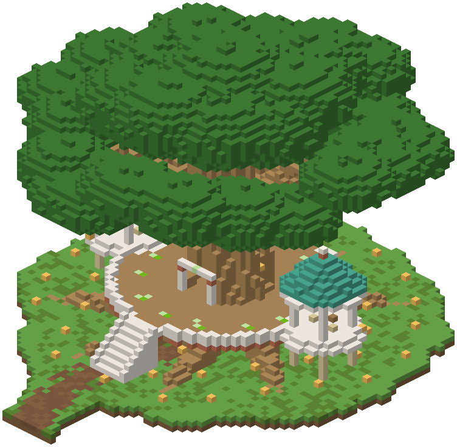
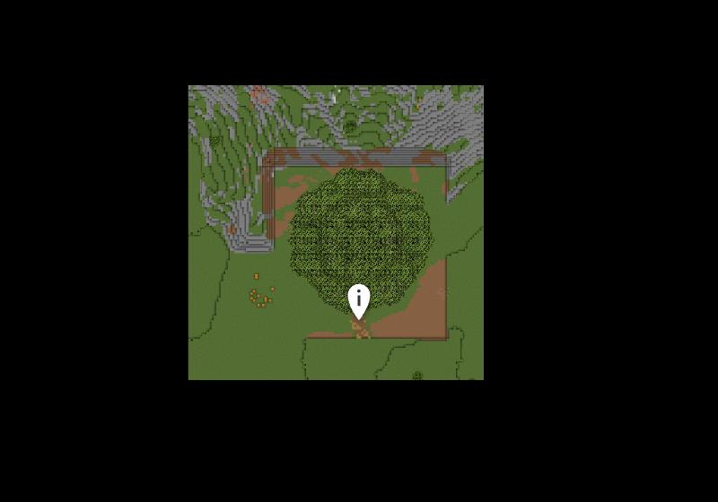
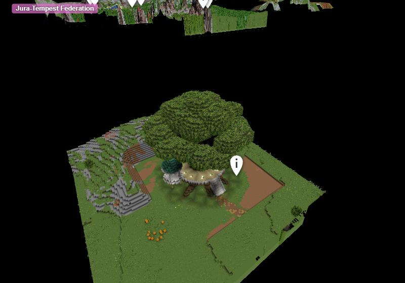

# Elmine (Sarion capital in the Divine Tree)

**Current own-world handoff (R88):** use `world/map.svg`, centre (−1680,1740), r100, margin64, walking first-air 104 in source `355d1a33`. Northern approach; root lake east/southeast. [Current lore](../../../design/lore/elmine.md) and [tree/approach study](../../../world/elmine-tree-study-r88.md) supersede the imported-map placement below. Paulzero's grove and coordinates (1100,2760) are historical. The small 75×60×75 model is not the full tree/capital; the 180° trial is not configured placement.

## Historical imported-world brief

`id: elmine` · build (our blueprint) · region **S** (Sorcerous Dynasty of Sarion)

| | |
|---|---|
| Anchor (Lerfing's map, x, z) | **1100, 2760** (x grows east, z grows south) |
| Audit status (19/11/2026) | **OK** |
| Blueprint | [`blueprints/elmine.py`](../../../blueprints/elmine.py), 75 x 60 x 75 blocks (x, y, z), anchor [37, 4, 67] |
| Preview (blueprint only) |  |
| Lore page | [`design/lore/elmine.md`](../../../design/lore/elmine.md) |

## Lore (canon)

The Divine Tree is as tall as the highest mountains and one of two surviving holy relics made by Veldanava. Sarion is a great power in the series, ruling thirteen vassal kingdoms.

## What it should look like

A public embassy terrace under a compressed crown: a pale staircase between buttress roots to a birch promenade round the trunk; thirteen pairs of green inlays for the thirteen houses; two copper-capped reading pavilions; a charter room inside the wood with bookshelves and a lectern; nine great limbs above. It stands beside Paulzero's giant tree, which the current map uses as the Divine Tree.

Why it stands here (anchor table, Lerfing coordinates): Sarion <-> Fulbrosia swap (owner Q3): Paulzero's giant grove is the Divine Tree. Moved from the design's (900, 2700), where the 75 x 75 terrace (clear_above) would cut the grove's north-east canopy: the open terrace just east of the grove, y 72, relief 2.

## Current state: BlueMap audit of 19/11/2026

Map: Tensura by Lerfing (current, being replaced). The screenshots are from the public BlueMap; positions and terrain will change with the new world, the lore and the design intent above will not.

- **Status:** OK
- **Placed:** 1100 73 2760 (corner 1063 69 2693)
- Divine-tree terrace (plains); only the build's own chunks are rendered so far.

  
*Top-down, about 300 blocks across. Map: Tensura by Lerfing (current, being replaced).*

  
*3D perspective, about 100 blocks. Map: Tensura by Lerfing (current, being replaced).*

## What ChatGPT can deliver for this place

- Concept art: `docs/art/places/elmine.png` + `docs/art/places/elmine.md` (see [art.md](../art.md)).
- Blueprint design notes or a Python blueprint in the format of [builds.md](../builds.md) (never the placement data: that is Claude's).
- Lore and quest text in EN and NL for this place (see [tasks.md](../tasks.md)).

Back to the [world guide](../world.md) · [knowledge pack](../README.md)
