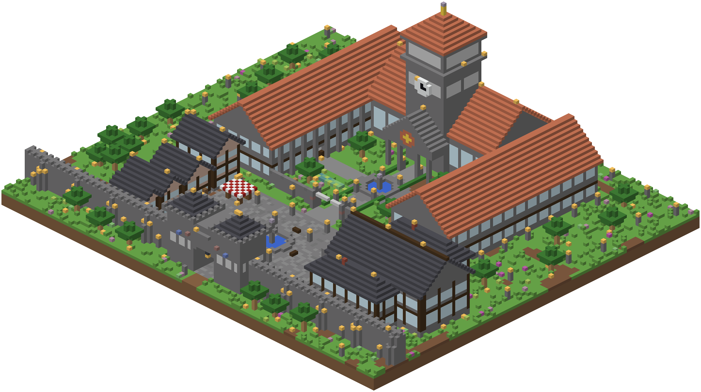
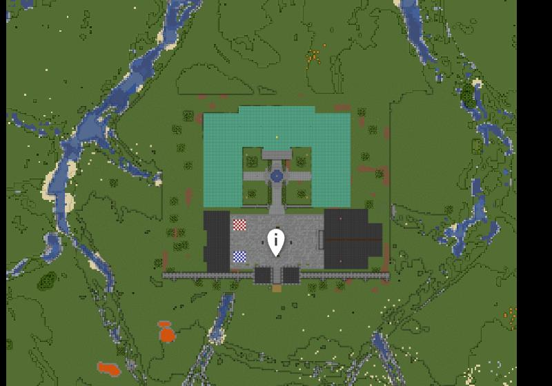
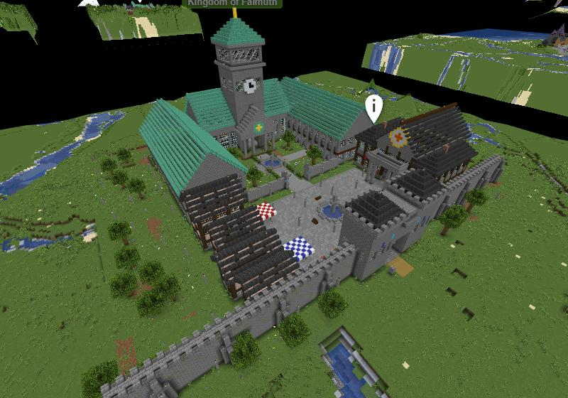

# Englassia capital (Lura): Freedom Academy, Free Guild HQ

`id: englassia` · build (our blueprint) · region **G** (Kingdom of Englassia)

| | |
|---|---|
| Anchor (Lerfing's map, x, z) | **-2150, -410** (x grows east, z grows south) |
| Audit status (19/11/2026) | **OK** |
| Blueprint | [`blueprints/englassia.py`](../../../blueprints/englassia.py), 128 x 60 x 112 blocks (x, y, z), anchor [64, 5, 92] |
| Preview (blueprint only) |  |
| Lore page | [`design/lore/englassia.md`](../../../design/lore/englassia.md) |

## Lore (canon)

The leading power of the Western Nations: a large walled capital with two gates, home of the Council of the West, the Free Guild HQ (Yuuki) and the Freedom Academy where Rimuru taught Shizu's students.

## What it should look like

A refined academic city: stone brick walls with dark oak timber; the Academy under oxidised-copper (teal) roofs, the Guild and the gate under slate; blue banners for the city and Academy, red for the Guild; a crenellated wall with a two-tower gate, Lura Square with fountain, townhouses, and the Guild HQ hall with a columned portico.

Why it stands here (anchor table, Lerfing coordinates): Centre of the western plain, y 65/66/66.

## Current state: BlueMap audit of 19/11/2026

Map: Tensura by Lerfing (current, being replaced). The screenshots are from the public BlueMap; positions and terrain will change with the new world, the lore and the design intent above will not.

- **Status:** OK
- **Placed:** -2150 67 -410 (corner -2214 62 -502)
- Plains with streams; verify 100 %.

  
*Top-down, about 300 blocks across. Map: Tensura by Lerfing (current, being replaced).*

  
*3D perspective, about 100 blocks. Map: Tensura by Lerfing (current, being replaced).*

## What ChatGPT can deliver for this place

- Concept art: `docs/art/places/englassia.png` + `docs/art/places/englassia.md` (see [art.md](../art.md)).
- Blueprint design notes or a Python blueprint in the format of [builds.md](../builds.md) (never the placement data: that is Claude's).
- Lore and quest text in EN and NL for this place (see [tasks.md](../tasks.md)).

Back to the [world guide](../world.md) · [knowledge pack](../README.md)
