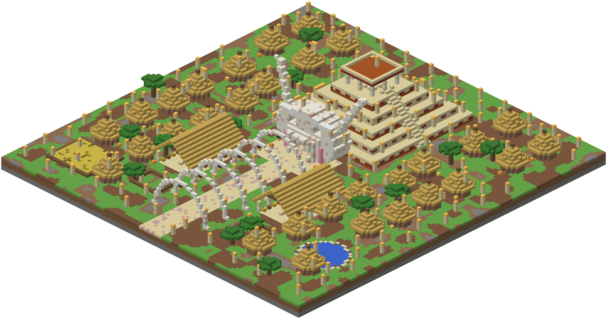
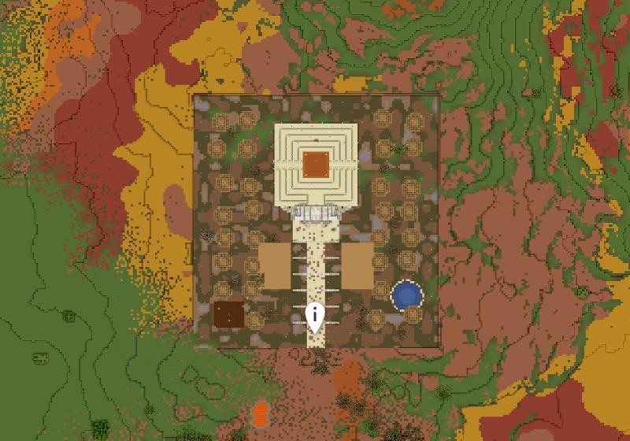
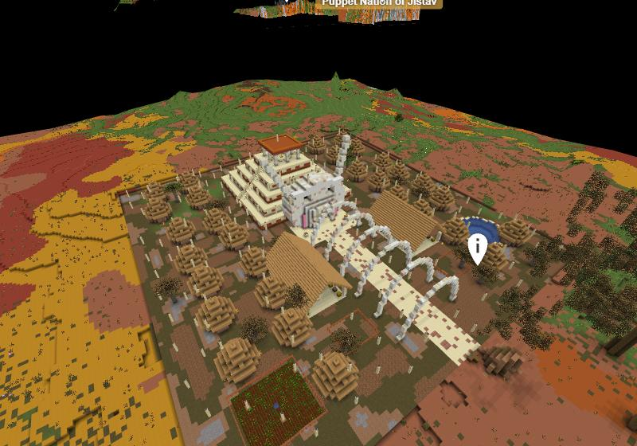

# City of the Forgotten Dragon (Milim)

## Current own-world/source correction — round37

Current old settlement(2650,800),radius100. Official Middray profile directly supports a temple here,not the existing project skeleton/pyramid design. The new image is a modest interpreted goods-yard precinct,with the larger bone avenue outside the camera. It does not certify or remove the existing blueprint; no late Laura palace is imported. [Source distinctions](../../research/tensura-world-2026-11-19/final-place-source-review.md).

Imported-map coordinates and older audit descriptions below are historical; current source/era qualifications supersede them.

`id: forgotten_dragon_city` · build (our blueprint) · region **M** (Milim's Domain)

| | |
|---|---|
| Anchor (Lerfing's map, x, z) | **4680, 840** (x grows east, z grows south) |
| Audit status (19/11/2026) | **OK** |
| Blueprint | [`blueprints/forgotten_dragon_city.py`](../../../blueprints/forgotten_dragon_city.py), 121 x 44 x 125 blocks (x, y, z), anchor [60, 5, 118] |
| Preview (blueprint only) |  |
| Lore page | [`design/lore/forgotten_dragon_city.md`](../../../design/lore/forgotten_dragon_city.md) |

## Source context and project interpretation

Own-world placement update (20 November 2026): the authored map now reserves this old settlement at
**(2650,800), radius 100**. This improves its southeastern reference proportions while keeping all fixed
rules. The preceding coordinates describe the retired imported map. Exact server placement remains our
interpretation. At the post-Kijin baseline this is separate from Milim's later planned capital project in former Eurazania. [The directly inspected LN20 opening](../../research/tensura-world-2026-11-19/ln20-licensed-capital-review.md) does not locate that project at the authored `laura` reservation.

Milim's domain on the south-eastern edge of the continent is fertile river plain fed by the Ameld; the Dragon Faithful run the city with no government: head priest Middray and priest Hermes gather what the people produce at the Central Temple and hand it out evenly; the temple is Milim's castle. Wyverns live in the city. Primitive and poor until Tempest develops it.

## Existing project build interpretation — not verified canon architecture

Our interpretation: a primitive commune that grew inside the bones of a dead ancient dragon. South to north: an avenue under six bone rib arches with granaries on either side, a plaza with bone fires, the dragon skull (glowing eye sockets, horns) whose mouth is the tunnel into the Central Temple's hall, a five-tier stepped pyramid with a summit pavilion and bonfire, Milim's bone throne on a dais at the back of the hall, pink banners (her colour, our choice), and mud-brick huts with thatch cone roofs, wheat plots, animal pens and a pond. A wyvern roost on the temple's upper tiers is not built yet.

Why it stands here (anchor table, Lerfing coordinates): The lake-and-river plain of the badlands, relief 2.

## Current state: BlueMap audit of 19/11/2026

Map: Tensura by Lerfing (current, being replaced). The screenshots are from the public BlueMap; positions and terrain will change with the new world, the lore and the design intent above will not.

- **Status:** OK
- **Placed:** 4680 75 840 (corner 4620 70 722)
- Badlands/terracotta (Milim's domain); verify 100 %.

  
*Top-down, about 300 blocks across. Map: Tensura by Lerfing (current, being replaced).*

  
*3D perspective, about 100 blocks. Map: Tensura by Lerfing (current, being replaced).*

## What ChatGPT can deliver for this place

- Concept art: `docs/art/places/forgotten_dragon_city.png` + `docs/art/places/forgotten_dragon_city.md` (see [art.md](../art.md)).
- Blueprint design notes or a Python blueprint in the format of [builds.md](../builds.md) (never the placement data: that is Claude's).
- Lore and quest text in EN and NL for this place (see [tasks.md](../tasks.md)).

Back to the [world guide](../world.md) · [knowledge pack](../README.md)
