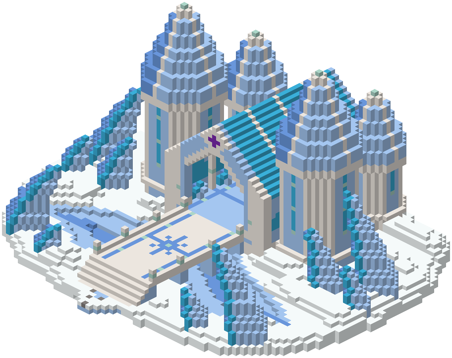
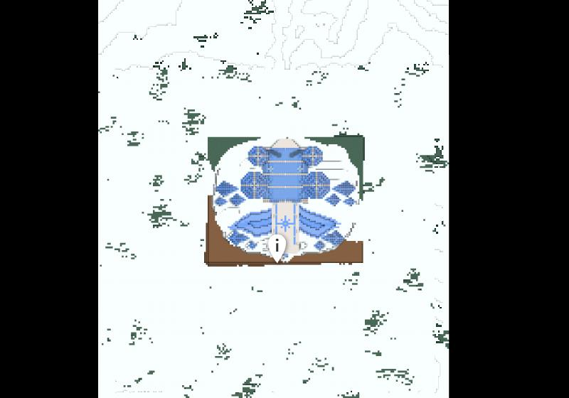
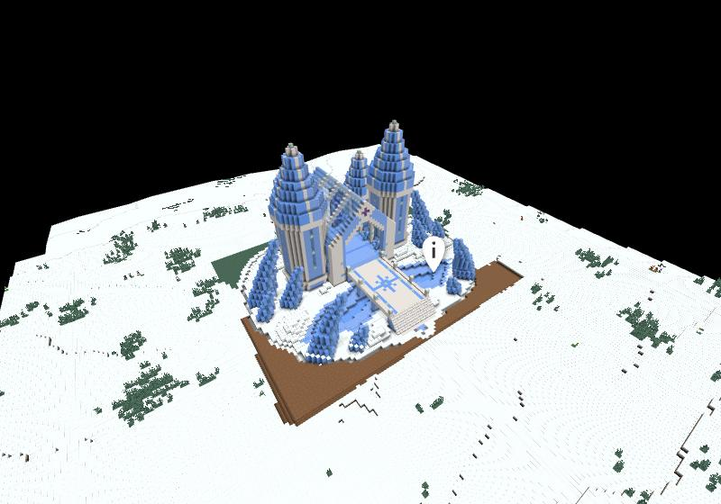

# Frost Palace (Guy Crimson)

**Own-world source correction (round28):** directly read WN78 places the palace centrally on the frozen continent; LN agreement remains unverified. The active coast-kind reserve is a server interpretation. An inert inland alternative and entry-versus-palace decision are recorded in [C22 source review](https://github.com/Yasuke2000/ocs-two-lives/blob/chatgpt/world-map/world/frost-palace-source-review.md). No active placement/type change is made. Earlier Lerfing coordinates and the southern causeway are not surveyed canon.

`id: frost_palace` · build (our blueprint) · region **I** (Ice Continent)

| | |
|---|---|
| Anchor (Lerfing's map, x, z) | **-1980, -4300** (x grows east, z grows south) |
| Audit status (19/11/2026) | **ISSUE, low** |
| Blueprint | [`blueprints/frost_palace.py`](../../../blueprints/frost_palace.py), 85 x 51 x 69 blocks (x, y, z), anchor [42, 4, 65] |
| Preview (blueprint only) |  |
| Lore page | [`design/lore/frost_palace.md`](../../../design/lore/frost_palace.md) |

## Lore (canon)

Guy kept his castle encased in ice after his encounter with Velzard; the cold of the continent comes from the Frost Dragon herself (light novel vol. 16 epilogue). Leon walks a dark blue passage between pointed bays (anime episode 42).

## What it should look like

The southern gate: white masonry visible under blue ice on each gate tower; curved blades of ice; a dark blue passage with pointed wall bays, clusters of small crystals at their feet and a reflective floor; at the audience door two dark-blue leaves ajar on deepslate jambs, with pale ice curling across their panels; two violet cup lamps on quartz stems.

Why it stands here (anchor table, Lerfing coordinates): Moved from the design's (-1850, -4250), whose box would reach Lerfing's glass-pane ice crystals (keepout lerfing_ice): 130 west on the same shore plain, y 72/74/75.

## Current state: BlueMap audit of 19/11/2026

Map: Tensura by Lerfing (current, being replaced). The screenshots are from the public BlueMap; positions and terrain will change with the new world, the lore and the design intent above will not.

- **Status:** ISSUE, low
- **Placed:** -1976 73 -4304 (corner -2018 69 -4369)
- Cosmetic: a brown dirt skirt shows along the south edge of the box on the snowfield (no snow layer on top).
- verify 100 %, foundation solid, no fluids.
- Fix: Set the skirt top block to snow_block / add snow layers for this build (site top block).

  
*Top-down, about 300 blocks across. Map: Tensura by Lerfing (current, being replaced).*

  
*3D perspective, about 100 blocks. Map: Tensura by Lerfing (current, being replaced).*

## What ChatGPT can deliver for this place

- Concept art: `docs/art/places/frost_palace.png` + `docs/art/places/frost_palace.md` (see [art.md](../art.md)).
- Blueprint design notes or a Python blueprint in the format of [builds.md](../builds.md) (never the placement data: that is Claude's).
- Lore and quest text in EN and NL for this place (see [tasks.md](../tasks.md)).

Back to the [world guide](../world.md) · [knowledge pack](../README.md)
