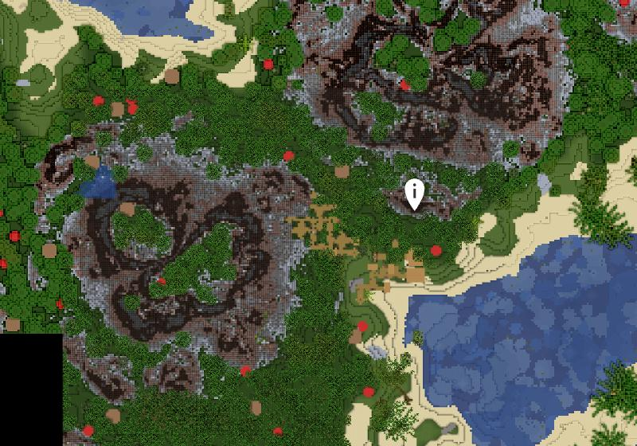
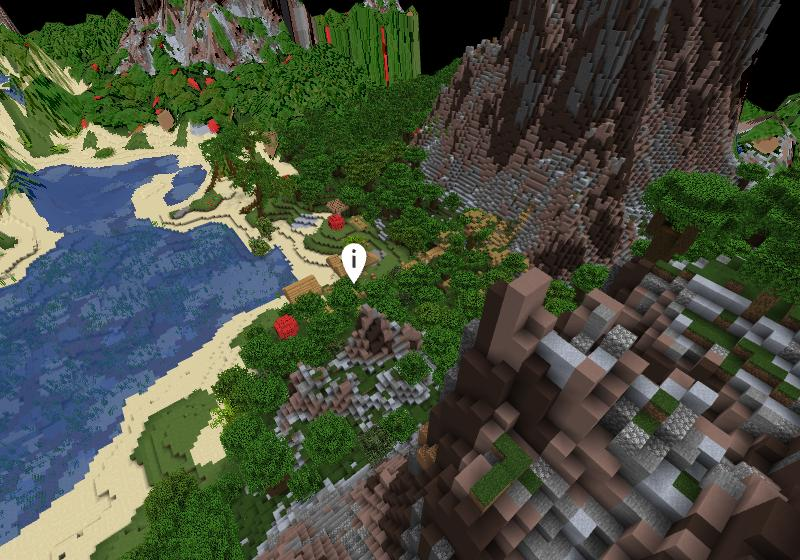
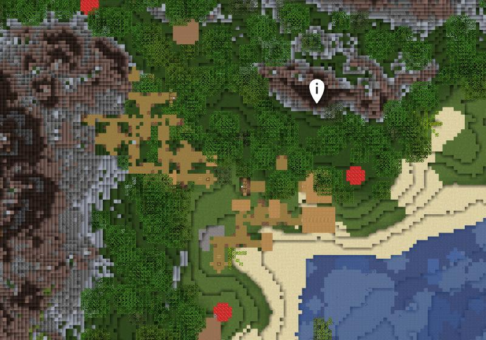

# Old goblin village (Rigurd's tribe)

`id: goblin_village` · landmark (a Tensura mod structure placed in game) · region **J** (Jura-Tempest Federation)

| | |
|---|---|
| Anchor (Lerfing's map, x, z) | **1390, 710** (x grows east, z grows south) |
| Audit status (19/11/2026) | **ISSUE, high** |
| Placed from | Tensura mod structure `tensura:villages/goblin_village/oak` (`design/data/landmarks.toml`) |
| Lore | [`design/lore/world.md`](../../../design/lore/world.md), section J |

## Lore (canon)

The goblins lived in shabby huts before Rimuru named them. In Life 2 it is the old quarter that the new town replaces gradually; Rigurd, the goblin chief, still lives in a chief hut.

## What it should look like

Built from Tensura's own oak goblin village structure (jigsaw, with goblin spawn pieces): thatched huts, beds, fires, rough palisade, hidden under canopy at the foot of a rock spire. Should read as a poor, crowded forest village, not a town.

Why it stands here (anchor table, Lerfing coordinates): Moved from the design's (1480, 720), which is 45 % lake: 90 blocks west onto dry ground (y 68/73/86) between the lake and the cave, 370 from Tempest (dark band).

## Current state: BlueMap audit of 19/11/2026

Map: Tensura by Lerfing (current, being replaced). The screenshots are from the public BlueMap; positions and terrain will change with the new world, the lore and the design intent above will not.

- **Status:** ISSUE, high
- **Placed:** 1358 72 710 (box 1313 52 688 1374 91 745)
- Placed TWICE in the same start: 16:55:52 at 1390 76 742 (box 1349 54 712 1406 91 767) and 16:56:41 at 1358 72 710 (box 1313 52 688 1374 91 745). Both copies stand (captures: 70 thatch beds and 54 thatch beds) and the boxes overlap at x 1349..1374, z 712..745. `/ttl landmark where` only knows the second copy.
- 2 of 20 perimeter samples have air under the lowest block; 212 of 3,596 box columns have an air gap of 3+ (median 4): small overhangs, not a floating village.
- Mostly hidden under jungle/dark-forest canopy at the foot of a rock spire; stored biome dark_forest (copy 1: beach).
- Fix: Find out why `life/landmarks.js` ran goblin_village twice after the import's world reset (the reset probably queued the landmarks twice). Remove the first copy by hand (box 1349 54 712 1406 91 767, minus the overlap with copy 2) or clear both boxes and place once again.
- **After the audit:** PR #57 (open on 19/11/2026) grounds the Tensura landmarks, removes the duplicate goblin village, moves the Dwarven Arena into the dwarf village and retries the orc camp.

  
*Top-down, about 300 blocks across. Map: Tensura by Lerfing (current, being replaced).*

  
*3D perspective, about 100 blocks. Map: Tensura by Lerfing (current, being replaced).*

  
*Zoom (about 130 blocks): paths of both copies under the canopy. Map: Tensura by Lerfing (current, being replaced).*

## What ChatGPT can deliver for this place

- Concept art: `docs/art/places/goblin_village.png` + `docs/art/places/goblin_village.md` (see [art.md](../art.md)).
- Blueprint design notes or a Python blueprint in the format of [builds.md](../builds.md) (never the placement data: that is Claude's).
- Lore and quest text in EN and NL for this place (see [tasks.md](../tasks.md)).

Back to the [world guide](../world.md) · [knowledge pack](../README.md)
