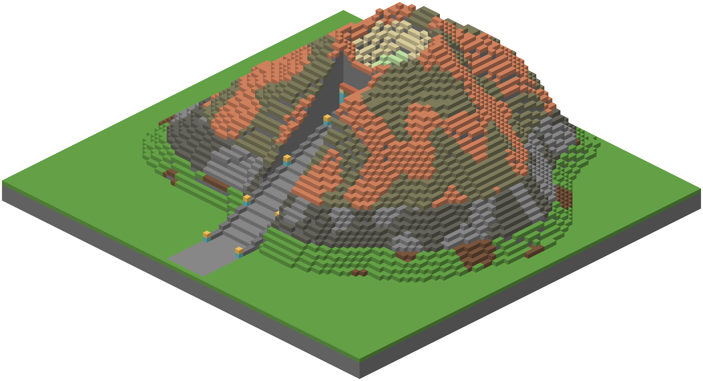
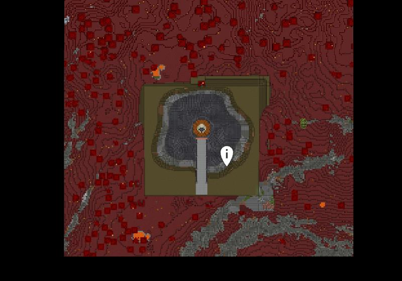
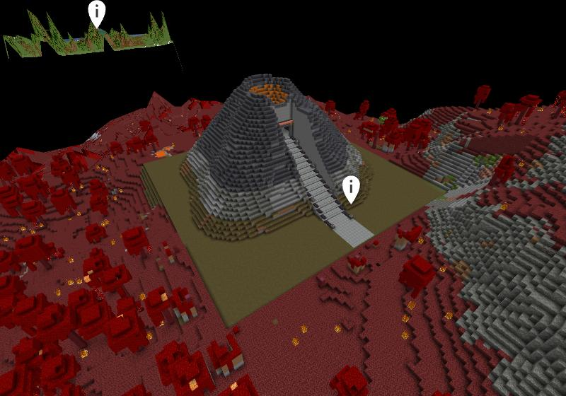

# Great Holy Mountain (Velgrynd's sanctuary)

`id: great_holy_mountain` · build (our blueprint) · region **E** (Eastern Empire)

| | |
|---|---|
| Anchor (Lerfing's map, x, z) | **5120, -1860** (x grows east, z grows south) |
| Audit status (19/11/2026) | **OK** |
| Blueprint | [`blueprints/great_holy_mountain.py`](../../../blueprints/great_holy_mountain.py), 89 x 52 x 85 blocks (x, y, z), anchor [44, 5, 78] |
| Preview (blueprint only) |  |
| Lore page | [`design/lore/great_holy_mountain.md`](../../../design/lore/great_holy_mountain.md) |

## Lore (canon)

The empire honours the Scorch Dragon Velgrynd as its guardian (light novel vol. 14).

## What it should look like

From the south a dark broken rim above the imperial road; the climb ends in a cut-stone arcade with benches facing a five-tongued flame behind amber glass; the vent floor catches the same colour. Volcano and crater lake stay natural.

Why it stands here (anchor table, Lerfing coordinates): NW flank of the red crater (y 110); the crater lake and lava stay.

## Current state: BlueMap audit of 19/11/2026

Map: Tensura by Lerfing (current, being replaced). The screenshots are from the public BlueMap; positions and terrain will change with the new world, the lore and the design intent above will not.

- **Status:** OK
- **Placed:** 5100 110 -1844 (corner 5056 105 -1922)
- Volcano sanctuary on red badlands; the flat square pad is visible but acceptable; verify 100 %.

  
*Top-down, about 300 blocks across. Map: Tensura by Lerfing (current, being replaced).*

  
*3D perspective, about 100 blocks. Map: Tensura by Lerfing (current, being replaced).*

## What ChatGPT can deliver for this place

- Concept art: `docs/art/places/great_holy_mountain.png` + `docs/art/places/great_holy_mountain.md` (see [art.md](../art.md)).
- Blueprint design notes or a Python blueprint in the format of [builds.md](../builds.md) (never the placement data: that is Claude's).
- Lore and quest text in EN and NL for this place (see [tasks.md](../tasks.md)).

Back to the [world guide](../world.md) · [knowledge pack](../README.md)
