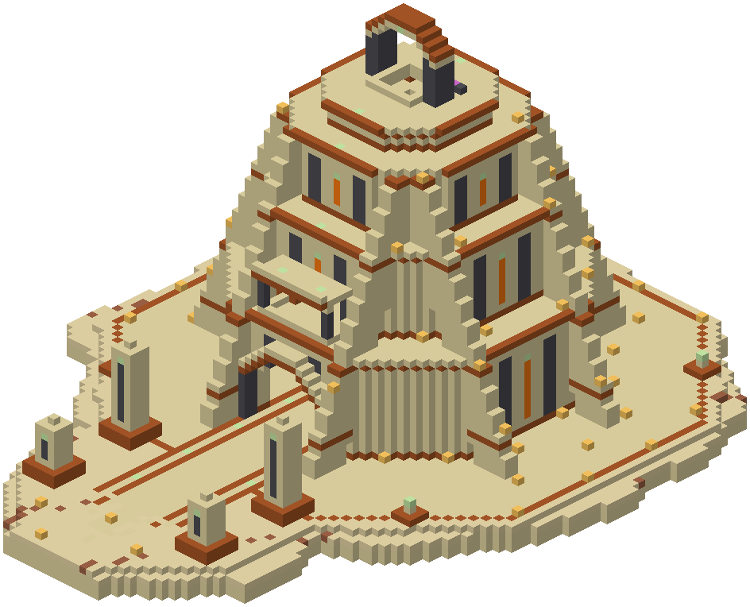
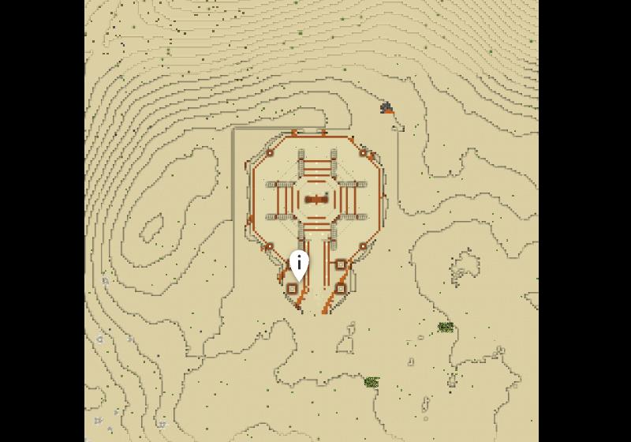
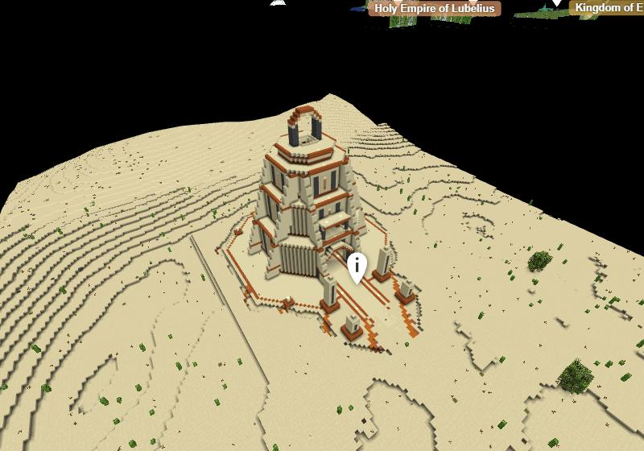

# Heaven Tower (Dagruel, Damargania)

## Current own-world terrain - R97

The current authored western coast changes the normal-export preparation ground for Heaven Tower from first-air71 to73 at unchanged centre(-4200,-200), radius84. All sampled cells in that reservation change+2blocks. The adjoining western caravan profile follows the same change. Carry staged anchor/site heights together when applying the map; no live placement has been changed. This is original server terrain, not a measured canonical elevation. [Coast and fit review](../../../world/western-peninsula-r97.md). Imported-map coordinates and older placement/audit records below are historical.

`id: heaven_tower` · build (our blueprint) · region **V** (Holy Void of Damargania)

| | |
|---|---|
| Anchor (Lerfing's map, x, z) | **-4500, 560** (x grows east, z grows south) |
| Audit status (19/11/2026) | **OK** |
| Blueprint | [`blueprints/heaven_tower.py`](../../../blueprints/heaven_tower.py), 81 x 60 x 91 blocks (x, y, z), anchor [40, 4, 83] |
| Preview (blueprint only) |  |
| Lore page | [`design/lore/heaven_tower.md`](../../../design/lore/heaven_tower.md) |

## Lore (canon)

The tower rises over a wasteland inside an ancient barrier whose protected ground shelters even Dagruel's giants; corrosive sandstorms rage outside after Guy and Milim's battle. It is the access to the Heavenly Star Palace.

## What it should look like

A pale octagonal court with red seams of sand, gate stones, an open central shaft with a ladder to galleries at y 19, 33, 44 and 48, two arcades of dark piers and an empty frame at the top representing the passage.

Why it stands here (anchor table, Lerfing coordinates): Deep in the desert, relief 1.

## Current state: BlueMap audit of 19/11/2026

Map: Tensura by Lerfing (current, being replaced). The screenshots are from the public BlueMap; positions and terrain will change with the new world, the lore and the design intent above will not.

- **Status:** OK
- **Placed:** -4492 83 568 (corner -4532 79 485)
- Desert tower (stored desert); verify 100 %.

  
*Top-down, about 300 blocks across. Map: Tensura by Lerfing (current, being replaced).*

  
*3D perspective, about 100 blocks. Map: Tensura by Lerfing (current, being replaced).*

## What ChatGPT can deliver for this place

- Concept art: `docs/art/places/heaven_tower.png` + `docs/art/places/heaven_tower.md` (see [art.md](../art.md)).
- Blueprint design notes or a Python blueprint in the format of [builds.md](../builds.md) (never the placement data: that is Claude's).
- Lore and quest text in EN and NL for this place (see [tasks.md](../tasks.md)).

Back to the [world guide](../world.md) · [knowledge pack](../README.md)
