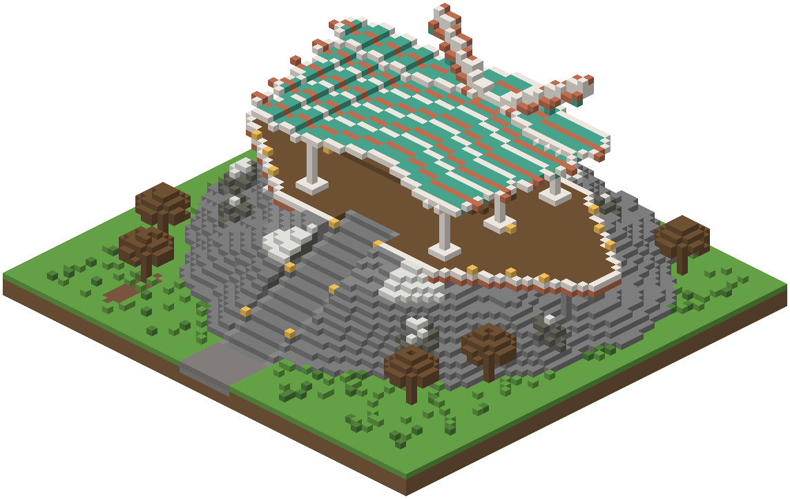
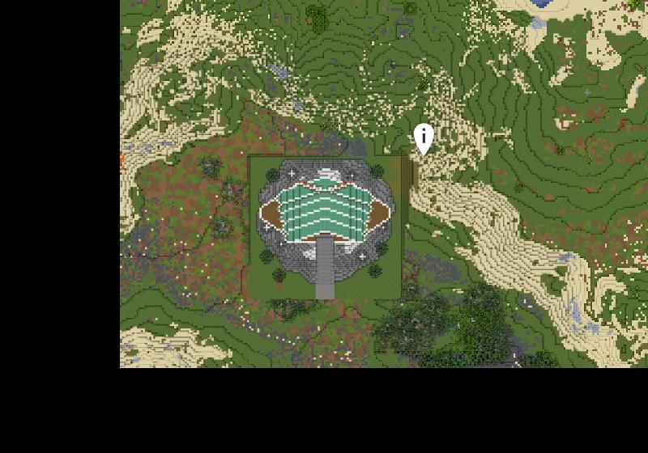
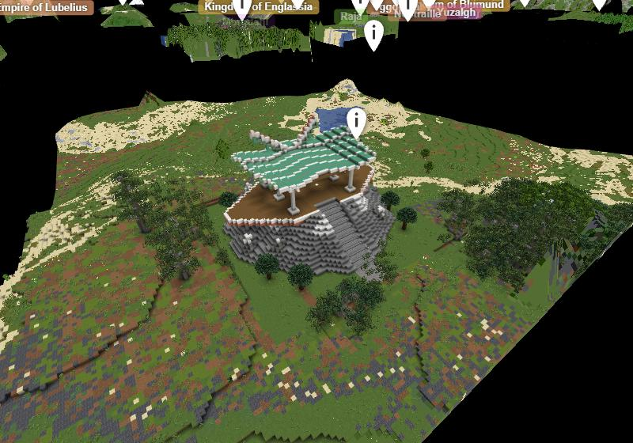

# Jia (Fulbrosia capital, Frey)

**Own-world reservation:** x 200, z 2450, radius68, plateau; authored highland court in the owner-approved southern Fulbrosia arrangement. Exact court bearing and shape are our interpretation. Read [map.svg](../../../world/map.svg) and the [initial-era policy](../../../world/era.md); the southwest crystal-hill placement below belongs to the retired Lerfing map.

`id: jia` · build (our blueprint) · region **H** (Harpy Queendom of Fulbrosia)

| | |
|---|---|
| Anchor (Lerfing's map, x, z) | **-2700, 1500** (x grows east, z grows south) |
| Historical audit (19/11/2026) | **OK on retired map; not own-world acceptance** |
| Blueprint | [`blueprints/jia.py`](../../../blueprints/jia.py), 73 x 40 x 69 blocks (x, y, z), anchor [36, 4, 64] |
| Preview (blueprint only) |  |
| Lore page | [`design/lore/jia.md`](../../../design/lore/jia.md) |

## Source scope and initial-era limit

The official glossary describes Fulbrosia as a cold, high-mountain harpy country (ledger OFF-009). Frey remains its ruler at the chosen initial instant. Jia's exact capital coordinate and the landing-court architecture are not established by that country description. The former crystal-hill mesa was a server adaptation; it does not override the current southern placement.

## Representative court: our interpretation

Frey's landing court: a broad stone stair climbing through exposed ribs of a mountain spur; six quartz columns carry a canopy of overlapping copper flight feathers; two long landing galleries stand out over the rock on ribbed timber supports; the sheltered audience seat faces the stair; the open gallery tips give a harpy a straight flight path.

Historical placement rationale (retired Lerfing coordinates): A mesa of the south-west crystal hills (owner Q3), terrain kept; y 73/82/88.

## Historical state: BlueMap audit of 19/11/2026

Map: Tensura by Lerfing (historical, being replaced). These public BlueMap screenshots record the retired terrain and placement. Use the source and era limits above for the new world. This audit does not establish own-world acceptance.

- **Status:** OK
- **Placed:** -2748 90 1564 (corner -2784 86 1500)
- Hilltop court, 80 blocks from the retired authored anchor; historical verification note.

  
*Top-down, about 300 blocks across. Map: Tensura by Lerfing (current, being replaced).*

  
*3D perspective, about 100 blocks. Map: Tensura by Lerfing (current, being replaced).*

## What ChatGPT can deliver for this place

- Concept art: `docs/art/places/jia.png` + `docs/art/places/jia.md` (see [art.md](../art.md)).
- Blueprint design notes or a Python blueprint in the format of [builds.md](../builds.md) (never the placement data: that is Claude's).
- Lore and quest text in EN and NL for this place (see [tasks.md](../tasks.md)).

Back to the [world guide](../world.md) · [knowledge pack](../README.md)
