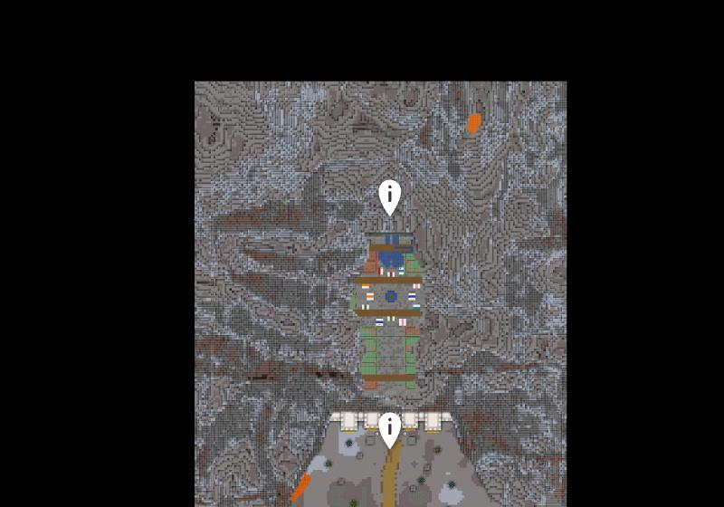
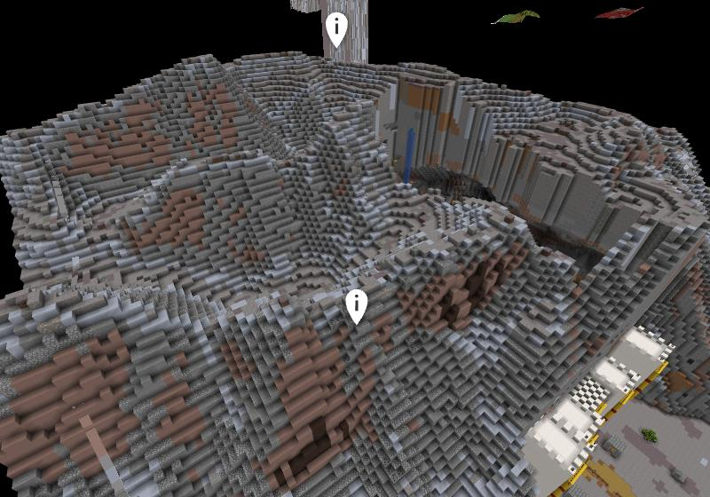

# Kaijin's smithy

**Current authored world reservation (R86):** `(768,-1474)`, radius8; [current geography and fit](../../../world/dwargon-relocation-r86.md). Legacy Lerfing coordinates below are historical.

`id: kaijin_smithy` · spot (NPC, boss or quest point) · region **D** (Armed Nation of Dwargon)

| | |
|---|---|
| Anchor (Lerfing's map, x, z) | **1866, -628** (x grows east, z grows south) |
| Audit status (19/11/2026) | **ISSUE, medium** |
| Relative to | `dwargon` + (-12, -84) |
| Lore page | [`design/lore/dwargon.md`](../../../design/lore/dwargon.md) |

## Lore (canon)

Kaijin, master blacksmith, was exiled by King Gazel and then joined Rimuru. His smithy in Dwargon is where the pack's Artificer path starts.

## What it should look like

A forge street smithy: open front, anvil, blast furnaces, quench cauldron, grindstone, charcoal store, ore pile. Part of the Dwargon build.

Why it stands here (anchor table, Lerfing coordinates): Dwargon-relative (artifice.toml smithy).

## Current state: BlueMap audit of 19/11/2026

Map: Tensura by Lerfing (current, being replaced). The screenshots are from the public BlueMap; positions and terrain will change with the new world, the lore and the design intent above will not.

- **Status:** ISSUE, medium
- **Placed:** not applicable (no structure: spot)
- Water cells reach to about 6 blocks east of the smithy spot (cluster at 1872 -632, 59 cells). Check the smithy NPC area for water after the Dwargon drain.
- Fix: Covered by the Dwargon drain; check the spot afterwards.

  
*Top-down, about 300 blocks across. Map: Tensura by Lerfing (current, being replaced).*

  
*3D perspective, about 100 blocks. Map: Tensura by Lerfing (current, being replaced).*

## What ChatGPT can deliver for this place

- Concept art: `docs/art/places/kaijin_smithy.png` + `docs/art/places/kaijin_smithy.md` (see [art.md](../art.md)).
- Lore and quest text in EN and NL for this place (see [tasks.md](../tasks.md)).

Back to the [world guide](../world.md) · [knowledge pack](../README.md)
