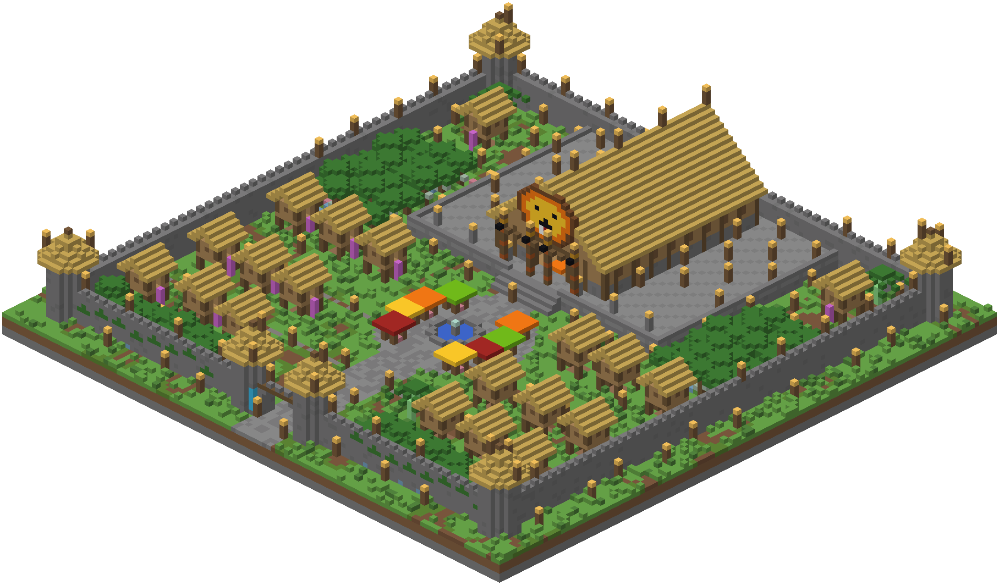
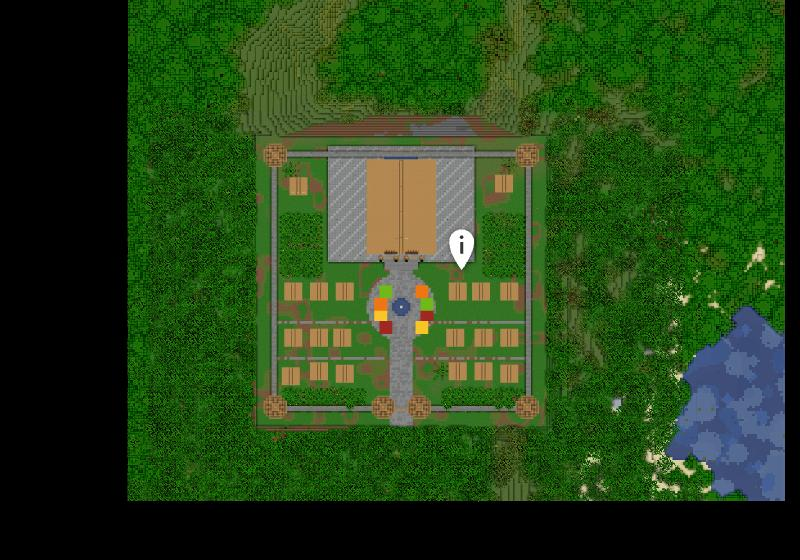
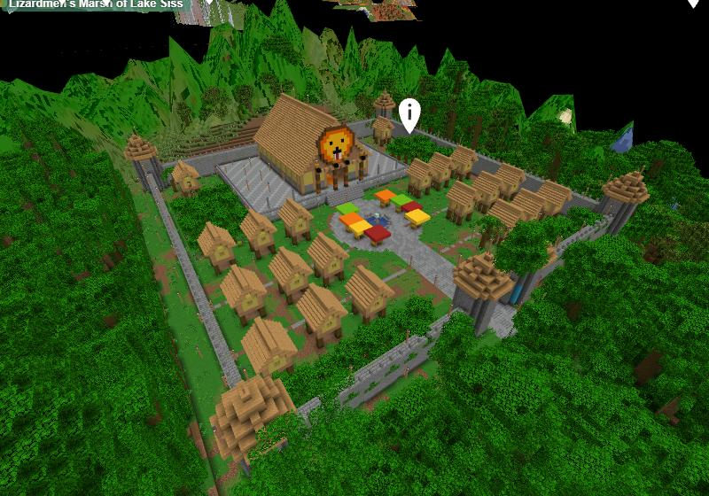

# Laura (Eurazania capital, rebuilt)

`id: laura` · build (our blueprint) · region **B** (Beast Kingdom of Eurazania)

| | |
|---|---|
| Anchor (Lerfing's map, x, z) | **3300, 2600** (x grows east, z grows south) |
| Audit status (19/11/2026) | **OK** |
| Blueprint | [`blueprints/laura.py`](../../../blueprints/laura.py), 113 x 46 x 113 blocks (x, y, z), anchor [56, 5, 108] |
| Preview (blueprint only) |  |
| Lore page | [`design/lore/laura.md`](../../../design/lore/laura.md) |

## Lore (canon)

An agricultural kingdom with fertile soil and a tropical climate, famous for fruit. Milim destroyed the old capital and Tempest helped build Laura. Carrion is a lion beastman.

## What it should look like

A timber longhouse-style hall with a tall thatch roof and a lion's head in the south gable, totem pillars with lion caps, stilt houses with ladders, orchards of jungle trees with cocoa on the trunks, melon and berry rows, a fruit market with eight stalls, a young stone wall with towers and a gate, Tempest light-blue banners at the gate and beside the throne. Gold-and-brown palette.

Why it stands here (anchor table, Lerfing coordinates): Heart of the jungle peninsula, y 74/81/84.

## Current state: BlueMap audit of 19/11/2026

Map: Tensura by Lerfing (current, being replaced). The screenshots are from the public BlueMap; positions and terrain will change with the new world, the lore and the design intent above will not.

- **Status:** OK
- **Placed:** 3276 83 2656 (corner 3220 78 2548)
- Jungle (stored jungle), fits the beast kingdom; verify 100 %.

  
*Top-down, about 300 blocks across. Map: Tensura by Lerfing (current, being replaced).*

  
*3D perspective, about 100 blocks. Map: Tensura by Lerfing (current, being replaced).*

## What ChatGPT can deliver for this place

- Concept art: `docs/art/places/laura.png` + `docs/art/places/laura.md` (see [art.md](../art.md)).
- Blueprint design notes or a Python blueprint in the format of [builds.md](../builds.md) (never the placement data: that is Claude's).
- Lore and quest text in EN and NL for this place (see [tasks.md](../tasks.md)).

Back to the [world guide](../world.md) · [knowledge pack](../README.md)
