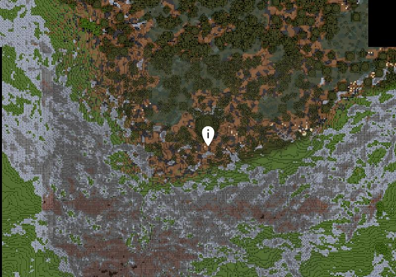
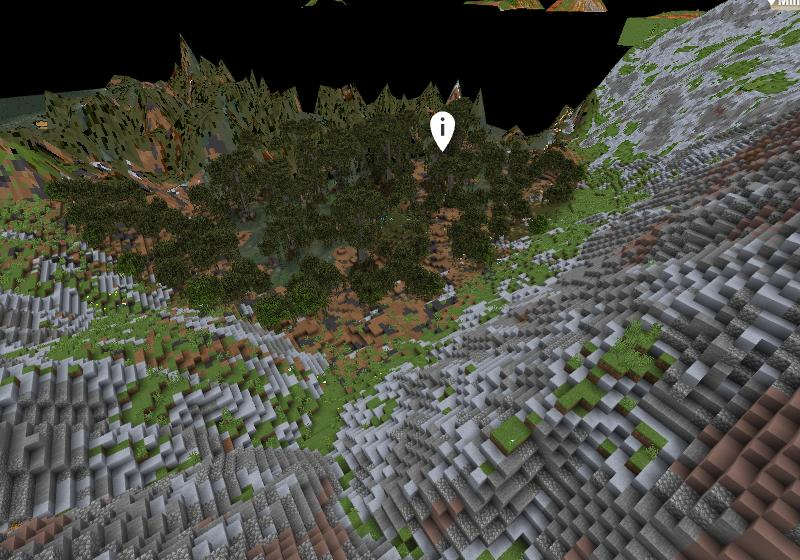

# Lizardmen's caverns (Gabiru, Avalos)

`id: lizardmen_caverns` · landmark (a Tensura mod structure placed in game) · region **W** (Lizardmen's Marsh of Lake Siss)

| | |
|---|---|
| Anchor (Lerfing's map, x, z) | **3300, 1200** (x grows east, z grows south) |
| Audit status (19/11/2026) | **OK** |
| Placed from | Tensura mod structure `tensura:villages/lizardmen_village/underground` (`design/data/landmarks.toml`) |
| Lore | [`design/lore/world.md`](../../../design/lore/world.md), section W |

## Lore (canon)

Their caverns form a natural labyrinth that is both fortress and government of the lizardmen. Avalos is their chief, Gabiru his son who allies with Tempest.

## What it should look like

Tensura's underground lizardmen village, with an entrance in the swamp forest surface; little visible from above, as intended.

Why it stands here (anchor table, Lerfing coordinates): Moved 50 south of the design's (3300, 1150), whose centre is lake: the south shore inside the marsh, y 63/67/83.

## Current state: BlueMap audit of 19/11/2026

Map: Tensura by Lerfing (current, being replaced). The screenshots are from the public BlueMap; positions and terrain will change with the new world, the lore and the design intent above will not.

- **Status:** OK
- **Placed:** 3323 68 1177 (box 3247 38 1156 3338 87 1233)
- Underground under a swamp forest; little visible from above (as intended).

  
*Top-down, about 300 blocks across. Map: Tensura by Lerfing (current, being replaced).*

  
*3D perspective, about 100 blocks. Map: Tensura by Lerfing (current, being replaced).*

## What ChatGPT can deliver for this place

- Concept art: `docs/art/places/lizardmen_caverns.png` + `docs/art/places/lizardmen_caverns.md` (see [art.md](../art.md)).
- Blueprint design notes or a Python blueprint in the format of [builds.md](../builds.md) (never the placement data: that is Claude's).
- Lore and quest text in EN and NL for this place (see [tasks.md](../tasks.md)).

Back to the [world guide](../world.md) · [knowledge pack](../README.md)
