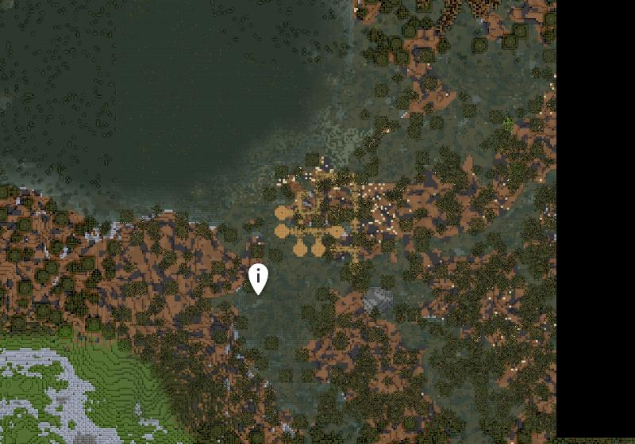
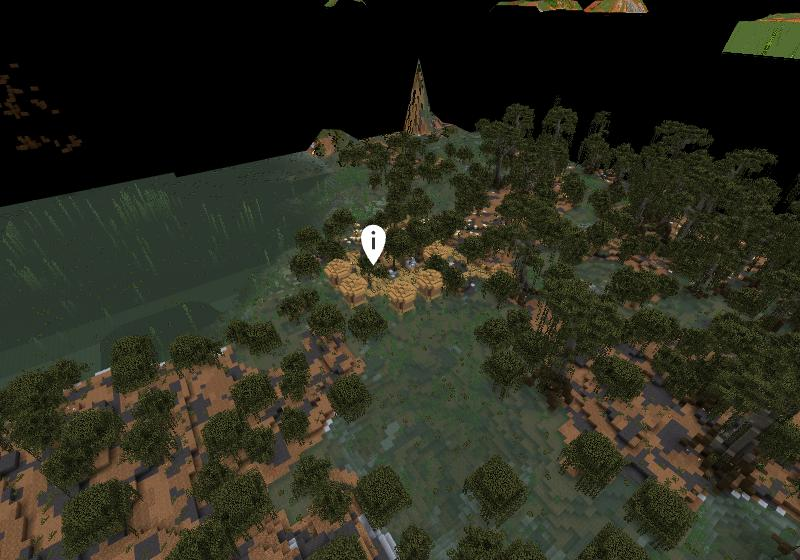

# Lizardmen's stilt village

`id: lizardmen_village` · landmark (a Tensura mod structure placed in game) · region **W** (Lizardmen's Marsh of Lake Siss)

| | |
|---|---|
| Anchor (Lerfing's map, x, z) | **3184, 988** (x grows east, z grows south) |
| Audit status (19/11/2026) | **OK** |
| Placed from | Tensura mod structure `tensura:villages/lizardmen_village/water` (`design/data/landmarks.toml`) |
| Lore | [`design/lore/world.md`](../../../design/lore/world.md), section W |

## Lore (canon)

Lizardmen (Gabiru's people) live on the lake's shore and caves.

## What it should look like

Tensura's lizardmen water-village structure: stilt huts on swamp water, walkways, reed roofs. Little height, mostly water level.

Why it stands here (anchor table, Lerfing coordinates): South shore of Lake Siss, swamp, part water (surface = water in landmarks.toml): 45 % water and ground y 60/64/70 within 48 on the imported world. WP-L4 moved it from the design's (2900, 1020), which lies among Lerfing's south-west huts (keepout lerfing_lake_village_sw); every hut cluster stays more than reach 48 + 64 away.

## Current state: BlueMap audit of 19/11/2026

Map: Tensura by Lerfing (current, being replaced). The screenshots are from the public BlueMap; positions and terrain will change with the new world, the lore and the design intent above will not.

- **Status:** OK
- **Placed:** 3207 70 965 (box 3192 55 927 3234 72 977)
- Swamp village on the marsh water (stored swamp), placed 32 blocks from the anchor; fits.

  
*Top-down, about 300 blocks across. Map: Tensura by Lerfing (current, being replaced).*

  
*3D perspective, about 100 blocks. Map: Tensura by Lerfing (current, being replaced).*

## What ChatGPT can deliver for this place

- Concept art: `docs/art/places/lizardmen_village.png` + `docs/art/places/lizardmen_village.md` (see [art.md](../art.md)).
- Blueprint design notes or a Python blueprint in the format of [builds.md](../builds.md) (never the placement data: that is Claude's).
- Lore and quest text in EN and NL for this place (see [tasks.md](../tasks.md)).

Back to the [world guide](../world.md) · [knowledge pack](../README.md)
