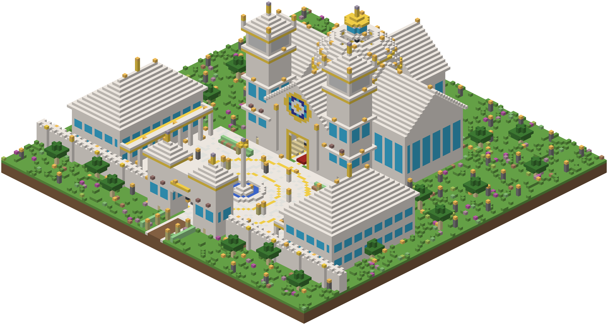
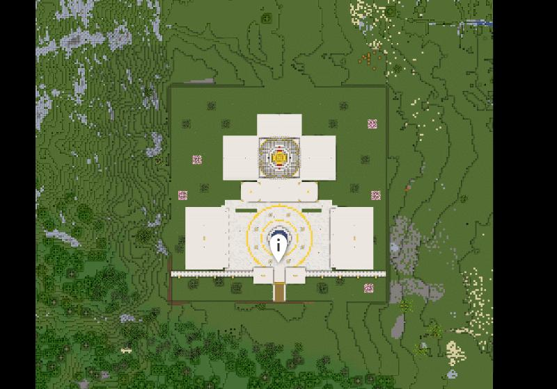
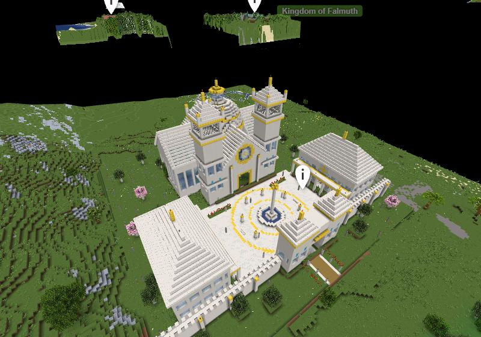

# Holy City Lubelius (Lune)

`id: lubelius` · build (our blueprint) · region **L** (Holy Empire of Lubelius)

| | |
|---|---|
| Anchor (Lerfing's map, x, z) | **-2550, -700** (x grows east, z grows south) |
| Audit status (19/11/2026) | **OK** |
| Blueprint | [`blueprints/lubelius.py`](../../../blueprints/lubelius.py), 120 x 64 x 120 blocks (x, y, z), anchor [60, 5, 98] |
| Preview (blueprint only) |  |
| Lore page | [`design/lore/lubelius.md`](../../../design/lore/lubelius.md) |

## Lore (canon)

Theocratic holy land of the Luminous faith; below the human holy city lies the Night Garden for non-humans. Hinata and the Holy Knights are based here; Holy Emperor Louis is secretly a vampire in Luminous's service.

## What it should look like

White and gold, a Vatican-like cathedral district: a Holy Gate with two gold-capped pylons and light-blue banners, a paved quartz Holy Square, the cathedral. Owner asked for exactly this look.

Why it stands here (anchor table, Lerfing coordinates): East foot of the north-west ridge.

## Current state: BlueMap audit of 19/11/2026

Map: Tensura by Lerfing (current, being replaced). The screenshots are from the public BlueMap; positions and terrain will change with the new world, the lore and the design intent above will not.

- **Status:** OK
- **Placed:** -2550 72 -700 (corner -2610 67 -798)
- White holy city on plains; verify 100 %.

  
*Top-down, about 300 blocks across. Map: Tensura by Lerfing (current, being replaced).*

  
*3D perspective, about 100 blocks. Map: Tensura by Lerfing (current, being replaced).*

## What ChatGPT can deliver for this place

- Concept art: `docs/art/places/lubelius.png` + `docs/art/places/lubelius.md` (see [art.md](../art.md)).
- Blueprint design notes or a Python blueprint in the format of [builds.md](../builds.md) (never the placement data: that is Claude's).
- Lore and quest text in EN and NL for this place (see [tasks.md](../tasks.md)).

Back to the [world guide](../world.md) · [knowledge pack](../README.md)
