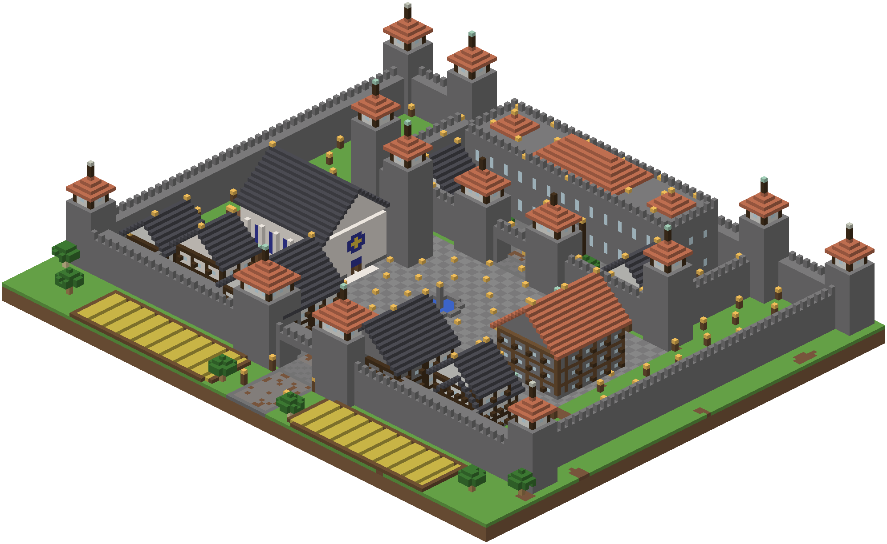
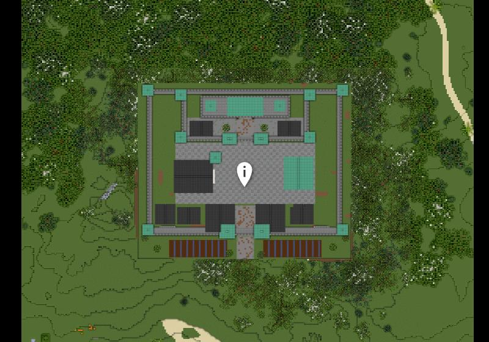
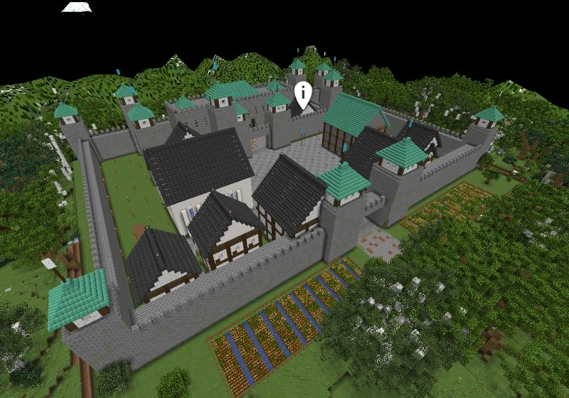

# Marris (Falmuth capital)

`id: marris` · build (our blueprint) · region **F** (Kingdom of Falmuth)

| | |
|---|---|
| Anchor (Lerfing's map, x, z) | **-2000, -1450** (x grows east, z grows south) |
| Audit status (19/11/2026) | **OK** |
| Blueprint | [`blueprints/marris.py`](../../../blueprints/marris.py), 136 x 64 x 112 blocks (x, y, z), anchor [68, 5, 66] |
| Preview (blueprint only) |  |
| Lore page | [`design/lore/marris.md`](../../../design/lore/marris.md) |

## Lore (canon)

At the selected S1E10 snapshot, this is Marris in the Kingdom of Falmuth under Edmaris. The later war with Tempest, Edmaris's defeat and Youm's Farmenas belong to later story phases. Retain the old capital without showing those outcomes as completed. See [era policy](../../../world/era.md); no exact early palace plan follows from that chronology.

## What it should look like

The largest of the human towns: a monumental gate, an avenue, a Royal Plaza with the royal palace (throne hall) facing the Western Holy Church cathedral across it. Pale stone and white quartz, verdigris copper roofs; banners neutral blue and white so a Farmenas version is easy.

Why it stands here (anchor table, Lerfing coordinates): The north arm, north-west of Jura, by the sea.

## Current state: BlueMap audit of 19/11/2026

Map: Tensura by Lerfing (current, being replaced). The screenshots are from the public BlueMap; positions and terrain will change with the new world, the lore and the design intent above will not.

- **Status:** OK
- **Placed:** -2000 73 -1450 (corner -2068 68 -1516)
- Walled town in forest; verify 100 %.

  
*Top-down, about 300 blocks across. Map: Tensura by Lerfing (current, being replaced).*

  
*3D perspective, about 100 blocks. Map: Tensura by Lerfing (current, being replaced).*

## What ChatGPT can deliver for this place

- Concept art: `docs/art/places/marris.png` + `docs/art/places/marris.md` (see [art.md](../art.md)).
- Blueprint design notes or a Python blueprint in the format of [builds.md](../builds.md) (never the placement data: that is Claude's).
- Lore and quest text in EN and NL for this place (see [tasks.md](../tasks.md)).

Back to the [world guide](../world.md) · [knowledge pack](../README.md)
