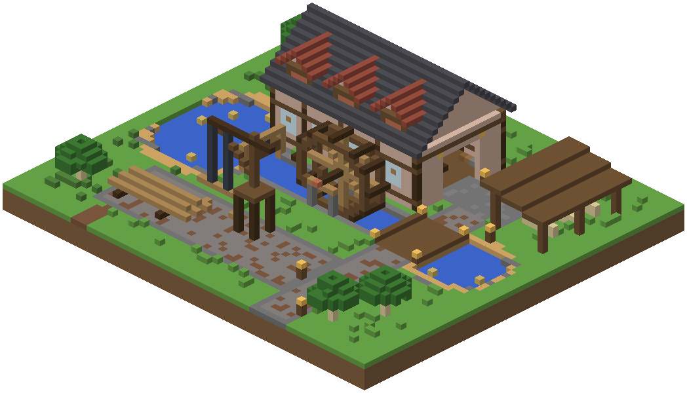
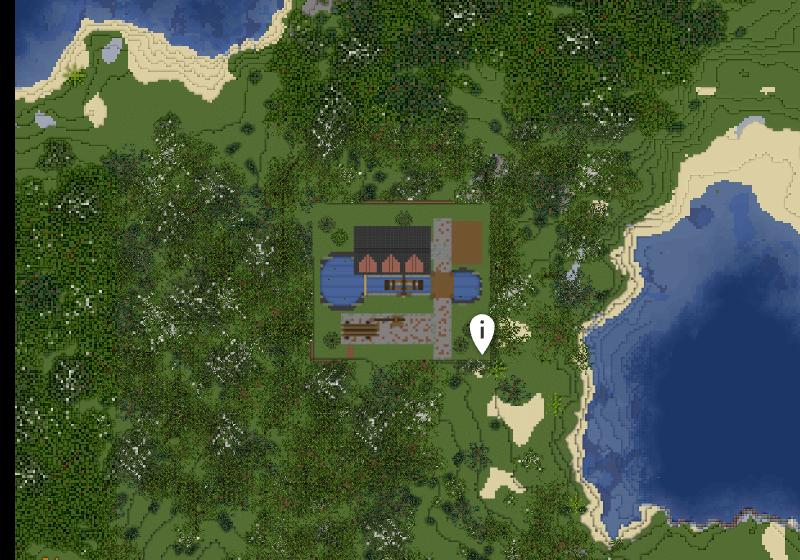
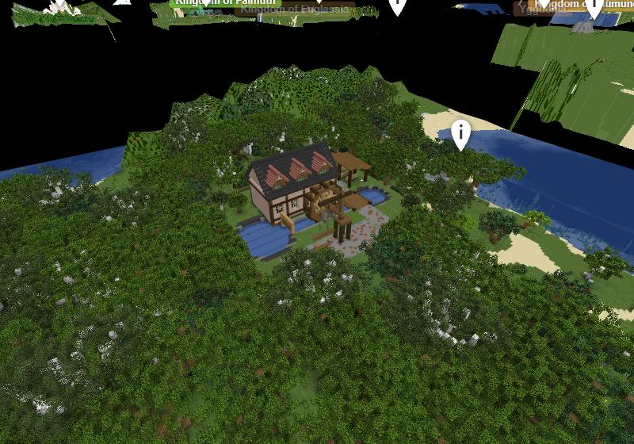

# Morgdahl

`id: morgdahl` · build (our blueprint) · region **O** (Morgdahl)

| | |
|---|---|
| Anchor (Lerfing's map, x, z) | **-2440, 740** (x grows east, z grows south) |
| Audit status (19/11/2026) | **OK** |
| Blueprint | [`blueprints/morgdahl.py`](../../../blueprints/morgdahl.py), 69 x 31 x 61 blocks (x, y, z), anchor [50, 5, 51] |
| Preview (blueprint only) |  |
| Lore page | [`design/lore/morgdahl.md`](../../../design/lore/morgdahl.md) |

## Source context (qualified)

Shown on the Western Council map; no canon plan or industry. The pack calls it a timber landing.

A community comparison reports this name on a later Council map (FAN-WES-034). The selected official episode76 stills inspected here do not expose that map; exact borders/capital and S1E10 buildings/industries remain unverified. The project role below is our interpretation,not canonical national architecture or economy.

## What it should look like

A timber landing: a cart road over a millrace, a twelve-paddle oak wheel by a white-plastered mill, a framed saw and sliding log carriage, a raised sluice and collecting pool, a jib lifting a trunk over trestles, birch stock drying under a shelter.

Why it stands here (anchor table, Lerfing coordinates): Moved from the design's (-2350, 750), which is in the river (93 % water): 90 blocks west onto the bank, a timber landing on the river at the west end of the belt, y 68/72/74.

## Current state: BlueMap audit of 19/11/2026

Map: Tensura by Lerfing (current, being replaced). The screenshots are from the public BlueMap; positions and terrain will change with the new world, the lore and the design intent above will not.

- **Status:** OK
- **Placed:** -2456 73 732 (corner -2506 68 681)
- Timber landing in forest by a lake; verify 100 %.

  
*Top-down, about 300 blocks across. Map: Tensura by Lerfing (current, being replaced).*

  
*3D perspective, about 100 blocks. Map: Tensura by Lerfing (current, being replaced).*

## What ChatGPT can deliver for this place

- Concept art: `docs/art/places/morgdahl.png` + `docs/art/places/morgdahl.md` (see [art.md](../art.md)).
- Blueprint design notes or a Python blueprint in the format of [builds.md](../builds.md) (never the placement data: that is Claude's).
- Lore and quest text in EN and NL for this place (see [tasks.md](../tasks.md)).

Back to the [world guide](../world.md) · [knowledge pack](../README.md)
