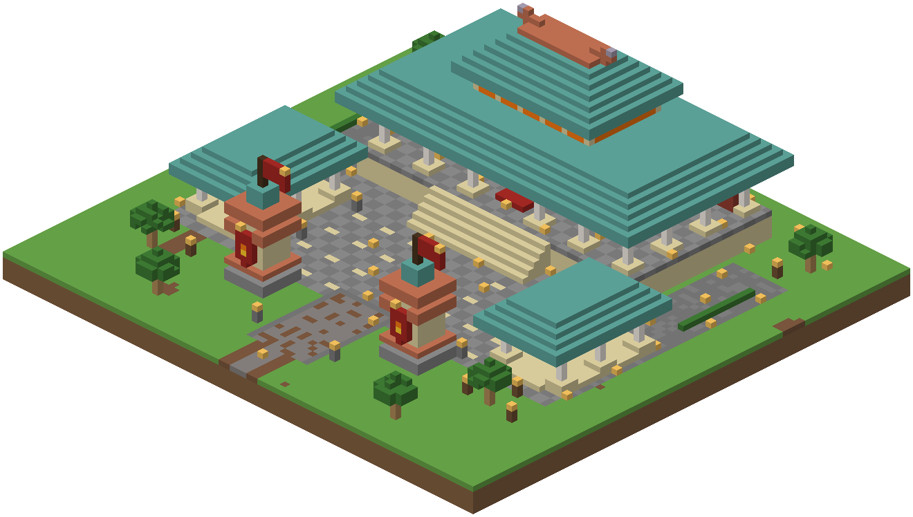
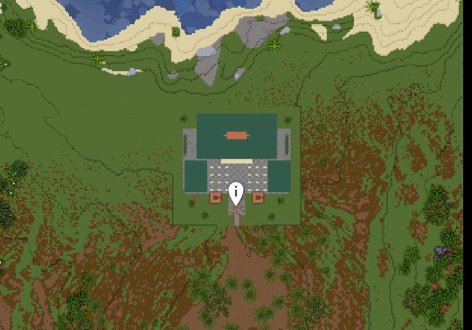
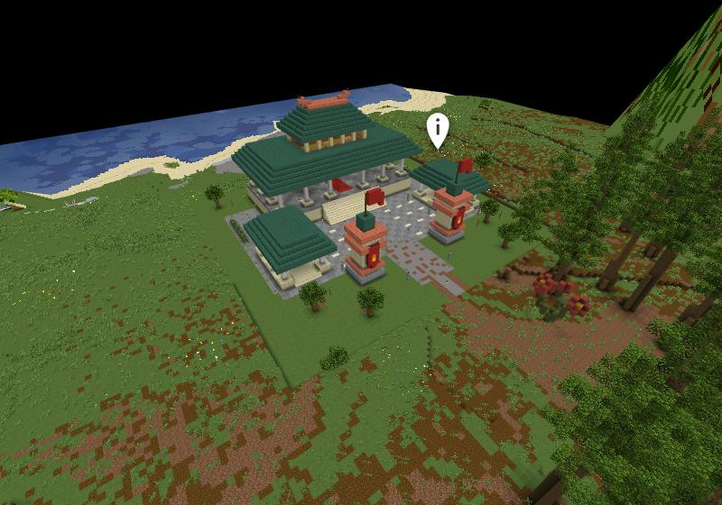

# Nasca (Eastern Empire capital)

**Own-world clarification (R76):** the current authored plateau is (3200, -1800), radius 90. The audience court is a fragment rather than a verified full capital. Direct WN166/167 prose supports gate access on four sides and a near-capital forest road in later scenes, without surveyed bearings or proof of identical S1E10 construction. [Source and topology review](../../../world/nasca-source-topology.md). The Lerfing coordinates and coastal audit below are retired placement evidence, not canonical geography. C05’s mountain-bearing conflict remains open.

`id: nasca` · build (our blueprint) · region **E** (Eastern Empire)

| | |
|---|---|
| Anchor (Lerfing's map, x, z) | **5100, -2680** (x grows east, z grows south) |
| Audit status (19/11/2026) | **OK** |
| Blueprint | [`blueprints/nasca.py`](../../../blueprints/nasca.py), 85 x 42 x 79 blocks (x, y, z), anchor [42, 5, 66] |
| Preview (blueprint only) |  |
| Lore page | [`design/lore/nasca.md`](../../../design/lore/nasca.md) |

## Source-qualified setting and original court design

The broad eastern polity is officially described; Nasca capital identity is directly supported within WN continuity. [R93 source/era review](../../../world/empire-chronology-r93.md). Mountain adjacency/bearing remains separately qualified; the existing court is an original fragment, not a verified capital plan.

## What it should look like

An imperial audience court: two standards mark the way onto a parade ground with pale lines in the paving; two galleries face one another; five broad steps lead to an open audience pavilion with three chairs before a red screen; an amber-glass clerestory; copper scrolls on a dark green roof.

Why it stands here (anchor table, Lerfing coordinates): The valley north of the crater, relief 1.

## Current state: BlueMap audit of 19/11/2026

Historical map: Tensura by Lerfing (being replaced). The screenshots are from the public BlueMap; positions and terrain are retired. Qualified lore and original design intent are distinguished above.

- **Status:** OK
- **Placed:** 5100 70 -2680 (corner 5058 65 -2746)
- Imperial court near the coast; verify 100 %.

  
*Top-down, about 300 blocks across. Historical map: Tensura by Lerfing (being replaced).*

  
*3D perspective, about 100 blocks. Historical map: Tensura by Lerfing (being replaced).*

## What ChatGPT can deliver for this place

- Concept art: `docs/art/places/nasca.png` + `docs/art/places/nasca.md` (see [art.md](../art.md)).
- Blueprint design notes or a Python blueprint in the format of [builds.md](../builds.md) (never the placement data: that is Claude's).
- Lore and quest text in EN and NL for this place (see [tasks.md](../tasks.md)).

Back to the [world guide](../world.md) · [knowledge pack](../README.md)
